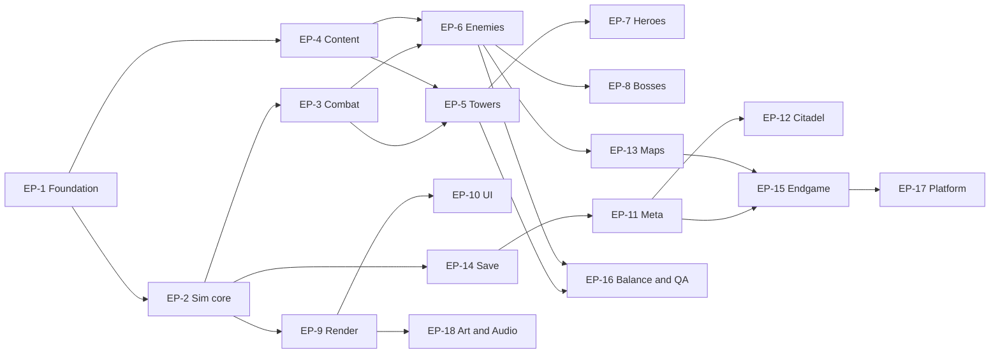

# Guardians of the Nexus — Development Backlog

Derived from the [GDD](../gdd/00-index.md) and [TDD](../tdd/00-index.md). Ordered **MVP first**.

## Files

| File | Milestone | Purpose |
|---|---|---|
| [01-mvp.md](01-mvp.md) | **MVP** | Prove the fun and the architecture (build first) |
| [02-alpha.md](02-alpha.md) | **Alpha** | Prove the loop and the meta |
| [03-beta.md](03-beta.md) | **Beta** | Prove scale, endgame and polish |
| [04-release-1.0.md](04-release-1.0.md) | **1.0** | Complete the game and launch |
| [05-post-launch.md](05-post-launch.md) | **Post** | Seasons, expansions, mobile, community |

## Hierarchy and Format

```
Epic (theme, spans milestones)
└─ Feature (deliverable capability, belongs to one milestone)
   └─ User Story (user-visible or developer-visible outcome)
      └─ Technical Task (one coding session, one PR)
```

| Level | Markdown | GitHub mapping |
|---|---|---|
| Epic | `## EP-n` heading in each milestone file; roster below | Issue with label `epic` |
| Feature | `### FT-n.m` heading with priority and dependencies | Issue with label `feature` |
| Story | `- [ ] **US-n.m.k**` | Issue with label `story`, parent = feature |
| Task | Nested `- [ ]` under the story | Sub-issue or task-list item with label `task` (the line is the issue title) |

### ID Scheme

`EP-<epic>` · `FT-<epic>.<feature>` · `US-<epic>.<feature>.<story>`. Tasks are identified by their story ID plus order (e.g., `US-2.2.1/3`).

Feature numbers are unique **per epic across all milestone files** (e.g., `FT-5.1` is only used once).

## Task Sizing Rule

A **task** is one focused coding session and one reviewable PR:

- One concern, one package (or one package plus its tests/fixtures).
- Includes its own tests and any data/doc updates needed to merge.
- If a task would need a design decision, it is split into a **Spike** task first.
- If a task touches more than two packages materially, split it.
- Content tasks ("Tower: X") include data, balance rows, tests and a sandbox check, but **not** final art.

## Priorities

| Label | Meaning |
|---|---|
| `P0` | Critical path for the milestone; blocks other work |
| `P1` | Required for milestone exit |
| `P2` | Valuable; first to slip if scope tightens |
| `P3` | Stretch |

## Labels

| Group | Labels |
|---|---|
| Type | `epic`, `feature`, `story`, `task`, `spike`, `bug`, `chore` |
| Milestone | `ms:mvp`, `ms:alpha`, `ms:beta`, `ms:1.0`, `ms:post` |
| Priority | `p0`, `p1`, `p2`, `p3` |
| Area | `area:sim`, `area:meta`, `area:render`, `area:ui`, `area:content`, `area:save`, `area:tools`, `area:infra`, `area:balance`, `area:audio`, `area:platform`, `area:docs` |
| State helpers | `blocked`, `needs-design`, `needs-art`, `good-first-task` |

## Definition of Ready (Task)

- [ ] Linked to a story; acceptance criteria clear.
- [ ] Dependencies merged or stubbed.
- [ ] Touches ≤ 2 packages; fits one session.
- [ ] Required design reference (GDD/TDD section) linked.

## Definition of Done (Task)

- [ ] Code merged with strict typecheck, lint and boundary rules passing.
- [ ] Unit/property tests added; golden vectors/replays updated where relevant.
- [ ] No banned APIs in `sim`/`kernel`/`meta`; replays still deterministic.
- [ ] Docs/ADR/content authoring notes updated if behavior changed.
- [ ] Feature flag or content gate in place if incomplete for players.

## Definition of Done (Story / Feature)

- [ ] Acceptance criteria demonstrated in a PR preview or recorded replay.
- [ ] Telemetry/logging hooks present where specified.
- [ ] Accessibility considered (shape + colour, keyboard, scaling) for UI work.
- [ ] Balance rows registered and lint-clean for content.

## Epic Roster

Check an epic when **all milestones** that contain it are complete.

- [ ] **EP-1** Foundation, Tooling and Guardrails
- [ ] **EP-2** Simulation Core (ECS, loop, commands, replay, host)
- [ ] **EP-3** Combat and Effect Engine
- [ ] **EP-4** Content Pipeline and Balance Data
- [ ] **EP-5** Towers
- [ ] **EP-6** Enemies, Waves, Navigation and Handcrafted Maps
- [ ] **EP-7** Heroes and Nexus Spells
- [ ] **EP-8** Bosses
- [ ] **EP-9** Rendering, Input and Audio
- [ ] **EP-10** UI, Game Flow and Accessibility
- [ ] **EP-11** Meta Progression (Profile, Skill Tree, Research, Relics, Mastery, Prestige)
- [ ] **EP-12** Nexus Citadel
- [ ] **EP-13** Map Systems: Events, Hazards, Weather, Branching and Rift (Procedural)
- [ ] **EP-14** Save and Persistence
- [ ] **EP-15** Endgame Modes, Competition and Services
- [ ] **EP-16** Balance Tooling, Telemetry and QA
- [ ] **EP-17** Platform, Monetization and Release
- [ ] **EP-18** Art, Audio and Narrative Integration

## Epic Dependency Overview



## Backlog Decisions (Where the Backlog Resolves GDD Ambiguity)

| # | Decision | Reason |
|---|---|---|
| 1 | **Alpha has exactly 16 towers** (8 starters + Plague Bloom, Beastcaller Lodge, Gale Perch, Sun Beacon, Rune Warden, Cursed Idol, Ember Brazier, Wyrmling Roost). **Thunder Drum** (Act III unlock) moves to Beta | GDD Alpha cap is 16, but starters + Acts I–III unlocks total 17 |
| 2 | **Beta has 24 towers**: adds Thunder Drum, Mortar Emplacement, Sanctuary Shrine, Permafrost Totem, Hailstorm Battery, Crystal Cannon, Resonance Pylon, **Anchor Pillar** (pulled forward for Acts VI–VII). **Shard Harvester, Chrono Pendulum, Shadow Obelisk, Nightblade Den, Truth Lantern, Void Rift** ship in 1.0 | Matches the GDD count while covering Dominion/Crystal counters |
| 3 | **Beta has 11 heroes**: Alpha's 5 + Kyra, Brannoc, Isolde, Lyric, Orrin, **Zephyra** (pulled forward from Act IX via a Citadel quest). 1.0 adds Morrigan, Seraphine, Vael, Auren Echo | Matches the GDD hero counts per milestone |
| 4 | **MVP includes 3 Nexus Spells** (Nexus Pulse, Time Dilation, Guardian's Bulwark) | Required to exercise Mana and Nexus Energy |
| 5 | **MVP evolutions** are Arcane Tower, Frost Spire, Flame Forge, Tesla Coil (A/B each) | Matches GDD §18; remaining starter evolutions land in Alpha |
| 6 | Keyframes/rewind (Orrin) are **Beta**; MVP only needs command-log replay | Reduces MVP risk |
| 7 | MVP ships **programmer art**; final Act I art lands in Alpha | Keeps MVP focused on fun and architecture |

## Cross-Cutting Spikes (Tracked as Stories)

| Spike | Where |
|---|---|
| Determinism across browsers | US-1.3.1 |
| ECS build vs buy | US-1.3.1 |
| Snapshot transport (transferable vs SAB) | US-1.3.1 |
| Pixi batching on integrated GPUs | US-1.3.1 |
| Expression evaluator design | US-3.4.2 |
| Hero pathfinding (A* vs flow field) | US-7.1.2 (Alpha review) |
| Tauri vs Electron | Beta, EP-17 |
| Backend stack for leaderboards | Beta, EP-15 |

## Importing Into GitHub

1. Create milestones: `MVP`, `Alpha`, `Beta`, `1.0`, `Post`.
2. Create the labels above.
3. Create one **Epic issue** per `EP-n` and paste its roster section as a task list.
4. Create one **Feature issue** per `FT-n.m`; its body lists its stories as `- [ ] US-…` items.
5. Create one **Story issue** per `US-…` with its nested tasks as a task list (GitHub can convert each task to a sub-issue).
6. Use a project board with columns: `Backlog`, `Ready`, `In progress`, `In review`, `Done`; group by milestone and filter by priority.
