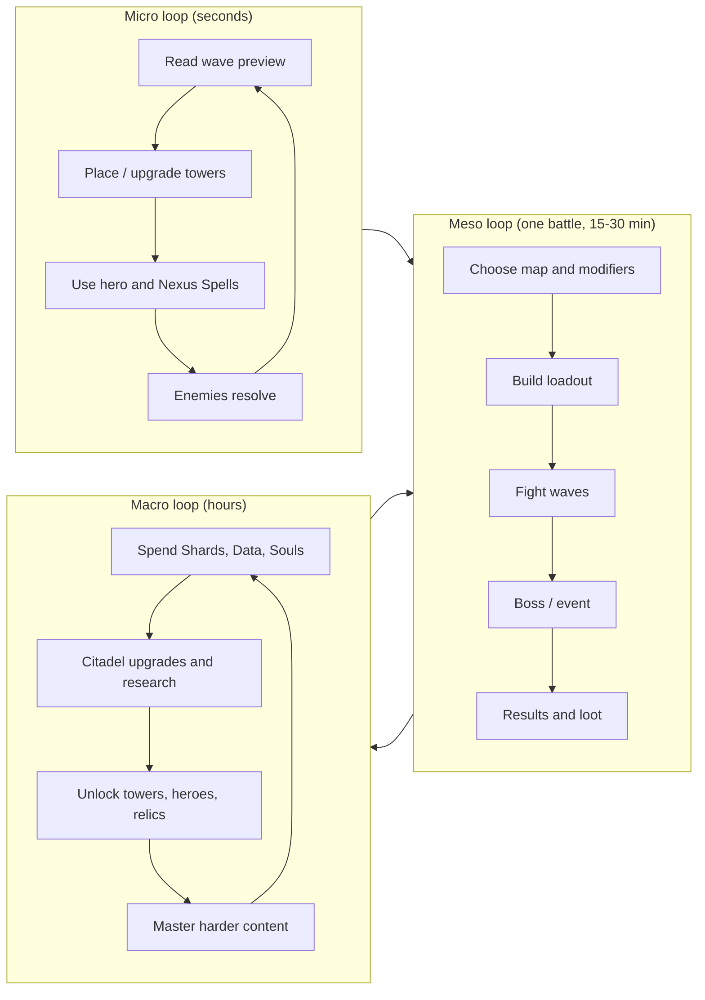

# 1. Executive Summary

## 1.1 The Pitch

> You are the Guardian of the Nexus, the last conscious mind bound to the machine that keeps reality from unravelling. Ten dimensions are collapsing. Ten civilizations believe their way of existing should be the one that survives. They march on the Nexus. You hold the line with towers, heroes, relics and research, and in the end you decide whether the world is saved, replaced, or rewritten.

**Guardians of the Nexus** is a premium tower defense game with the strategic depth of *Cursed Treasure* and *GemCraft*, the readability and charm of *Kingdom Rush*, and the sandbox breadth of *Bloons TD*, fused with RPG heroes, a rogue-lite mode and a long-term meta layer.

## 1.2 Unique Selling Points

| USP | Why it matters |
|---|---|
| **Loadout-first strategy** | Pick 8 of 30 towers per battle. Each map is a fresh puzzle; no single "meta build". |
| **60 evolutions with distinct mechanics** | Evolutions change *how* a tower plays (new targeting, new geometry), not just numbers. |
| **Heroes who level independently** | Each hero has an own skill tree, gear and mastery, so roster-building is a game in itself. |
| **Enemies that argue back** | Enemies disable, steal, adapt, and judge. Bosses are puzzles, not HP sponges. |
| **Anti-monoculture bosses** | Bosses like *The Arbiter* punish over-reliance on one tower school. Variety is mechanically rewarded. |
| **Sidegrade-heavy meta** | Mastery and research add options and efficiency, with hard caps on raw power. |
| **Deterministic simulation** | Enables replays, verified leaderboards, fair weekly seeds and a headless balance bot. |
| **Ethical business model** | One-time purchase, free browser demo, cosmetic-only extras. |

## 1.3 Target Audience

| Segment | Motivation | Served by |
|---|---|---|
| Genre veterans (Bloons / GemCraft) | Depth, optimization, high difficulty | Mythic tiers, Endless, Boss Rush, leaderboards |
| Casual strategy players (Kingdom Rush) | Clear goals, charm, fair difficulty | Normal difficulty, assist options, wave preview |
| RPG / rogue-lite fans | Builds, loot, synergy | Heroes, relics, Rifts |
| Browser gamers | Instant play, short sessions | Free Act I demo, 20-minute battles, autosave |

## 1.4 Platform and Format

- **Launch:** modern desktop browsers (Chromium, Firefox, Safari). Mouse + keyboard first, full rebinding.
- **Steam:** wrapped desktop build, achievements, cloud saves, Workshop-ready content layer (later).
- **Mobile:** touch-first UI layer on the same simulation (later; requires its own UX pass).
- **Session length:** 15–30 min per campaign battle; Rift runs 45–75 min; Endless open-ended with pause-and-resume.

## 1.5 Success Criteria

- Players can describe at least three distinct viable strategies for any given map.
- A first-time player completes Map 1 without a tutorial popup stack.
- A veteran can still fail Mythic 10 after 150 hours.
- Total progression content supports at least 200 hours (see [08-economy-progression-research.md](08-economy-progression-research.md#102-hours-of-content-budget)).

---

# 2. Core Gameplay Loop

## 2.1 Three Nested Loops

## 2.2 Micro Loop (Second-to-Second)

1. **Scout:** The wave preview shows enemy types, counts, lanes and special traits for the next 2 waves (3 with Observatory upgrades).
2. **Build:** Place towers on build pads (or free-form zones on some maps). Upgrade, sell, retarget.
3. **Act:** Move and command the hero, cast Nexus Spells, trigger tower overcharges with Mana.
4. **React:** Respond to dynamic events (ambush, weather change, hazard). Adjust routes with Path Switches where available.
5. **Bank or spend:** Early-calling waves gives a gold bonus; banking gold yields small interest (see below).

## 2.3 Meso Loop (One Battle)

| Stage | Description |
|---|---|
| **Briefing** | Map, biome, faction roster, hazards, weather forecast, modifiers (optional), star objectives. |
| **Loadout** | 8 tower slots (up to 10 via research), 1 hero slot (2 via Hero Hall), 3 relic slots (up to 5), 3 Nexus Spell slots. |
| **Preparation** | 30 s pre-wave setup with starting Gold and free repositioning (100% refund while preparing). |
| **Waves** | 20–40 waves per map (campaign), with mini-event waves and a boss wave on map 3 and 5 of each act. |
| **Resolution** | Victory/defeat, medals, loot, hero XP, Research Data, Crystal Shards, relic drops, codex entries. |

**Stars (per map):**
1. **Victory** — clear the final wave.
2. **Pristine** — clear with at least 80% Integrity remaining.
3. **Challenge** — meet a map-specific restriction (e.g., "no Frost towers", "use only 5 tower slots", "hero must not die").

**Difficulty tiers:** Normal → Veteran → Heroic → Mythic (Mythic 1–20, see endgame). Each tier is a separate star set.

## 2.4 Macro Loop (Hours)

1. Finish battles → earn Crystal Shards, Research Data, Soul Essence, relic drops, XP.
2. Return to the **Nexus Citadel** → spend currencies on building levels, research, hero progression, forge crafting.
3. Unlock new towers, heroes, relics, spells → new loadout possibilities.
4. Tackle harder tiers, Rifts, Endless and weekly challenges using new options.
5. At the apex, **Ascend** (prestige) for Echo Points and permanent sidegrade options.

## 2.5 Rogue-lite Layer: Rifts

A **Rift** is a procedurally generated run using the *Rift Atlas* (see [09-citadel-and-maps.md](09-citadel-and-maps.md#133-procedural-challenge-maps-the-rift-atlas)).

- 10 stages on a branching node map; each stage is a short battle (8–12 waves) on a generated layout.
- Between stages: pick 1 of 3 **Boons** (temporary run-only upgrades), spend Gold on a shop node, risk an **Elite node**, or visit a **Shrine** (trade Integrity for power).
- Towers and hero are carried between stages; losing the Nexus ends the run.
- Permanent progress: Research Data, Relic drops, Shards, Echo Points (post-prestige) and unique cosmetics.

## 2.6 Combat Rules Reference

### Damage types (9)

Physical, Arcane, Fire, Frost, Storm, Nature, Shadow, Radiant, Void.

**Resistance model**
- Each enemy has a resistance value per type, range −100% (double damage) to +75% (cap). Hitting the cap means 25% damage taken.
- **Armor** is a flat reduction applied to **Physical** only: `damage = max(10% of raw, raw − armor)`. Armor-piercing effects reduce armor first.
- In the enemy tables, **R:** lists resistances and **W:** lists weaknesses (default +25% damage taken unless noted).

### Status effects

| Status | Effect | Notes |
|---|---|---|
| Burn | Damage over time, stacks to 5, refreshed by Fire | Prevents regeneration |
| Chill / Freeze | Slow (up to 50%); Freeze is a hard stop | Freeze limited by Tenacity |
| Shock | Brief stun / chain trigger | Storm |
| Poison / Rot | Stacking DoT, reduces healing received | Nature |
| Curse | Enemy takes +% damage | Shadow, does not stack with itself |
| Root / Bind | Stops movement, still can act | Nature |
| Silence | Disables abilities | Void / Radiant tower effects, enemy casters |
| Mark | Target takes +% damage from the marker's school | Radiant / Shadow |
| Disable (tower) | A tower cannot fire for a duration | Applied by saboteur enemies |
| Brittle | Next Physical or Sonic hit deals bonus damage | Frost |

**Tenacity (control fairness):** Elites have 30% Tenacity. Bosses are immune to hard CC (stun, freeze, root) but can be slowed to a maximum of 40%. Each crowd-control application on a boss reduces further durations by 30% for 10 s. This prevents lock-down strategies from trivializing encounters.

### Targeting modes

First · Last · Strongest · Weakest · Fastest · Closest · Flying-first · Marked. Evolutions may unlock unique modes.

### Tower tiers and cost curve

| Tier | Cost (multiple of base) | Typical effect |
|---|---|---|
| I | 1.0× | Base behavior |
| II | +0.8× | ~×1.5 core stats, minor perk |
| III | +1.4× | ~×2.3 core stats, major perk |
| IV (Evolution) | +2.4× | Specialization A or B, unique mechanic |
| V–X (Mastery) | Meta | Cosmetics and capped ≤ +15% total sidegrades (see mastery) |

Total in-battle investment for an evolved tower is **5.6× base cost**. Selling refunds 70% (100% during preparation; 85% for 10 s after building).

### Nexus Integrity

Default 100. Enemies deal their **Threat** value when they leak (infantry 1, elites 3–5, bosses 20+). Integrity regenerates only through specific effects (Sanctuary Shrine, Ancient Heart, Nexus Spells).

### Nexus Spells (3 slots chosen from 12)

| Spell | Effect (base) | Mana |
|---|---|---|
| Nexus Pulse | Radial damage and knockback from the Nexus | 40 |
| Time Dilation | Enemies −40% speed for 6 s | 50 |
| Guardian's Bulwark | Absorb next 15 Integrity of leaks | 60 |
| Meteor Call | Targeted high-damage AoE after 1.5 s | 55 |
| Arcane Surge | Refill 50% Mana to towers' overcharges | 0 (cooldown 90 s) |
| Summon Wardens | Spectral blockers for 12 s | 35 |
| Cleansing Light | Remove all disables/debuffs from towers and hero | 30 |
| Gravity Snare | Pull enemies in a radius to a point | 45 |
| Greed's Bargain | Lose 5 Integrity, gain Gold | 0 (cooldown 120 s) |
| Chain Storm | Lightning chains across 10 enemies | 50 |
| Lockdown | Freeze all towers' disables from enemies for 8 s (immunity) | 45 |
| Sanctify Ground | Zone: towers inside +20% damage, enemies −20% armor | 55 |

**Nexus Surge:** A once-per-battle ultimate fueled by **Nexus Energy** (charged from kills and absorbed leaks). The Surge effect depends on the chosen Citadel Core Attunement (one of three, unlockable).

## 2.7 Economy Within a Battle (Overview)

- **Gold:** starting 250–400; kill bounties; wave completion bonus; early-call bonus; interest (+2% of banked gold per wave, capped at 10% of income and +120 gold per wave).
- **Mana:** cap 100 (up to 160 with research); +1/s base; +Mana Font; +0.3 per kill by certain towers. Spent on Nexus Spells and tower Overcharges.
- **Nexus Energy:** 0–100; fills from kills and leaks; spent on Surge.
- Full economy and meta currencies: [08-economy-progression-research.md](08-economy-progression-research.md).

## 2.8 Fairness and Readability Rules

| Rule | Implementation |
|---|---|
| No unseen deaths | Wave preview, boss telegraphs (≥ 2 s) for any tower-disabling ability |
| No sudden spikes | Wave strength curve validated by headless bot (see tech doc): max +18% effective HP between consecutive non-boss waves |
| Soft counters | Resistance caps at 75%; every enemy has ≥ 3 counters, ≥ 1 available from the act's unlock set |
| Assist options | Slower game speed, extra starting gold (disables leaderboards), lives modifier |
| Information | Hover any enemy to see resistances, abilities and suggested counters (unlocked via Codex) |
| Game speed | 0.5× / 1× / 2× / 3×, pause-with-build always allowed on Normal |

## 2.9 "No Mandatory Build Order" — Structural Guarantees

1. **Power parity:** Each tower's DPS-per-gold at each tier falls within ±15% of a reference curve; specialties trade damage for utility.
2. **Role coverage per school:** every school has a damage, a control and a support/summon tower.
3. **Damage type redundancy:** every damage type is delivered by at least 6 towers across at least 4 schools.
4. **Map design rule:** every map is verified winnable on Normal with at least 5 differing loadouts (automated bot).
5. **Boss rule:** at least two bosses punish each popular archetype (mono-element, hero-carry, pure economy, tower-spam).
