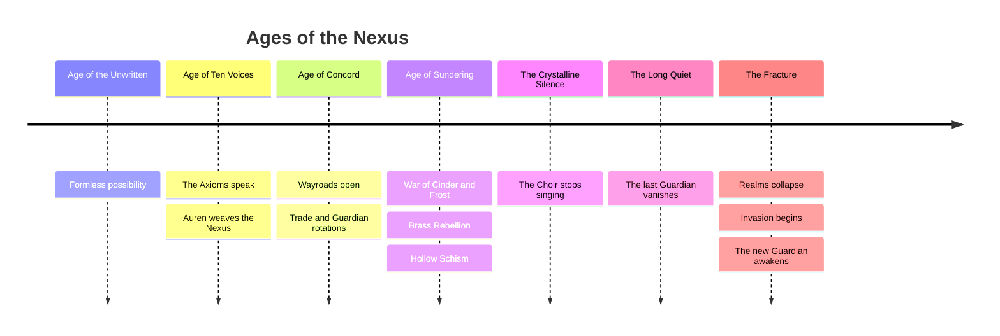

# 3. Complete Worldbuilding

## 3.1 Tone and Themes

- **Tone:** Mythic, hopeful, morally nuanced. Enemies are people with reasons, not monsters with labels.
- **Themes:** Order versus change; memory versus ending; what is worth preserving.
- **Rule of three villains:** every faction is wrong for an understandable reason, dangerous because it is partly right, and redeemable in at least one hero.

## 3.2 Origin of the Nexus

Before anything existed there was **the Unwritten**: a boundless, formless field of every possibility and therefore of no reality at all.

From the Unwritten, **Ten Voices** emerged, ten fundamental principles each yearning to be spoken as a world. They are called **Axioms**:

| Axiom | Principle | Realm |
|---|---|---|
| Growth | Life reaches outward | Verdancy |
| Entropy | Everything passes | The Ashen Expanse |
| Will | Passion shapes matter | Cinderhold |
| Craft | Making is meaning | The Brass Meridian |
| Stillness | Preservation through calm | Fimbul Reach |
| Harmony | Parts become whole | The Resonant Waste |
| Knowledge | To know is to hold | The Aetherium |
| Memory | The dead are the foundation | The Hollow |
| Order | Truth must be judged | The Empyrean |
| Change | Nothing is final | The Interstice |

Each Axiom, spoken alone, burned itself out or devoured the others. Only when the ten were spoken together, by the **First Guardian, Auren the Weaver**, did a stable reality form. Auren wove the ten Words around a single knot, **the Nexus**, a crystalline lattice that holds the Axioms in tension. The Nexus is not a weapon or a throne. It is a *balance point*: if any Axiom dominates, reality collapses into that Axiom's extreme.

Around the Nexus, the **Citadel** was raised as the Guardian's seat, and the **Wayroads**, luminous paths, connected the Nexus to each of the ten Realms.

## 3.3 The Hidden Truth (Spoiler Layer)

There is an **Eleventh Voice**: **Ending**. Auren refused to speak it, believing a world without endings would never need one. The refused Voice did not vanish. It became **the Unmaker**, a patient, intelligent absence that seeks to speak the **Last Word** and return everything to the Unwritten.

The twist: the Unmaker is not purely evil. Without Ending, nothing can be finished, and so nothing can truly be written. The Guardian's final choice is not *destroy* or *save*, it is *what kind of world do we write*:

| Ending | Choice | Meta consequence |
|---|---|---|
| **Concord** | Rebind all ten Axioms in balance | Standard victory; unlocks Prestige "Ascension" as the Nexus re-weaving |
| **Rewrite** | Elevate one Axiom as the new dominant principle | Cosmetic and gameplay flavor: the chosen Axiom adds a persistent faction-themed modifier to Rift runs |
| **Acceptance** | Speak the Eleventh Word, permitting endings | Unlocks a "Final Cycle" challenge and the hero Auren Echo's alternate skin |

## 3.4 Timeline of the World

### Ancient Wars

| War | Parties | Cause | Outcome and legacy |
|---|---|---|---|
| **War of Cinder and Frost** | Ember Clans vs Frostbound Reach | Dispute over the Heart-Flame, a shared ember at the boundary of their realms | Wayroads between realms were severed; the border became a permanent magma-ice scar visible in Act III/V maps |
| **The Brass Rebellion** | Iron Collective vs Arcane Dominion | The Dominion enslaved artificers to power its Spellwork | The Collective gained independence and banned magic in its territory; its constructs are built to resist spells |
| **The Hollow Schism** | Hollow Court vs Celestial Order | The Order judged the dead "unfinished" and sought to sever them from the living | The Court seceded; undead are reframed by the Court as "the remembered" |
| **The Locust Crusade** | Verdant Covenant vs Ashen Sultanate | A scarab plague destroyed Verdancy's southern groves | A cold truce; the Sultanate still claims the scarabs were a gift |
| **The Silent Concert** | Crystalline Choir (internal) | The Great Cantor Ilyssa refused to sing the final stanza of the Harmony | The Choir fractured into shard-clans; the Resonant Waste formed from the unfinished song |
| **The Interstice Breach** | Void Swarm vs everyone | The Unmaker whispered to the Interstice, awakening the Swarm | The direct trigger of the Fracture |

## 3.5 The Ten Realms (Dimensions)

| Realm | Axiom | Faction | Biome | Environment and atmosphere |
|---|---|---|---|---|
| **Verdancy** | Growth | Verdant Covenant | Forest | A living world-forest; bioluminescent canopy, sentient roots |
| **The Ashen Expanse** | Entropy | Ashen Sultanate | Desert | Endless dunes over buried time-tombs; the sun is an eroded god |
| **Cinderhold** | Will | Ember Clans | Volcano | A chain of caldera-fortresses; molten rivers; ash-sky |
| **The Brass Meridian** | Craft | Iron Collective | Badlands (desert/volcano hybrid) | Smelter plains, rail networks, endless steam |
| **Fimbul Reach** | Stillness | Frostbound Reach | Frozen Tundra | Glacier cathedrals, aurora skies, frozen oceans |
| **The Resonant Waste** | Harmony | Crystalline Choir | Crystal Wastes | Singing crystal canyons; light refracts into colored sound |
| **The Aetherium** | Knowledge | Arcane Dominion | Ancient Ruins (academy) | Floating libraries, leyline terraces |
| **The Hollow** | Memory | Hollow Court | Ancient Ruins (necropolis) | Sunless catacombs lit by soul-lanterns |
| **The Empyrean** | Order | Celestial Order | Sky Islands | Floating temples, wind-bridges, golden cloud-seas |
| **The Interstice** | Change | Void Swarm | Void Realm | Shifting geometry, unstable gravity, rewriting terrain |

## 3.6 The Nexus Citadel

The Citadel stands at the center of the Wheel. Its six primary buildings reflect the Guardian's roles (see [09-citadel-and-maps.md](09-citadel-and-maps.md)). Narratively, every building the player restores re-lights a wing of the Citadel and awakens a **Citadel Keeper**, an NPC who provides lore, quests and tutorials:

| Keeper | Building | Personality |
|---|---|---|
| **Wick** | Research Lab | A nervous, brilliant lamp-spirit that loves hypotheses |
| **Dame Orla Brightfen** | Hero Hall | A retired hero, blunt and warm; trains the roster |
| **Garrick Slagbeard** | Forge | An exiled Iron Collective smith who misses the rails |
| **The Cartulary** | Relic Vault | A scholarly, slightly sinister living archive |
| **Ysolde the Star-Reader** | Observatory | Cryptic, reads omens as weather forecasts |
| **Magister Tobias Pell** | Arcane Academy | A disgraced Dominion lecturer who teaches spells with delight |

## 3.7 The Guardian (Player Character)

The player character is an **Awakened Guardian**: a mind drawn from the Nexus's own memory. The Guardian has no fixed gender, name or face by default (customizable cosmetics). The player chooses a **Guardian Aspect** at the start, which determines a starting Nexus Spell and a cosmetic style (not a power gate):

| Aspect | Style | Starting spell |
|---|---|---|
| Warden | Protective, armored | Guardian's Bulwark |
| Weaver | Magical, flowing | Arcane Surge |
| Architect | Technological, precise | Gravity Snare |

## 3.8 Legendary Characters

| Name | Role | Summary |
|---|---|---|
| **Auren the Weaver** | First Guardian | Wove the Nexus. Her Echo becomes a playable hero after the campaign. |
| **The Unmaker** | Final antagonist | The Eleventh Voice, speaker of Ending. |
| **Ilyssa, the Last Cantor** | Crystalline legend | Refused the final stanza; her unfinished song still echoes in the Waste. |
| **Khet-Ra, the Ashen Sun** | Ashen Sultanate sovereign | A pharaoh who entombed himself to outlast entropy and became a sun-parody. |
| **Kaldris Vane** | Arcane Dominion founder | Invented the Spellwork Compact; his last thesis is a spell that rewrites spells. |
| **Queen Nythra** | Hollow Court ruler | Mourning mother turned guardian of the dead. |
| **Pyrrax** | Caldera Wyrm | Ancient dragon who forged the Cinderhold calderas. |
| **The Great Engine** | Iron Collective (Leviathan Mk-IX) | A city-sized locomotive and the Collective's mobile capital. |
| **The Arbiter** | Celestial Order | A voice of judgment; no one has seen its face. |
| **Old Gnarl** | Verdant Covenant | Oldest tree-mind; a heart that remembers every spring. |
| **Jarl Skadi Rimeheart** | Frostbound champion | Duelist who never lost until the Fracture. |
| **Hivemother Xyrrith** | Void Swarm matriarch | The first Swarm queen to feel doubt. |

## 3.9 Lore Delivery

| Channel | Content |
|---|---|
| **Act intros** | 6-panel animated comic sequences, faction viewpoint |
| **Codex** | Unlocks per enemy, tower, hero, relic, map; revealing weaknesses and story |
| **Tower lore** | Short flavor text in tower detail cards |
| **Relics** | Each relic is a story fragment with a named origin |
| **Hero banter** | Pre-battle dialogue between hero and Keepers; pairs trigger special lines |
| **Environmental storytelling** | Map props, ruined structures, enemy behavior |
| **Boss encounters** | Mini-dialogue at start/end; mechanics reflect each boss's story |

## 3.10 Narrative Structure of the Campaign

| Act | Faction | Narrative beat |
|---|---|---|
| I | Verdant Covenant | The Guardian awakens; the Covenant fears the Nexus's silence and tests it |
| II | Ashen Sultanate | Entropy argument: "nothing lasts, so why defend?" |
| III | Ember Clans | The Heart-Flame is stirring; war memory returns |
| IV | Iron Collective | A sympathetic uprising; the Collective wants machines that never end |
| V | Frostbound Reach | Stillness seeks to freeze the Nexus to preserve it |
| VI | Crystalline Choir | The Waste sings; the Guardian hears Ilyssa's unfinished song |
| VII | Arcane Dominion | The Dominion would "optimize" reality with a final spell |
| VIII | Hollow Court | Memory and grief; the Queen wants the dead to be safe |
| IX | Celestial Order | Judgment: the Arbiter weighs the Guardian |
| X | Void Swarm | The Interstice; the truth about Ending; the final choice |
