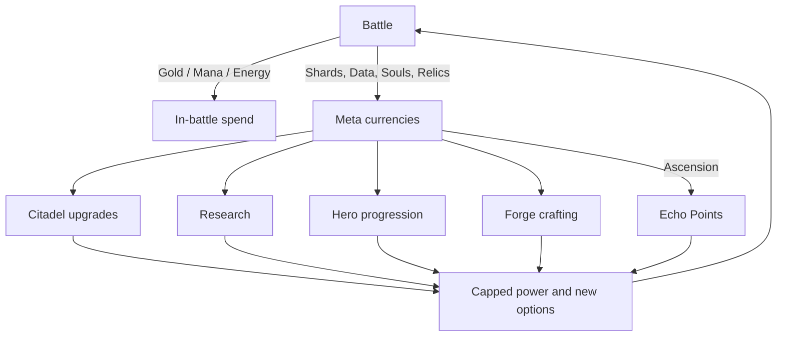
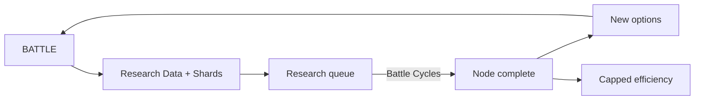

# 9. Resources

## 9.1 Resource Overview

| Resource | Scope | Purpose | Primary sources | Primary sinks |
|---|---|---|---|---|
| **Gold** | In-battle | Build, upgrade, revive | Kill bounties, wave bonuses, early-call bonus, interest, Harvesters | Towers, upgrades, hero revive |
| **Mana** | In-battle | Nexus Spells, Overcharge, some evolution actives | Passive regen, Mana Font, kill procs, relics | Spells, overcharges |
| **Nexus Energy** | In-battle | Nexus Surge, hero Ultimate (50%) | Kills, damage absorbed (leaks), events | Surge, Ultimate |
| **Crystal Shards** | Meta (soft) | Unlocks and upgrades | Battle rewards, Shard Harvester bonus, achievements | Tower unlocks, building levels, Forge |
| **Soul Essence** | Meta (hero) | Hero growth and Heroic Mastery | Elites/bosses, Shadow school, Rift shrines | Hero levels past 30, Heroic Mastery, respec of gear sigils |
| **Ancient Relics** | Meta (collection) | Build-defining passives | Boss chests, Rift rewards, weekly/seasonal events | Collected; duplicates level a relic |
| **Research Data** | Meta | Research nodes and Codex | Battles, first-time enemy scans, challenge stars | Research Lab/Academy/etc. |
| **Echo Points** | Meta (prestige) | Ascension boons and cycle options | Ascension completion, Mythic clears | Echo Boons |
| **Prism Tokens** | Cosmetic only | Skins, effects, Citadel decor | Seasonal achievements, optional purchase | Cosmetics |

## 9.2 Gold

**Acquisition**
- **Kill bounty:** 12% of base HP (infantry), 10% (elites), 8% (swarm).
- **Wave bonus:** `20 + 2 × wave` Gold per wave completed.
- **Early-call bonus:** calling the next wave early grants `+3% of remaining prep timer value`, up to +40 Gold per call; calling is optional and a risk/reward decision.
- **Interest:** +2% of banked Gold per wave, capped at 10% of income and +120 Gold per wave. Banking is a deliberate skill, not a requirement.
- **Passive:** Shard Harvester (+1.2/s Tier I, scales), Hero Rook's Bounty Hunter.

**Spending:** Build 100–180, Upgrade II 0.8×, III 1.4×, IV 2.4×, Sell 70% refund, Hero instant-revive `50 + 10 × level`.

**Balance rules**
- Typical campaign map starting Gold: 250–400 (scales with map length).
- A well-played map ends with 8–14 evolved towers, not 20 mediocre ones.
- **Anti-snowball:** overkill gold is not generated; Gold bounties decrease 15% per wave once a map's `Target Wave` is exceeded in Endless.
- **Anti-turtle:** interest cap prevents hoarding being strictly dominant.

## 9.3 Mana

- **Cap:** 100 base; research up to 160.
- **Regen:** 1.0/s base; Mana Font +1.5/s (Tier I) to +3.5/s (Tier III). Kill procs from Arcane and Shadow towers +0.3 Mana per kill.
- **Spending:** Nexus Spells (30–60), Tower Overcharge (20), Evolution actives (varies), Hero Skills do **not** use Mana (cooldown-based).
- **Denial:** enemy Spell Thieves, Leeches, Nullspores can reduce Mana, making Mana-dependent builds a deliberate risk.
- **Balance:** a player who casts every spell on cooldown should be Mana-neutral with one Mana Font; going deeper on Mana requires a build commitment.

## 9.4 Nexus Energy

- **Cap:** 100. Fills by 0.4 per kill, 2 per leak absorbed (Integrity lost), 10 on boss phase transitions.
- **Spending:** Nexus Surge (100); Hero Ultimate (50 each).
- **Design purpose:** creates a comeback valve that rewards tension without punishing success. It is intentionally not stockpilable beyond 100.
- **Carry-over:** 25% of energy carries between maps in a Rift run.

## 9.5 Crystal Shards

**Acquisition (Normal baseline per 30-wave map):** 110–130 Shards; ×1.4 Veteran, ×2.0 Heroic, ×2.8 Mythic 1 (+0.1 per Mythic level). Bonus: +20 per star (first time per difficulty), +10 for Pristine clear.

**Sinks (target total ≈ 240,000 over 200 hours)**

| Sink | Est. total Shards |
|---|---|
| Tower unlocks (22) | 22,000 |
| Evolution unlocks (60) | 48,000 |
| Citadel building levels (6 × 20) | 96,000 |
| Hero unlocks (12) | 14,000 |
| Forge crafting & gear upgrades | 40,000 |
| Misc (respec, Nexus Core upgrades) | 20,000 |

**Balance levers:** rewards by difficulty, star bonuses, weekly boosted-reward map (+50% Shards), no purchasable Shards.

## 9.6 Soul Essence

- **Sources:** Elites (1–3), Bosses (20–60), Shadow tower/hero effects, Rift Shrines, first-clear bonuses.
- **Sinks:** Hero levels 31–40 (Heroic Mastery 1–10: 40–250 Essence each), Sigil re-forging, Forge Soul-Bound gear tier.
- **Balance:** targeted so that a dedicated hero is Mastery 10 in roughly 8–10 hours of play; a roster of 15 heroes is a long-term collection goal.

## 9.7 Ancient Relics

- **120 relics** in six rarities: Common 40, Uncommon 30, Rare 25, Epic 15, Legendary 8, Mythic 2.
- **Slots:** 3 (Relic Vault level 10: 4; level 20: 5).
- **Acquisition:** boss chests (guaranteed), Rift Elite nodes, weekly challenges, seasonal events, Mythic bosses. Drop table is weighted toward relics you do not own (**bad luck protection**: after 3 duplicates you are guaranteed an unowned relic).
- **Duplicates:** level up a relic (Lv 1–5), each level improves its effect modestly and adds a lore fragment.
- **Design rules:** relics must *change how you play*, not merely add percent. Example relics:

| Relic | Rarity | Effect |
|---|---|---|
| Spore Cap | Common | Killed enemies drop a small Mana burst |
| Riddle Shard | Uncommon | Your first hit on each enemy type deals +25% |
| Heartwood Seed | Rare | Disabled towers recover 25% faster; Nature towers heal Integrity |
| Veyron's Mirror | Epic | First spell cast each wave is cast twice |
| Engine Core | Epic | Mechanical enemies take +15% damage; your Mechanical-type summons are free |
| Scales of Verdict | Legendary | Highest-damage school deals −10% damage but all others +12% |
| The Last Word | Mythic | Once per battle, Ending: erase all enemies on screen except bosses; lose 30% max Integrity |

## 9.8 Research Data

- **Sources:** 15–40 per battle; +20 first-time scan of each enemy type (**Codex**); +5 per star; +60 per boss first-kill per difficulty.
- **Sinks:** every research node (see Section 11) and Codex upgrades.
- **Balance:** Research Data is deliberately a separate pool from Shards so players cannot accidentally starve one.

## 9.9 Echo Points and Prism Tokens

- **Echo Points:** only earned via Ascension and Mythic milestones; spent on **Echo Boons** (sidegrades; see Prestige).
- **Prism Tokens:** cosmetic currency, earned via achievements/seasons and optionally purchased (cosmetics only; no gameplay value).

## 9.10 Economy Telemetry and Tuning Loop

1. Headless bot simulations run nightly (see [11-technical-architecture.md](11-technical-architecture.md)) producing income curves per map and per loadout archetype.
2. The target: 85–110 minutes of play to afford a typical tier unlock at mid-game; no single upgrade should cost more than ≈ 45 minutes of income at the player's current difficulty.
3. Guard-rails: no currency has a single dominating source; no sink gives more than 5% power per purchase.

---

# 10. Progression Systems

## 10.1 Progression Pillars

| Pillar | What it adds | Cap |
|---|---|---|
| **Account Level** (1–100) | Nexus Points, unlocks, cosmetics | n/a |
| **Nexus Skill Trees** | Passive power and options | ≤ +20% power |
| **Research** | Unlocks, efficiency, new options | ≤ +20% power |
| **Mastery** | Cosmetics and tiny sidegrades | ≤ +15% power |
| **Relics** | Build-defining effects | Conditional ≤ +25% |
| **Heroes** (level + gear) | Hero power | Gear ≤ +15% |
| **Prestige (Ascension)** | New cycles, Echo Boons | Sidegrades only |

**Power Ledger:** The sum of *unconditional* meta power is capped near +60% over a fresh account. Mythic 20 difficulty scales faster than that, so skill and variety remain the deciding factors.

## 10.2 Hours of Content Budget

Target ≥ 200 hours of primary activity:

| Activity | Hours |
|---|---|
| Campaign Normal (50 maps) | 25 |
| Campaign Veteran | 20 |
| Campaign Heroic | 25 |
| Mythic ladder (1–20) | 30 |
| Rifts (rogue-lite) | 35 |
| Endless and Survival | 20 |
| Boss Rush | 8 |
| Weekly and Seasonal | 15 |
| Mastery challenge maps | 12 |
| Ascension cycles (3 cycles) | 20 |
| Completionist (stars, codex, relics) | 10 |
| **Total** | **220** |

## 10.3 Account Levels

- **Levels 1–100.** XP to next level: `150 + 22 × n^1.4` (total ≈ 590k XP; ≈ 110 hours at the average earn rate).
- **XP sources:** battle completion (scales with map length and difficulty), stars, challenges, first-clears, codex discoveries.
- **Rewards:** each level grants 1 Nexus Point; milestone levels (10, 20, …, 100) grant a tower/hero/relic slot or Citadel upgrade; 20 bonus Points are distributed across milestones (total 120 Points).

## 10.4 Nexus Skill Trees

Four trees, ≈ 40 nodes each (160 total) vs 120 Points: players must specialize.

| Tree | Theme | Sample nodes | Capstone |
|---|---|---|---|
| **Bastion** | Defense and integrity | +5 starting Integrity, tower disable duration −10%, heal 1 Integrity per wave | *Unbreakable Nexus:* the first lethal leak is negated once per battle |
| **Arcanum** | Mana and spells | +10 Mana cap, spell cooldown −5%, Overcharge +1 s | *Archmage's Wellspring:* Mana regen doubles below 20% |
| **Tactician** | Economy and utility | +20 starting Gold, wave-preview +1, free pad swap | *Perfect Plan:* first tower placed each wave refunds 50% |
| **Warbringer** | Offense | +3% damage to elites, +5% crit on first hit, hero skill cooldown −5% | *Nexus Dominion:* first 10 s of each wave gives +15% damage |

Each tree has 5 tiers; nodes in higher tiers require points in lower ones. **Respec is free** between battles.

## 10.5 Unlockables

| Category | Count | Unlock method |
|---|---|---|
| Towers | 22 (8 starters) | Act clears + Shards |
| Evolutions | 60 | Research Lab nodes (Shards + Data); Tier IV evolutions unlock per tower |
| Heroes | 12 + 3 starters | Act clears + Shards or Soul Essence |
| Relics | 120 | Drops |
| Nexus Spells | 12 | Arcane Academy levels |
| Maps | 50 + endless variants | Campaign, challenges |
| Cosmetics | 300+ | Mastery, achievements, optional purchase |

## 10.6 Mastery Levels

| Mastery type | Range | Reward |
|---|---|---|
| Tower Mastery | 1–20 | Skins, effects, ≤ +15% sidegrades, challenge maps at 10 and 20 |
| Hero Mastery | 1–10 (beyond level 30) | Unique skins, Heroic Trials, bonus Sigil slots |
| Map Mastery | 3 stars × 4 difficulties | Titles, decorations, Mythic unlocks |
| Faction Codex | 4 levels | Lore, hints, cosmetics |
| Account Mastery | Cumulative | Titles, Ascension prerequisites |

## 10.7 Prestige: Nexus Ascension

**Unlocks at:** account level 60 and Act X Mythic 1 cleared.

**What resets**
- Citadel building levels reset to level 5 (refunding 50% of Shards spent above level 5 as Echo Points).
- Unspent currencies reset.
- Campaign *progress* is preserved (maps stay unlocked) but star difficulty ratings can be replayed under **Cycle Modifiers**.

**What persists:** unlocked towers/heroes/relics, mastery, codex, cosmetics, titles, Echo Boons.

**Reward:** Echo Points (1–5 per ascension), plus a **Cycle Reward** (cosmetic Nexus aura; relic slot at Cycle 5 and Cycle 10).

**Cycles (10):** each applies a **Cycle Modifier** that remixes game rules:

| Cycle | Modifier |
|---|---|
| 1 | Elite waves +20% |
| 2 | Towers have a 10% disable chance on hit |
| 3 | Heroes are hobbled: no passive abilities |
| 4 | Half the map's pads are blocked (random) |
| 5 | Mana regen −40% |
| 6 | Bosses gain a secondary phase |
| 7 | Resistances +15% |
| 8 | Wave preview limited to 1 wave |
| 9 | Gold income −20% |
| 10 | All of the above, rotating |

**Echo Boons:** sidegrades (e.g., "Echo of Growth: Nature towers can be built on any pad but cost +10%"); capped at 8 active.

---

# 11. Research Systems

## 11.1 Principles

- **Options before numbers:** at least 60% of research nodes unlock new options (evolutions, spells, relic slots, Nexus abilities) instead of stat boosts.
- **No wall-clock timers.** Research completes after a number of **Battle Cycles** (one battle = one cycle). Offline waiting never matters.
- **Queue:** 1 slot initially; 2 at Research Lab level 8; 3 at level 16.
- **Costs:** Research Data + Crystal Shards. Costs climb gently within a track and include a "free preview": you may test any unresearched evolution once per map in the Armory (no progress).
- **Respec:** exclusive doctrine choices can be swapped for a Shard fee.

## 11.2 Tracks

| Track | Building | Nodes | Focus | Example nodes |
|---|---|---|---|---|
| **Ballistics & Engineering** | Research Lab | 24 | Martial, Crystal, Storm | Siege Repeater unlock, +2% Ballista range, Mortar min-range −1 |
| **Elemental Sciences** | Research Lab | 24 | Flame, Frost, Nature | Phoenix Kiln unlock, Frost slow +3%, Burn tick +2% |
| **Arcane Theory** | Arcane Academy | 24 | Arcane, Void/Time, spells | Nexus Spell unlocks, Mana cap +10, Overcharge efficiency |
| **Hero Training** | Hero Hall | 20 | Hero stats and slots | 2nd hero slot, XP share +10%, revive time −10% |
| **Metallurgy & Enchanting** | Forge | 20 | Gear, Sigils | Mythic gear, Sigil slots, gear upgrade cost −5% |
| **Archaeology** | Relic Vault | 20 | Relics | Relic slot +1, duplicate protection, relic fusion |
| **Foresight** | Observatory | 20 | Intel and map tools | Wave preview +1, weather forecast, hazard preview |
| **Total** | | **152** | | |

## 11.3 Doctrines (Exclusive Choices)

At nodes 12 and 24 of each track, the player picks **one of two Doctrines** (a meaningful identity choice):

| Track | Doctrine A | Doctrine B |
|---|---|---|
| Ballistics | **Precision:** +10% crit damage for Martial towers | **Volume:** Martial towers +8% attack speed |
| Elemental | **Wildfire:** Burn stacks +2 | **Permafrost:** Slow effects +10% duration |
| Arcane | **Archmage:** Spells cost −10% Mana | **Tempo:** Spell cooldown −8% |
| Hero Training | **Veteran:** hero XP +10% | **Vanguard:** hero HP +10% |
| Metallurgy | **Artisan:** gear upgrades cost −8% | **Warsmith:** gear +1 affix slot |
| Archaeology | **Collector:** duplicates grant +20% relic XP | **Specialist:** one relic slot becomes Mythic-capable |
| Foresight | **Scout:** wave preview +1 | **Cartographer:** unlock map hazard previews |

## 11.4 Codex Research

- Each enemy has a Codex entry: first sighting yields name/lore; defeating 25 reveals resistances; 100 reveals abilities; 250 reveals counter suggestions.
- Codex progress contributes small account XP and Research Data.

## 11.5 Research Data Flow

