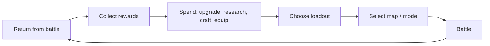
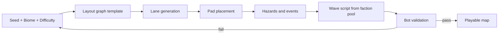

# 12. Base Building: The Nexus Citadel

## 12.1 Overview

The Citadel is a **hub scene**, not a time-gated idle game. Buildings level up with Shards (and Research Data from level 10) and complete after a number of **Battle Cycles** (1–3), so progress is bound to playing, not waiting.

- **Cost curve:** `cost(level) = 16 × level^1.6` Shards (≈ 16,000 total per building for levels 1–20).
- **Visual feedback:** each upgrade changes the Citadel's skyline; at level 20 a building gains a unique Keeper animation and a cosmetic aura.
- **Citadel Core Attunement:** the central **Nexus Core** (starts level 1; 5 levels) lets the player choose a **Surge** type (Pulse, Stasis, Rebirth); upgrades unlock further Surge variants.

## 12.2 Buildings

| Building | Keeper | Function | Lv 1 | Lv 5 | Lv 10 | Lv 15 | Lv 20 |
|---|---|---|---|---|---|---|---|
| **Research Lab** | Wick | Tower and evolution research | 1 queue slot; base tracks | Elemental track | 2nd queue slot (Lv 8) | Doctrine slots | 3rd queue slot; Capstone techs |
| **Hero Hall** | Dame Orla | Hero roster, training, 2nd slot | Roster view; level 10 cap | Skill respec free | **2nd hero slot** | Heroic Trials | Mastery 10; Hero Banner cosmetics |
| **Forge** | Garrick | Gear crafting and upgrades | Common crafting | Rare gear | Epic gear, Sigil forging | Legendary | Mythic gear, Forge Contracts |
| **Relic Vault** | The Cartulary | Relic storage, slots, fusion | 3 slots | Relic Codex | **4th slot** | Relic Fusion | **5th slot**; Mythic-ready |
| **Observatory** | Ysolde | Map intel, weather and event forecasts | Preview 2 waves | Weather forecast | Preview 3 waves | Hazard preview | Weekly challenge preview, seasonal omens |
| **Arcane Academy** | Magister Pell | Nexus Spells, Mana upgrades | 3 spells | Mana cap +10 | 6 spells | Spell Fusion | All 12 spells; Mana cap +60 |

### Later-unlocked Structures
| Structure | Unlock | Function |
|---|---|---|
| **Armory** | Act II | Test any unlocked tower/evolution for free on a practice map (the "Training Ground"). |
| **Wayroad Gate** | Act V | Access to Rift mode (Atlas). |
| **Hall of Echoes** | Ascension 1 | Cycle management, Echo Boons. |
| **Menagerie** | Optional | Cosmetic pets and decor; Prism Token shop. |
| **Void Gate** | Act X cleared | Mythic ladder, Boss Rush, Endless leaderboards. |

## 12.3 Citadel Loop

## 12.4 Citadel Events and Keepers

- **Keeper quests:** short side objectives (e.g., "Clear Map 8 using only Shadow towers") reward cosmetic decor and relics.
- **Dialogue:** each Keeper reacts to hero roster and recent boss kills.
- **Citadel Assault:** at certain progress points a *story battle* takes place on the Citadel map itself (Act IV, VII, X). These are special maps with unique mechanics and no tower loadout restrictions.

---

# 13. Maps

## 13.1 Map Anatomy

| Element | Description |
|---|---|
| **Lanes** | 1–4 enemy routes; may merge or fork |
| **Build pads** | Small and Large pads; some maps have free-form build zones |
| **Terrain tiles** | Standard, Elevated (+10% range), Marsh (−slow for units), Lens pad (Crystal Waste), Anchor (Ancient Ruins) |
| **Interactables** | Path Switches, Shrines, Leylines, Levers |
| **Waves** | Campaign maps 20–40 waves (Map 1 has 15) with scripted events |
| **Win/lose** | Clear final wave / Integrity 0 |
| **Stars** | Victory, Pristine, Challenge |

## 13.2 Handcrafted Maps (50)

**Acts and biomes**

| Act | Faction | Primary biome | Maps | Boss maps |
|---|---|---|---|---|
| I | Verdant Covenant | Forest | 1–5 | 3 (Myra), 5 (Gnarl) |
| II | Ashen Sultanate | Desert | 6–10 | 8, 10 |
| III | Ember Clans | Volcano | 11–15 | 13, 15 |
| IV | Iron Collective | Smelter Badlands (Desert/Volcano hybrid) | 16–20 | 18, 20 |
| V | Frostbound Reach | Frozen Tundra | 21–25 | 23, 25 |
| VI | Crystalline Choir | Crystal Wastes | 26–30 | 28, 30 |
| VII | Arcane Dominion | Ancient Ruins (Academy) | 31–35 | 33, 35 |
| VIII | Hollow Court | Ancient Ruins (Necropolis) | 36–40 | 38, 40 |
| IX | Celestial Order | Sky Islands | 41–45 | 43, 45 |
| X | Void Swarm | Void Realm | 46–50 | 48, 50 |

**Map list**

| # | Map | Biome | Waves | Lanes | Weather / Hazard / Event highlights |
|---|---|---|---|---|---|
| 1 | Greenwood Gate (tutorial) | Forest | 15 | 1 | Gentle breeze; teaches pads, upgrades, hero |
| 2 | Mossroot Crossing | Forest | 20 | 2 merging | Rain (Storm +10%, Fire −10%); slippery logs slow all |
| 3 | Sporefall Hollow | Forest | 25 | 2 | Fog; Spore Pod events; boss Myra |
| 4 | The Canopy Run | Forest | 25 | 2 tiered | Elevated pads; Path Switch gates; Wolf-rider ambush |
| 5 | Heart of the Greenwood | Forest | 30 | 3 forking | Rootwall re-route; wildfire; boss Gnarl |
| 6 | Dustwind Caravan | Desert | 25 | 2 | Periodic sandstorm: range −15%; caravan escort event |
| 7 | Scarab Oasis | Desert | 25 | 2 | Oasis pads (+10% Frost range); Scarab burrow events |
| 8 | Tomb of Whispers | Desert | 30 | 3 | Sarcophagi open mid-wave; boss Anuket-Zar |
| 9 | Sunscar Ramparts | Desert | 30 | 2 mirrored | Heat wave: Mana regen −20%; shaded zones |
| 10 | Pyramid of Khet-Ra | Desert | 35 | 3 forking | Day/Night cycle; Sun Beams; boss Khet-Ra |
| 11 | Cinderpath Pass | Volcano | 25 | 2 | Lava vents scorch path tiles every 20 s (affects both sides) |
| 12 | Obsidian Switchbacks | Volcano | 30 | 1 long switchback | Ashfall reduces visibility; Fire-resist enemies |
| 13 | Warchief's Forge | Volcano | 30 | 2 | Destructible bridges; boss Grashka |
| 14 | Magma Rivers | Volcano | 30 | 3 | Lava-river lanes; toggling bridges (Path Switch) |
| 15 | Caldera Heart | Volcano | 35 | 3 | Eruption event, lava floods; boss Pyrrax |
| 16 | Brass Gate Outpost | Badlands | 25 | 2 | Mine carts crossing lanes (hazard to both sides) |
| 17 | Foundry Row | Badlands | 30 | 2 | Conveyors speed/slow enemies by lane |
| 18 | The Assembly Line | Badlands | 30 | 3 | Conveyor spawn points; boss Foreman Mk-7 |
| 19 | Steamworks Junction | Badlands | 35 | 3 forking | Steam vents blind towers; rail switches |
| 20 | Leviathan Rails | Badlands | 35 | 1 looped | A moving train; boss Leviathan |
| 21 | Rimefrost Fjord | Tundra | 25 | 2 | Frozen water paths (slippery: +20% speed) |
| 22 | Howling Pass | Tundra | 30 | 2 | Blizzards: range −15%, vision reduced |
| 23 | Skadi's Hall | Tundra | 30 | 2 | Duel arena event; boss Skadi |
| 24 | Glacier Labyrinth | Tundra | 30 | 4 | Maze walls that can be shattered (Hailstorm/Mortar) |
| 25 | Wintermaw's Lake | Tundra | 35 | 3 | Thin Ice; boss Wintermaw |
| 26 | Shardfields | Crystal | 25 | 2 | **Lens pads**: beam towers extend range |
| 27 | Resonant Canyons | Crystal | 30 | 2 | Echo events: sound waves stun briefly |
| 28 | Cantor's Spire | Crystal | 30 | 3 | Chord puzzle; boss Cantor Prime |
| 29 | Prism Maze | Crystal | 35 | 3 | Mirrors redirect enemy paths; beam hazards |
| 30 | The Grand Prism | Crystal | 35 | 3 | Spectrum phases; boss Grand Prism |
| 31 | Broken Academy | Ruins | 25 | 2 | Floating books; Mana surges |
| 32 | Leyline Terraces | Ruins | 30 | 3 | Leyline nodes boost Mana regen if occupied |
| 33 | Archmagus Vault | Ruins | 30 | 2 | Warded rooms; boss Veyron |
| 34 | Obsidian Library | Ruins | 35 | 3 | Shifting bookshelf walls change paths between waves |
| 35 | Archon's Sanctum | Ruins | 35 | 3 | Counterspell Circle; boss Thaumos |
| 36 | Gravebloom Fields | Ruins | 25 | 2 | Corpse mechanics tutorial; mist |
| 37 | Catacomb Crossroads | Ruins | 30 | 4 | Branching tomb doors (Path Switch) |
| 38 | Malgrave's Mausoleum | Ruins | 30 | 2 | Phylactery Lanterns; boss Malgrave |
| 39 | Bone Orchard | Ruins | 35 | 3 | Bone fog; wraith waves |
| 40 | The Hollow Throne | Ruins | 35 | 3 | Soul-link Lanterns; boss Nythra |
| 41 | Cloudstep Landing | Sky | 25 | 2 | Wind gusts push fliers; platform gaps |
| 42 | Windbridge Spans | Sky | 30 | 3 | Bridges collapse and rebuild between waves |
| 43 | Auriel's Aerie | Sky | 30 | 2 | Divine shield cycles; boss Auriel |
| 44 | Radiant Cascade | Sky | 35 | 3 | Lightning storms (Storm +20%); waterfalls slow |
| 45 | The Tribunal Spire | Sky | 35 | 3 | Verdict UI; boss Arbiter |
| 46 | Fractured Threshold | Void | 25 | 2 | Drifting pads (move every 3 waves) |
| 47 | Hive of Nowhere | Void | 30 | 3 | Null zones (Mana regen 0) |
| 48 | Xyrrith's Brood Nest | Void | 30 | 3 | Rift Eggs; boss Xyrrith |
| 49 | Unwritten Expanse | Void | 35 | 3 | Terrain rewrites mid-wave |
| 50 | The Unmaker's Throne | Void | 40 | 3 | Four-phase finale; boss Unmaker |

**Mythic variants:** every map has a Mythic remix with one new hazard and a modified boss rule.

## 13.3 Procedural Challenge Maps: The Rift Atlas

### Goals
- Endless variety without the "same map with a different skin" feeling.
- Always fair: generated maps are validated by the headless bot before being offered.
- Deterministic: a seed fully reproduces a map (supports weekly shared seeds and replays).

### Generator Pipeline

1. **Layout templates:** hand-authored skeletons (e.g., spiral, hourglass, delta, ring, braid) with parameter ranges for lane count and length.
2. **Lane generation:** Wave-function-collapse-style tile assembly along the skeleton, enforcing minimum lane length and branching rules.
3. **Pad placement:** maintain pad density between 0.18 and 0.30 per path tile; guarantee at least 2 Large pads near each junction.
4. **Hazards and events:** pick 1–3 from the biome's table plus 0–2 universal modifiers.
5. **Wave script:** compose from 2–3 factions via the interaction matrix; schedule one **mechanic** unit every 3 waves; boss every 10 waves (Rift stage 5 and 10).
6. **Validation:** the headless bot runs 5 distinct loadouts; map passes if ≥ 3 clear and no loadout trivializes the map (win margin < 70% Integrity).
7. **Rift nodes:** Battle, Elite, Shop, Shrine, Rest (heal Integrity), Mystery.

### Rift Boons (examples)
| Boon | Effect |
|---|---|
| Overgrown Arsenal | Tier I towers are 20% cheaper for this stage |
| Hollow Pact | Lose 10 Integrity; gain a free Evolution |
| Static Charge | Overcharge duration +3 s |
| Echo of Fire | Burn spreads |
| Treasure Seeker | +30% Gold; elite waves increase |
| Anchor Point | A new Large pad appears |

## 13.4 Branching Paths

| Type | Behavior |
|---|---|
| **Path Switch** | The player toggles which branch is open (costs Mana or a cooldown); enemies take the open branch. |
| **AI Fork** | Enemies pick the lower-cost route (shorter, fewer towers) with some randomization, allowing "decoy" pathing. |
| **Dynamic Reroute** | Events or bosses block/open lanes (Old Gnarl's rootwalls, Obsidian Library's shifting shelves). |
| **Optional Lane** | A secondary lane that only certain factions use. |
| **Blockable Lane** | Some units (like Isolde's Ice Wall) can temporarily block; enemies will attack walls or re-route. |

Rule: no route can be closed entirely; if both branches are blocked the game opens the shortest route automatically (with a warning).

## 13.5 Dynamic Events

| Event | Description | Counterplay |
|---|---|---|
| **Ambush Portal** | A portal opens mid-lane with 6–10 enemies | Hero, Barracks, Mortar |
| **Meteor Shower** | 3–5 telegraphed impact zones | Move hero; avoid placing on glowing tiles |
| **Caravan Escort** | A friendly caravan must cross; protect it for a bonus | Block lanes; hero escort |
| **Supply Drop** | A pad grants a free relic-like buff | Claim with hero |
| **Corrupted Shrine** | A shrine can be cleansed (risk/reward) | Hero channel |
| **Reinforcement Call** | Enemy elite boss signal; countdown | Burst the call-bearer |
| **Mana Surge** | Mana doubles for 15 s | Spend freely |
| **Rift Tear** | Enemy spawn point relocates | Adjust defense |

## 13.6 Weather

| Weather | Effect | Biome |
|---|---|---|
| Rain | Storm +10%, Fire −10%, Burn duration −20% | Forest, Sky |
| Sandstorm | Tower range −15% | Desert |
| Heat Wave | Mana regen −20%; Frost slow −10% | Desert, Volcano |
| Ashfall | Visibility reduced; Fire resist for enemies +10% | Volcano |
| Blizzard | Range −15%; enemies +10% Frost resist | Tundra |
| Aurora | Mana regen +25%; Radiant +10% | Tundra, Sky |
| Fog | Enemy stealth increases; accuracy −10% | Forest, Ruins |
| Thunderstorm | Storm +20%; random lightning strikes zones | Sky |
| Crystal Resonance | Sonic +25%; random silence pulses | Crystal |
| Void Storm | Random pad displacement; Mana drain | Void |

Weather is forecast by the Observatory and shown on the briefing; some weather can be dispelled (Gale Perch vs Sandstorm).

## 13.7 Environmental Hazards

| Biome | Hazards |
|---|---|
| Forest | Spore clouds, wildfire, thorn growth |
| Desert | Quicksand (slows units), sun glare, scarab burrows |
| Volcano | Lava vents, eruptions, falling rocks |
| Badlands | Mine carts, steam vents, conveyor belts |
| Tundra | Thin ice, avalanche, whiteout |
| Crystal Wastes | Beam refractions, resonance pulses, shard storms |
| Ancient Ruins | Warding runes, collapsing shelves, soul fog, corpse piles |
| Sky Islands | Wind gusts, collapsing bridges, lightning |
| Void Realm | Gravity wells, shifting terrain, null zones |

Hazards affect both enemies and player towers when appropriate, and every hazard has a visible telegraph of at least 2 s.

## 13.8 Map Authoring Checklist

1. Winnable with ≥ 5 loadouts (bot-verified).
2. At least two viable branching defensive strategies.
3. Boss telegraph test (≥ 2 s warnings).
4. Readability test: all lane entrances visible without scrolling at 1080p and on 1366×768.
5. Pad count tuned: 18–36 small pads, 2–6 Large pads.
6. Wave scripts have no two new mechanics on one wave.
7. Colour-blind safe palette check.
