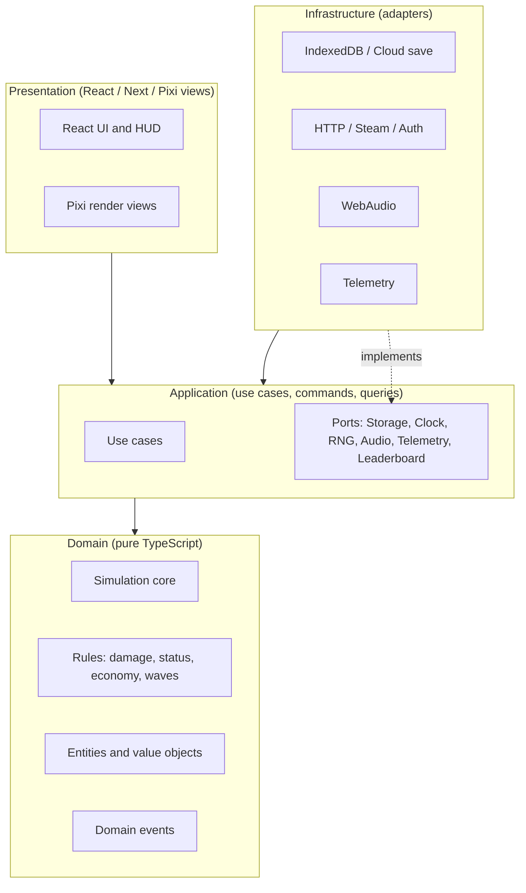

# 16. Technical Architecture

## 16.1 Goals and Constraints

| Goal | Implication |
|---|---|
| Browser first, Steam and mobile later | Platform-agnostic simulation core; thin platform adapters |
| 60 FPS with large waves | Data-oriented simulation, pooled rendering, off-main-thread sim |
| Content-heavy game | Data-driven content, schema validation, extensible registries |
| Fair leaderboards | Deterministic simulation + command-log replays + server verification |
| Long-lived saves | Versioned save envelope with migration chain |
| Testability | Pure domain logic; headless runs; balance bot |
| SOLID / Clean Architecture | Strict dependency rule, ports and adapters |

## 16.2 Technology Stack

| Concern | Choice | Notes |
|---|---|---|
| App shell, routing, menus | **Next.js (App Router)** | Static export for Steam/mobile wrappers; route handlers for optional services |
| UI | **React** + **Tailwind CSS** | HUD, Citadel, menus; accessible components |
| Language | **TypeScript (strict)** | `noUncheckedIndexedAccess`, exact optional properties |
| UI/meta state | **Zustand** | Slice pattern; selectors; transient subscriptions for HUD |
| Rendering | **PixiJS** | WebGL/WebGPU renderer; sprite batching, texture atlases |
| Validation | **Zod** (or equivalent) | Content schemas; save validation; import safety |
| Persistence (web) | **IndexedDB** via a small wrapper | Local-first; optional cloud sync |
| Audio | **WebAudio** (Howler-class abstraction) | Bus mixing, ducking |
| i18n | **i18next-style** | Content keys in data files |
| Testing | **Vitest**, **Playwright** | Unit, property, integration, E2E |
| Tooling | **pnpm workspaces + Turborepo**, ESLint, Prettier | Monorepo |
| Desktop wrapper | **Tauri** (or Electron) + Steamworks bridge | Decision at Beta |
| Mobile wrapper | **Capacitor** | Touch input adapter |

## 16.3 Clean Architecture Layers



**Dependency rule:** inner layers never import outer layers. `domain` has no dependency on React, Pixi, browser APIs or Next.

### SOLID Mapping

| Principle | Application |
|---|---|
| **S**ingle Responsibility | Each system (movement, targeting, damage, status, economy) is a separate class/module |
| **O**pen/Closed | New towers, enemies, abilities and relics are added via content definitions and registered behaviors, not edited switch statements |
| **L**iskov | All behavior implementations conform to ability/targeting interfaces and are substitutable in tests |
| **I**nterface Segregation | Small ports (`SaveStore`, `Clock`, `Rng`, `Telemetry`) instead of god-interfaces |
| **D**ependency Inversion | Application depends on ports; infrastructure supplies adapters via composition root |

## 16.4 Monorepo Layout (Proposed)

```
guardians-of-the-nexus/
├─ apps/
│  ├─ web/                 # Next.js app (UI shell, Citadel, battle host)
│  └─ desktop/             # Tauri/Electron wrapper (later)
├─ packages/
│  ├─ domain/              # Simulation, rules, entities, events (pure TS)
│  ├─ application/         # Use cases, commands, ports
│  ├─ content/             # Data definitions, schemas, localization keys
│  ├─ render-pixi/         # Pixi renderer, VFX, atlas loaders
│  ├─ ui/                  # React components, Tailwind design system
│  ├─ stores/              # Zustand stores (view/meta state)
│  ├─ infra/               # Persistence, audio, telemetry, platform adapters
│  ├─ shared/              # Utility types, math, result types
│  └─ tools/               # Content CLI, balance bot, replay verifier
├─ docs/gdd/               # This document
└─ tests/                  # Integration and E2E
```

## 16.5 Simulation Core

### Fixed Timestep, Deterministic
- **Tick rate:** 30 Hz simulation (33.3 ms), render at display rate with interpolation.
- **Determinism:** seeded PRNG (explicit stream per system), no `Math.random()`, no wall-clock reads inside the sim, deterministic iteration order, careful use of floating point (consistent operations; fixed-point for key economy values if needed). Replays are stored as `seed + content version + command log`.
- **Time control:** game speed multiplies ticks per frame (not delta); pause stops stepping.

### Data-Oriented Entity Component System
- Lightweight custom ECS (or a vetted library) with typed-array component storage for hot paths (position, velocity, health, status).
- Systems run in a fixed order per tick: Input Commands → Spawning → Movement → Targeting → Combat → Status → Abilities → Economy → Cleanup → Event Flush.
- **Spatial hash grid** for range queries; target caches invalidated on movement thresholds.
- Object pooling for projectiles, VFX and floating text to avoid GC spikes.

### Off-Main-Thread Simulation
- Simulation runs in a **Web Worker**; main thread renders and handles UI.
- Communication: command messages in; **snapshot buffers** (transferable, or SharedArrayBuffer when cross-origin isolation is available) out at render rate.
- Fallback: same-thread stepping with a time budget when Workers are unavailable (tests, SSR-less contexts).

### Performance Budgets

| Metric | Target |
|---|---|
| Simulation step | ≤ 4 ms at 600 enemies, 120 projectiles, 40 towers |
| Frame time | ≤ 16.6 ms (60 FPS) on mid-range laptop integrated GPU |
| Draw calls | ≤ 200 per frame (atlas + batching) |
| Memory | ≤ 700 MB in battle; ≤ 300 MB in Citadel |
| Initial load (demo) | ≤ 5 MB to first interaction; streaming for later assets |

## 16.6 Command / Event Architecture

### Commands (player intent)
`PlaceTower`, `UpgradeTower`, `EvolveTower`, `SellTower`, `SetTargetMode`, `MoveHero`, `CastHeroSkill`, `CastNexusSpell`, `ToggleSwitch`, `CallNextWave`, `SetGameSpeed`.
- Commands are validated by the domain (affordability, placement rules), recorded in the **command log**, and executed at a defined tick.
- This gives replays, undo-for-placement (within prep), network-free anti-cheat verification and test scripting for free.

### Domain Events (facts)
`WaveStarted`, `EnemySpawned`, `EnemyDamaged`, `EnemyKilled`, `EnemyLeaked`, `TowerBuilt`, `TowerDisabled`, `StatusApplied`, `HeroDied`, `BossPhaseChanged`, `ResourceChanged`, `RelicTriggered`, `BattleEnded`.
- Typed event bus with **synchronous, ordered dispatch inside the tick** and **batched dispatch to the UI/audio layers**.
- Subscribers: relics and abilities (as event listeners), achievements, audio cues, analytics, UI toasts, quest trackers.

### Ability / Effect Model
- Content defines abilities as **trigger → condition → effect** compositions (e.g., "OnHit → target has Burn → apply Spread").
- A finite set of well-tested **effect primitives** (damage, apply status, spawn, move, modify stat, grant resource, create zone) combine to build all towers, relics and enemy abilities, keeping the engine small and the content wide.
- Stat calculations use a **modifier stack** (base → flat → percent → multiplicative → caps) with source tracking for debugging and tooltips.

## 16.7 State Management

| State type | Home | Update frequency |
|---|---|---|
| Simulation state | Domain (worker), never in React state | 30 Hz |
| HUD snapshot (Gold, Mana, wave, hero cooldowns) | Zustand `battleView` store | ≤ 10 Hz, throttled; components subscribe via selectors |
| Citadel / profile | Zustand `meta` store + persistence adapter | On change |
| Settings and input bindings | Zustand `settings` store | On change |
| Content registry | Immutable singleton loaded at boot | Static |

Rules: no simulation objects stored in Zustand; the store holds **plain snapshots**. Pixi reads the simulation snapshot directly, not via React.

## 16.8 Content System (Extensible)

- **Data-driven definitions:** towers, evolutions, enemies, bosses, heroes, relics, maps, waves, events, weather, research nodes, spells, cosmetics.
- **Stable IDs:** namespaced (`core:tower.arcane_tower`) and never reused; deprecations kept as aliases.
- **Schema validation:** every definition is validated at build time (CI) and load time (dev). Cross-reference validation (e.g., an evolution's parent exists).
- **Content packs:** `core`, plus DLC and community packs register through the same `ContentRegistry` interface.
- **Behavior registry:** named behaviors (e.g., `behavior:riddle_shell`) are implemented in code once and referenced by data. New behaviors require code; new variants of existing behaviors do not.
- **Hot reload (dev):** edit a balance file and the running battle reloads definitions.
- **Balance data:** exported from spreadsheets to JSON via a CLI tool; diffs reviewed in PRs.
- **Localization:** all strings via keys; lore text in separate bundles for translators.

## 16.9 Save System and Versioning

### Save Envelope
A single JSON document with:
- `schemaVersion` (integer, monotonic)
- `contentVersion` (to detect removed or renamed content)
- `profileId`, `createdAt`, `updatedAt`
- `payload` (profile, Citadel, research, heroes, relics, mastery, settings)
- `checksum` (integrity; not security)

### Migration
- A chain of **pure migration functions** `vN → vN+1`, each unit-tested with fixtures from previous releases.
- **Pre-migration backup** is stored automatically; failed migration restores the backup and reports to the player.
- **Forward-compat:** unknown fields are preserved in an `extensions` bag; saves from newer versions are opened read-only with a warning.
- **Slots:** 3 profile slots; autosave after each battle and each Citadel action (debounced).
- **Import/Export:** a validated file; imported data is schema-validated and size-limited (see security).
- **Cloud sync (later):** last-writer-wins with conflict UI, based on `updatedAt` and a monotonic revision counter.

### Battle Persistence
- Mid-battle "suspend" saves store `seed + command log + tick` (replay-based resume), which is small, deterministic and tamper-evident.

## 16.10 Rendering Architecture (PixiJS)

- **Layers:** terrain (baked per map), decals, entities (sorted by Y), projectiles, VFX, overlays (range, telegraphs), UI hooks.
- **Sprite pooling and batching** with texture atlases per biome; GPU instancing for swarms where supported.
- **Animation:** sprite sheets with a small tween library; skeletal animation (e.g., Spine) only for heroes/bosses if budget allows.
- **VFX budget:** particle caps by quality tier; automatic quality scaling when frame time exceeds budget.
- **Readability:** outline shader for selected/threat units; consistent telegraph visuals (red = threat to tower, amber = threat to path, blue = beneficial zone).
- **Accessibility:** colour-blind palettes, reduced-flash mode, UI scaling 75–200%.

## 16.11 Input and Platform Abstraction

- **Input actions** (not raw keys): `Select`, `Place`, `Cancel`, `CastSkill1`, `PauseToggle`, etc.; adapters map mouse/keyboard, gamepad and touch.
- **Platform ports:** `FileSystem`, `Storage`, `Clipboard`, `Achievements`, `Cloud`, `Purchases`, `Haptics` with implementations for Web, Steam and Mobile.
- **Responsive UI:** layout tokens for compact and large screens; touch targets ≥ 44 px on mobile.

## 16.12 Services (Optional, Phase After Beta)

| Service | Purpose | Notes |
|---|---|---|
| **Leaderboards** | Weekly, Endless, Boss Rush | Replay submission + server-side headless verification |
| **Weekly seed service** | Publishes weekly challenge definitions | Static JSON is enough initially |
| **Cloud saves** | Cross-device | Opt-in account; encrypted at rest |
| **Telemetry** | Balance and crash analytics | Opt-in, anonymised; no PII |
| **Entitlements** | Verify purchases across platforms | Platform-provided receipts |

Implementation can use Next.js route handlers / serverless functions with a managed database. The architecture keeps the game fully playable offline.

## 16.13 Testing and Quality

| Layer | Approach |
|---|---|
| Domain unit tests | Vitest; table-driven tests for damage, statuses, economy |
| Property tests | Determinism (same seed → same outcome), save migration round-trips |
| Content tests | Schema validation, cross-reference, power-budget checks (cost vs DPS reference) |
| Golden replays | Recorded runs that must reproduce exact results across releases |
| **Balance bot** | Headless runs of N loadouts per map, reporting win-rate, margin, economy curves; run in CI nightly |
| Integration | Application use cases with in-memory adapters |
| E2E | Playwright: Citadel → loadout → battle → results → save reload |
| Performance | Automated stress scenes with frame-time and GC budget assertions |
| Visual | Screenshot tests for UI regressions |

## 16.14 Security and Integrity

- **Input validation** (OWASP A03/A08): all imported saves and shared seeds validated by schema, with size and depth limits.
- **No `eval`/dynamic code** from data; behaviors are registered, not executed from content strings.
- **CSP** with strict script sources; avoid inline scripts where possible; subresource integrity for third-party assets.
- **Dependency hygiene:** lockfile, automated advisory checks, minimal runtime dependencies.
- **Leaderboard anti-cheat:** server-side re-simulation of submitted command logs; reject mismatched results; rate limits.
- **Accounts:** optional; when used, standard OAuth/OpenID providers, secure cookies, CSRF protection on mutating endpoints.
- **Privacy:** telemetry opt-in, data minimization, deletion request path.

## 16.15 CI/CD and Environments

- **Pipeline:** typecheck → lint → unit/property tests → content validation → build → E2E → deploy preview.
- **Environments:** local, preview (per PR), staging (full content, test leaderboards), production.
- **Release artifacts:** web build, Steam build (wrapper), content pack manifests, source maps.
- **Feature flags:** for staged rollout of new content and experiments.
- **Versioning:** SemVer for the app; separate monotonic `schemaVersion` for saves and `contentVersion` for packs.

## 16.16 Observability

- Client error reporting (opt-in) with source maps.
- Frame-time histograms and slow-tick reports in dev/QA builds.
- Replay attach for bug reports ("Export replay" button).

## 16.17 Risks and Mitigations

| Risk | Impact | Mitigation |
|---|---|---|
| Floating-point nondeterminism across browsers | Broken replays/leaderboards | Deterministic math helpers; golden replay tests across browsers; fixed-point for critical values |
| React re-render overhead during battle | FPS drops | Sim outside React; throttled snapshots; selector discipline |
| Content volume overwhelms schedule | Scope creep | Vertical-slice-first, cut lines in roadmap, reuse of effect primitives |
| Worker/SharedArrayBuffer constraints | Compatibility | Message-based fallback; progressive enhancement |
| Balance complexity (30 towers × 60 evolutions) | Dominant strategies | Power budget checks; balance bot; telemetry |
| Next.js static export limits | Steam/mobile packaging issues | Battle and Citadel are client-only; optional services isolated |
