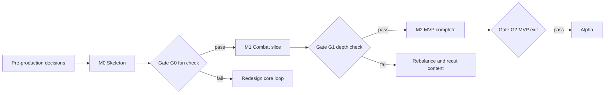

# MVP Definition

The smallest playable version that still **represents Guardians of the Nexus**: fun on its own, replayable, extensible, and built entirely from production-quality foundations.

**Relationship to earlier documents:** this definition **supersedes GDD §18 and the MVP backlog** where they differ (see §17 for every change). It resolves findings C-04, C-08, S-01, St-03, St-04, M-01, MS-01…MS-03, D-01 and D-04 of the [Architecture Validation Report](01-architecture-validation-report.md).

---

## 1. MVP Principles

| # | Principle | Consequence |
|---|---|---|
| 1 | **Represent every pillar, thinly** | The MVP must let a player feel each pillar: loadout-first strategy, evolutions, a hero, enemies that "argue back", a boss puzzle, and permanent progression |
| 2 | **Depth through choice, not volume** | Few items, but more options than slots, so every battle begins with a decision |
| 3 | **Final architecture, minimal content** | No throwaway engine code; only art and a handful of UI skins are placeholders |
| 4 | **Stage-gated** | Three increments (M0, M1, M2), each playable and each ending in a go/no-go gate |
| 5 | **Data-driven from day one** | Every tower, enemy, hero, map and upgrade is a validated definition; adding content never edits engine code |
| 6 | **Deterministic from day one** | Every battle is replayable from `setup + seed + command log` |

## 2. Pillar Coverage

| GDD pillar | How the MVP demonstrates it |
|---|---|
| Easy to learn, hard to master | Map 1 is a guided 15-wave tutorial; Map 3 and Veteran tier demand mastery of resistances, priorities and cleansing of debuffs |
| Many viable strategies | 7 towers, 6 evolutions, 4–5 loadout slots; at least three distinct winning builds required by the exit criteria |
| No mandatory build order | No tower is mandatory for any map; verified manually by observing three different winning loadouts (the balance bot arrives in Alpha) |
| Meaningful progression | Shards buy tower/evolution unlocks and five permanent upgrades; upgrades change how you play (a loadout slot, starting Gold, Mana, Integrity, hero cooldown) |
| High replayability | 3 maps × 2 difficulties × 3 star objectives = 18 goals; 21–35 possible loadouts; 6 evolution forks; hero skills; optional Endless (stretch) |
| Hero management | Aelara Voss with Q/W/E/R, controlled on the map |
| Boss puzzles | Sporemother Myra with phases and objectives |
| Fair difficulty | Wave preview, telegraphs ≥ 2 s on any tower-affecting ability, no hidden modifiers |

## 3. Scope Summary

| Category | MVP content |
|---|---|
| **Towers** | 7 base towers (Tiers I–III) |
| **Evolutions** | 6 (3 towers × 2) |
| **Heroes** | 1 (Aelara Voss, fixed level template) |
| **Nexus Spells** | 2 |
| **Enemies** | 8 (Verdant Covenant) |
| **Bosses** | 1 (Sporemother Myra) |
| **Maps** | 3 (Verdant Covenant, Act I slice) |
| **Difficulty** | Normal and Veteran |
| **Resources** | Gold, Mana, Nexus Integrity, Nexus Energy (in battle); Crystal Shards (meta) |
| **Progression** | Stars, Shards, unlock store, 5 Nexus Upgrades, Veteran unlock |
| **Persistence** | Save v1 with migration chain, 1 profile slot, device settings |
| **Platform** | Web (desktop browsers) |

---

## 4. Towers (7)

| # | Tower | Cost | Pad | Damage | AS | Range | Type | Targets | Role | Archetype | Availability |
|---|---|---|---|---|---|---|---|---|---|---|---|
| 1 | **Arcane Tower** | 120 | Small | 18 | 1.2 | 5.0 | Arcane | Ground + Air | All-round DPS | Projectile (homing) | Start |
| 2 | **Ballista Post** | 130 | Small | 55 (pierce 3) | 0.6 | 7.5 | Physical | Ground + Air | Long-range pierce | Projectile (pierce) | Start |
| 3 | **Garrison Barracks** | 150 | **Large** | 8 × 3 soldiers | 1.0 | 3.0 rally | Physical | Ground | Blockers | Summoner | Start |
| 4 | **Flame Forge** | 140 | Small | 14 (cone) | 2.0 | 2.8 | Fire | Ground | Burst + Burn | Cone | Start |
| 5 | **Frost Spire** | 120 | Small | 14 | 1.0 | 5.0 | Frost | Ground + Air | Slow / control | Projectile + status | Start |
| 6 | **Tesla Coil** | 150 | Small | 30 (chain 3, −20%/jump) | 0.9 | 4.5 | Storm | Ground + Air | Chain AoE | Chain | **Unlock (120 Shards)** |
| 7 | **Mana Font** | 150 | Small | — | — | 3.0 aura | — | — | Support / Mana | Generator + Aura | **Unlock (120 Shards)** |

**Why these seven:** they cover every role the game needs a player to reason about (single target, pierce, block, burst, control, chain, support) and exercise six weapon archetypes that every later tower reuses. **Nature Grove** (Root/Vine) is deferred to Alpha because the Verdant roster resists Nature, making it a poor teaching tower, and it adds an archetype and a status without adding a decision.

### Tier Rules (all towers)

| Tier | Cost (× base) | Effect |
|---|---|---|
| II | +0.8× | ≈ ×1.5 core stats, named perk |
| III | +1.4× | ≈ ×2.3 core stats, named perk |
| IV (Evolution) | +2.4× | Evolution A or B (Arcane Tower, Frost Spire, Tesla Coil only) |

Overcharge unlocks at Tier III: 20 Mana, +50% rate for 6 s, 30 s cooldown. Selling refunds 100% during preparation, 85% for 10 s after building, then 70%.

### Tier Perks (MVP)

| Tower | Tier II | Tier III |
|---|---|---|
| Arcane Tower | Focused Lens (+range) | Spellweave (every 4th bolt is a Dual Bolt) |
| Ballista Post | Windlass (+25% AS) | Barbed Bolts (pierce 5, Bleed) |
| Garrison Barracks | Plate Drill (+50% soldier HP) | Rally Standard (+15% damage, +1 soldier) |
| Flame Forge | Bellows (wider cone) | Searing Draft (Burn stacks to 7) |
| Frost Spire | Rime Tip (slow 35%) | Brittle Frost (applies Brittle) |
| Tesla Coil | Higher Voltage (better falloff) | Capacitor Bank (chain 5) |
| Mana Font | Wellspring (+1.0 Mana/s) | Overflow (+10% Overcharge duration to towers in aura) |

## 5. Evolutions (6)

| Base | Evolution A | Evolution B | Implementation class |
|---|---|---|---|
| Arcane Tower | **Archmage Spire** ◼ (Large): every 5th bolt casts an Arcane Nova; damage scales with the Mana pool | **Temporal Beacon**: bolts slow targets 30% and give towers in range +15% attack speed; −30% own damage | Compositional |
| Frost Spire | **Glacier Citadel**: chance to freeze; frozen enemies shatter for +100% Physical/Sonic damage | **Blizzard Engine**: weak global slow; every 25 s Whiteout freezes everything in range | Compositional |
| Tesla Coil | **Storm Conductor**: chain 7 and returns | **Overload Pylon**: charge and discharge a 1.5 s stun every 10 s | Parametric / Compositional |

**No evolution requires a registered behavior in the MVP**; all six are built from effect primitives, which also proves the Effect Engine's promise that content is data. Flame Forge's evolutions (Inferno Foundry, Phoenix Kiln) move to Alpha.

Evolutions are bought with Shards in the unlock store (90 Shards each) and require the base tower at Tier III in a battle.

## 6. Hero (1)

### Aelara Voss — Archmage (fixed level-5 template)

| Slot | Skill | Description | Cooldown / Cost |
|---|---|---|---|
| Q | **Arcane Barrage** | 3 homing arcane bolts | 6 s |
| W | **Mana Rift** | Ground zone: towers inside have −25% Overcharge cost | 20 s |
| E | **Blink** | 4-tile teleport; resets Barrage | 10 s |
| R | **Cataclysm Equation** | 3 s channel of chained detonations | 50 Nexus Energy |
| Passive | **Spellflow** | Each spell cast reduces other cooldowns by 1 s | — |
| Passive | **Archivist** | +10 max Mana | — |

Rules: control by click-to-move; auto-attacks nearby enemies; knocked out at 0 HP, respawn 30 s or instant revive for `50 + 10 × level` Gold. No XP, tree or gear in the MVP; `HeroSpec` is compiled from a fixed template through the **same `HeroCompiler` path** used later, so leveling is added without refactoring.

## 7. Nexus Spells (2)

| Spell | Effect | Mana |
|---|---|---|
| **Nexus Pulse** | Radial damage and knockback from the Nexus | 40 |
| **Time Dilation** | Enemies −40% speed for 6 s | 50 |

Two spell slots. Nexus Surge and Guardian's Bulwark are deferred to Alpha.

## 8. Enemies (8) and Boss (1)

### Standard Enemies — Verdant Covenant

| # | Enemy | Cat. | HP | Speed | Threat | Bounty | Signature behavior | Teaches |
|---|---|---|---|---|---|---|---|---|
| 1 | **Thornling Scout** | I | 80 | 1.6 | 1 | 10 | Regrow +2 HP/s after 3 s undamaged; R Nature 50, W Fire | Burst vs fast units; Burn stops regen |
| 2 | **Bark Guard** | I | 220 | 0.8 | 1 | 26 | Armor 20; R Phys 30 / Nature 50; W Fire, Storm | Armor and damage types |
| 3 | **Wolf-Rider Hunter** | I | 160 | 2.2 | 1 | 19 | Leaps over the first blocker; W Frost | Blockers can be bypassed; slows matter |
| 4 | **Spore Carrier** | I | 130 | 1.0 | 1 | 16 | On death, Spore Cloud (r1.5, 4 s): towers −20% attack speed | Kill range; "enemies argue back" |
| 5 | **Druid Warden** | M | 180 | 0.9 | 2 | 22 | Rejuvenation Aura r2.5: heals 4%/s; W Shadow, Phys | Priority targeting |
| 6 | **Mossback Brute** | E | 650 | 0.7 | 3 | 65 | Regenerate 3%/s if undamaged 3 s; Ground Slam stuns soldiers; W Fire | Sustained DPS; Fire stops regen |
| 7 | **Pollen Wisp** | F | 100 | 1.4 | 2 | 12 | Flying; Dust marks a tower: −30% accuracy for 4 s; W Storm | Anti-air; AoE/chain |
| 8 | **Treant Colossus** | E | 2,400 | 0.4 | 5 | 240 | Overgrowth (+10% max HP per 10 s alive); spawns 3 Thornlings at 50% HP; R Phys 30 / Nature 75; W Fire 50 | Time-to-kill pressure |

**Deferred to Alpha:** Briar Burrower (underground layer) and Gloomcap Shaman (range-debuff, redundant with Spore Cloud for teaching).

### Boss — Sporemother Myra (Warlord tier)

| Phase | Mechanics |
|---|---|
| 1 | **Spore Pods**: every 20 s four pods appear at the path edges; each bursts after 10 s releasing a cloud (−20% attack speed to towers in r1.5). Pods can be destroyed. |
| 2 (60% HP) | **Mycelium Network**: three nodes heal Myra 2%/s each; destroying a node stops its healing and stuns her 2 s. |
| Rules | Hard-CC immune; slow capped at 40%; every ability telegraphed ≥ 2 s. Reward: a Shard bonus and first-clear stars (relics are out of scope for the MVP). |

## 9. Maps (3)

| # | Map | Waves | Lanes | Pads (small / large) | Start Gold | Special | Introduces |
|---|---|---|---|---|---|---|---|
| 1 | **Greenwood Gate** (tutorial) | 15 | 1 | 14 / 1 | 300 | Static guided hints | Pads, tiers, hero, wave preview, early call; enemies 1–6 |
| 2 | **Mossroot Crossing** | 20 | 2 merging | 20 / 2 | 350 | **Rain** (Storm +10%, Fire −10%) | Flyers (Pollen Wisp), Tesla/Frost/Mana synergies, Treant Colossus as final elite |
| 3 | **Sporefall Hollow** | 25 | 2 | 24 / 3 | 400 | Pod hazards | Boss Myra on wave 25 |

**Star objectives (per map, per difficulty):** Victory; Pristine (≥ 80% Integrity); Challenge: Map 1 "clear with ≤ 8 towers built", Map 2 "clear using only 3 different tower types", Map 3 "destroy every Spore Pod before it bursts".

**Schema requirements (no rework later):** the Map schema includes walkable layer for heroes, branching nodes and switches, hazard emitters and weather slots, even though the MVP maps use only a subset.

## 10. Resources

### In Battle

| Resource | Rule |
|---|---|
| **Gold** | Start per map (300/350/400). Kill bounty (12% of base HP infantry/magical/flying, 10% elites). Wave bonus `20 + 2 × wave`. Early-call bonus `min(40, round(1.5 × remaining prep seconds))`. Interest 2% of bank per wave, capped at 120 and 10% of income. Spent on towers, tiers, hero revive. |
| **Mana** | Cap 100 (+10 with upgrade). Regen 1.0/s (+Mana Font). Spent on Nexus Spells (40/50) and Overcharge (20). |
| **Nexus Integrity** | 100 (+5 with upgrade). Leaks cost the enemy's Threat. Defeat at 0. |
| **Nexus Energy** | 0–100. +0.4 per kill, +2 per Integrity point absorbed, +10 on boss phase change. Spent on the hero Ultimate (50). *This is the MVP resolution of C-04: Surge is deferred, so Energy has a single sink.* |

### Meta

| Resource | Rule |
|---|---|
| **Crystal Shards** | Earned per clear: `4 × waves` Normal (Map 1: 60, Map 2: 80, Map 3: 100), × 1.4 Veteran; +20 per new star; +10 for Pristine. Spent on unlocks and upgrades. |

**Not in the MVP:** Soul Essence, Research Data, Ancient Relics, Echo Points, Prism Tokens.

## 11. Progression Systems

| System | MVP behavior | Becomes later |
|---|---|---|
| **Campaign progress and stars** | 3 stars × 3 maps × 2 difficulties; Map N+1 unlocks after Map N | Full campaign and mastery |
| **Crystal Shards** | Single meta currency | Remains; other currencies are added |
| **Unlock store** (via `UnlockResolver` + `Wallet`) | Buy Tesla Coil (120), Mana Font (120) and six evolutions (90 each) | The Research Lab and Armory unlock flow |
| **Nexus Upgrades (5)** | Each is a **node in the future Bastion/Tactician trees**, applied as a `ModifierSpec` in `BattleSetup` (see below) | The Nexus skill tree (no throwaway: only the UI skin changes) |
| **Veteran tier** | Unlocks after clearing Map 3 on Normal; ×1.35 HP, own star set, ×1.4 Shards | Heroic and Mythic |

### Nexus Upgrades

| # | Upgrade | Effect | Cost |
|---|---|---|---|
| 1 | Prepared Coffers | +50 starting Gold | 60 |
| 2 | Deep Reservoir | +10 max Mana | 90 |
| 3 | Reinforced Core | +5 Integrity | 120 |
| 4 | Wider Mind | **+1 tower slot (4 → 5)** | 150 |
| 5 | Spell Rhythm | −8% hero cooldowns | 180 |

### Economy Pacing Target

| Item | Value |
|---|---|
| Total sink | 240 (unlocks) + 540 (evolutions) + 600 (upgrades) = **1,380 Shards** |
| First clears Normal (3 maps) | 240 + 180 (stars) + 30 (pristine) ≈ **450** |
| First clears Veteran | ≈ **516** (336 + 180) |
| Remaining via replays | ≈ 2 more full-set passes |
| **Time to buy everything** | ≈ **5–6 hours** (≈ 14 battles) |

### Loadout Rule

4 tower slots (5 after Upgrade 4); 2 Nexus Spell slots; 1 hero slot. **Slot count is a rule value in `BattleSetup`**, so growth to 8–10 slots needs no code change. Start with five towers available, so the first loadout screen already asks "which four?".

## 12. Systems In and Out

### Included (Final-Quality Foundations)

| Area | Included |
|---|---|
| Engine | Kernel, ECS, fixed 30 Hz loop, command queue, sim event bus, RNG streams, timers, command-log replay, state-hash checkpoints, worker host with snapshot protocol and inline fallback |
| Combat | Modifier stack, full damage pipeline (accuracy, crit, vulnerability, resist/immunity, armor, DR, shields), status engine (Burn, Chill, Freeze, Stun, Bleed, Brittle), slow combination, tenacity and boss rules |
| Effect Engine | Triggers, conditions, selectors, expression evaluator, primitives (Damage, Heal, ApplyStatus, Cleanse, ModifyStat, SpawnProjectile, SpawnZone, SpawnEntity, Displace, GrantResource, SpendResource, Shield, Transform, Emit), aura system, behavior registry skeleton |
| Content | Schemas, ID interning and registry, balance tables with `$bal` keys, baked curves, content CLI and lint v0, power-budget lint v0 |
| Gameplay | Pads, placement, upgrade/evolve/sell, targeting modes, weapons and projectiles, overcharge, summons and blocking, nav lanes, leaks, waves, preview, early call, interest, boss framework |
| Client | Pixi renderer (layers, interpolation, view sync, health bars, damage numbers, range rings, telegraphs, 4 VFX recipes), input mapper, HUD, build menu, tower panel, hero panel, spell bar, wave preview, boss bar, menus, loadout, results, settings, i18n keys |
| Persistence | Save v1 (envelope, IndexedDB, atomic write, backups, migrations scaffold, single writer), device settings |
| Quality | Cross-browser golden replays, perf stress scene, playtest tooling |

### Excluded

| Area | Excluded |
|---|---|
| Content | Other Acts, Nature/Shadow/Radiant/Crystal/Void schools, other heroes, relics, gear |
| Meta | Account levels, skill trees, research, Citadel, mastery, codex, prestige |
| Modes | Rift, Endless (stretch), Survival, Weekly, Boss Rush, Mythic |
| Systems | Path Switches (schema only), corpses, stealth/phase/burrow, hazards beyond pods, dynamic events, weather beyond Rain, Nexus Surge, rewind, suspend/resume |
| Platform | Cloud, Steam, mobile, services |
| Presentation | Final art, music, localization beyond EN keys, colour-blind filters, UI scale, rebinding |
| Tooling | Balance bot, map editor, hot reload, quality auto-scaling |

## 13. No-Throwaway Audit

| Item | Final or placeholder? | Rule to avoid rework |
|---|---|---|
| Sim, ECS, effect engine, content pipeline | **Final** | Built as in the TDD from the first commit |
| Content definitions | **Final** | Authored through schemas; no hard-coded stats |
| Programmer art | **Placeholder** | Delivered through the final `ViewDefinition` + atlas manifest path; art drops in later without code changes |
| Nexus Upgrades UI | **Placeholder skin** | Data model is the future skill tree |
| Unlock store UI | **Placeholder skin** | Underlying `UnlockResolver` is final |
| Static map-1 hints | **Placeholder** | Replaced by the event-driven tutorial engine in Beta; no engine dependency |
| Hero fixed template | **Placeholder data** | Goes through the final `HeroCompiler` |
| Audio cues | **Placeholder assets** | Final `AudioPlayer` port and event→cue mapping |
| Save v1 | **Final** | Migration chain scaffold included; v1 is a real schema version |

## 14. Extension Points Built in the MVP

| Future feature | MVP hook |
|---|---|
| More towers, enemies, heroes | Definitions + registry; alias table for renames |
| Research, relics, skill trees | `ModifierSpec` pipeline with buckets and caps; Nexus Upgrades as first nodes |
| Mythic, affixes | Difficulty profiles and enemy `affixHooks`/tags in the schema |
| Branching maps, hazards, weather | Map schema fields present; nav graph supports junctions and switches |
| Rewind, suspend | Command log and checkpoints now; keyframe serializers added in Alpha |
| Leaderboards, verification | Replay format v0 and header versions stamped from day one |
| Localization | i18n keys for every string |
| Balance bot | Headless `sim` entry point and pure command API |

---

## 15. Increments and Gates

### M0 — Skeleton (≈ 140 tasks)

**Playable:** Map 1 only, headless-first then rendered. 3 towers (Arcane Tower, Ballista Post, Frost Spire), Tiers I–III, 3 enemies (Thornling Scout, Bark Guard, Wolf-Rider Hunter), no hero, no boss, no meta, no save.
**Includes:** EP-1 scaffold/guardrails/spikes; kernel, ECS, loop, events, host/snapshot; contract schemas; stats, damage pipeline core, statuses core, effect engine core; schemas/registry/balance; placement/targeting/weapons/projectiles; navigation and waves; renderer core and input; minimal flow and HUD.

**Gate G0 — Fun check (go/no-go)**

| Criterion | Threshold |
|---|---|
| 5 internal/external players play Map 1 | ≥ 4 finish it and ≥ 3 ask to continue |
| Tower decisions are visible | Players change a build in response to a wave preview or loss |
| Determinism | Golden replays identical on Chromium, Firefox, WebKit |
| Performance | 300 enemies, 60 FPS on a mid-range laptop; sim ≤ 4 ms/tick |
| Architecture | A fourth tower can be added by data only (≤ 1 session) |

### M1 — Combat Slice (≈ 70 tasks)

**Playable:** Maps 1–3 without hero, boss or meta. Remaining towers (Garrison Barracks, Flame Forge, Tesla Coil, Mana Font), six evolutions, remaining enemies (5), Rain weather, wave preview, early call, interest, telegraphs and VFX, tower panel, loadout screen.

**Gate G1 — Depth check**

| Criterion | Threshold |
|---|---|
| Distinct winning loadouts observed on Map 3 (manual) | ≥ 3 |
| Resistances/statuses understood | 6/8 testers explain "why Fire beats Bark Guards" unprompted |
| Enemy readability | No death attributed to "something I couldn't see" in 8 sessions |
| Content pipeline | A new enemy via data + art only |

### M2 — MVP Complete (≈ 75 tasks)

**Adds:** Aelara and her skills, Nexus Spells, Sporemother Myra, Shard rewards, stars, unlock store, Nexus Upgrades, Veteran, save v1, settings, audio placeholders, error/fault handling, hosting, playtest tooling.

**Gate G2 — MVP exit** (from GDD §18.3, adjusted)

| Category | Criteria |
|---|---|
| Fun | 10 external playtesters; ≥ 70% finish Map 3; ≥ 60% would play more; ≥ 3 distinct winning builds |
| Clarity | 8/10 explain resistances and statuses after Map 2 unprompted |
| Performance | 60 FPS with 300 enemies on target low-end laptop; sim ≤ 4 ms |
| Determinism | Golden replays reproduce on Chromium, Firefox and Safari |
| Stability | Zero data-loss bugs; save round-trip and fuzz suites green |
| Pipeline | A new enemy via data + art only |
| Replayability | ≥ 50% of testers start a second session voluntarily; ≥ 30% attempt Veteran |
| Progression | Median playtester buys ≥ 2 unlocks/upgrades in the first session |

## 16. Optional Stretch (Only After Gate G2 Passes)

| Stretch | Why | Size |
|---|---|---|
| **Endless variant of Map 3** | Cheap replayability using baked endless scaling and a personal-best score | ≈ 5 tasks |
| Third difficulty preview (Heroic data) | Validates the profile system | ≈ 1 task |
| Nature Grove | First Alpha tower; adds Root | ≈ 2 tasks |

## 17. Backlog Delta (vs the MVP Backlog)

### Removed or Deferred (−18 tasks)

| Item | New home |
|---|---|
| Content hot-reload | Alpha |
| Tower: Nature Grove | Alpha |
| Evolutions: Inferno Foundry, Phoenix Kiln | Alpha |
| Enemies: Briar Burrower, Gloomcap Shaman | Alpha |
| Spell: Guardian's Bulwark; Nexus Surge | Alpha |
| Adaptive quality controller; WebGL context-loss recovery | Alpha |
| Audio: event→cue mapping with voice limiting; music loop | Alpha |
| Loadout presets | Alpha |
| Tutorial prompt engine (replaced by static Map 1 hints) | Beta |
| Colour-blind palettes; UI scale and keyboard menu navigation | Alpha |
| Rebinding data model | Alpha |
| Nightly performance CI job (PR-time stress check remains) | Alpha |

### Added (+7 tasks)

| Item | Reason |
|---|---|
| Contract schemas (Setup, Result, ModifierSpec, HeroSpec) | MS-01 blocker |
| Composition root | MS-02 |
| Application event bus | MS-03 |
| i18n baseline (keys, EN bundle, lint) | M-01 |
| `UnlockTower`/`UnlockEvolution` use case | MVP progression |
| Unlock store UI | MVP progression |
| Veteran difficulty profile | Replayability |

**Net:** 296 − 18 + 7 = **285 tasks**, partitioned M0 ≈ 140 / M1 ≈ 70 / M2 ≈ 75 (±10%).

### Re-tagging Rule

Replace ★ with `ms:m0`, `ms:m1`, `ms:m2` labels. Move the Summoner framework (US-5.2.2) into M1 together with Garrison Barracks; M0 contains **no blockers/summoners**, so M0's three towers are free of that dependency.
