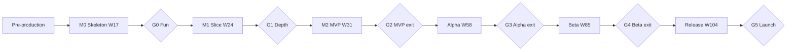

# Production Plan

Durations are **planning estimates derived from the backlog**, not commitments. They assume the team and velocity model in §2, express time in **calendar weeks of elapsed schedule after the team is in place**, and carry explicit ranges. Re-forecast at every gate using measured velocity (§12).

---

## 1. Planning Baseline

### 1.1 Task Counts (After Validation Corrections)

| Milestone | Tasks as written | Corrections from the [validation report](01-architecture-validation-report.md) and [MVP definition](02-mvp-definition.md) | **Planned tasks** |
|---|---|---|---|
| MVP | 296 | −18 deferred, +7 added | **285** |
| Alpha | 252 | +18 deferred from MVP, −2 moved to MVP, +14 gap fixes (map editor, replay viewer/inspector, targetability, research tracks, spell unlock, Relic Vault/Armory), +11 keyframes/suspend and +3 minimal cloud backup pulled forward | **296** |
| Beta | 305 | −11 (suspend moved to Alpha), +9 (achievement engine, services split, verification sampling, rewind reset, gating, demo definition) | **303** |
| Release 1.0 | 203 | +4 | **207** |
| **Total to 1.0** | 1,056 | | **1,091** |
| Post-launch | 27 | — | 27 |

Oversized tasks (≈ 10–20% of the backlog; validation finding St-02) are absorbed in the **buffers** below rather than re-counted.

### 1.2 Reference Team (Recommended)

| Role | Count | Notes |
|---|---|---|
| Game Director / Lead Designer | 1 | Content design, balance, owns the backlog; authors data |
| Engineers | 3 | E1 simulation and tools; E2 client, rendering, UI; E3 gameplay/content engineer (joins at M0 start) |
| Artists | 2 (+1 contractor FTE from Beta) | See §6 |
| Audio | Contract | Music and SFX (from Alpha) |
| QA / Community | 0.5 from M2 | Playtest operations, bug triage |

The GDD §17.4 assumes a leaner team (2 engineers); the lean case is costed in §8.

### 1.3 Velocity Model

| Parameter | Value | Rationale |
|---|---|---|
| Task = 1 coding session + 1 PR | ≈ 0.8–1 person-day including review and rework | Matches the sizing rule in the backlog index |
| Engineer throughput | 4 tasks/week | Meetings, reviews, context switches, bug-fixing included |
| Designer/data throughput | 5 tasks/week | Content tasks are shorter once the pipeline is stable |
| Gross team throughput | **17 tasks/week** | 3 × 4 + 5 |
| Parallel efficiency (dependency-bound work) | MVP 0.65 → Alpha 0.80 → Beta/Release 0.85 | The engine foundation is largely serial; content parallelizes well |
| Buffer (unknowns, rework, playtest iteration, oversized tasks) | MVP 20%, Alpha 25%, Beta 30%, Release 30% | Rises with external dependencies (platforms, public feedback, launch) |

## 2. Estimation Model

`Duration = Tasks ÷ (Gross throughput × Efficiency) × (1 + Buffer)`

| Milestone | Tasks | Effective tasks/wk | Base weeks | Buffer | **Likely weeks** |
|---|---|---|---|---|---|
| MVP | 285 | 11.1 | 25.8 | +20% | **31** |
| Alpha | 296 | 13.6 | 21.8 | +25% | **27** |
| Beta | 303 | 14.5 | 21.0 | +30% | **27** |
| Release | 207 | 14.5 | 14.3 | +30% | **19** |
| **Total** | 1,091 | | 82.9 | | **104** |

## 3. Duration Summary

| Milestone | Optimistic (×0.8) | **Likely** | Pessimistic (×1.45) | Cumulative (likely) |
|---|---|---|---|---|
| Pre-production (before Week 1; not counted below) | 2 wks | 3 wks | 5 wks | — |
| **MVP** | 25 wks | **31 wks** (≈ 7 months) | 45 wks | Week 31 |
| **Alpha** | 22 wks | **27 wks** (≈ 6 months) | 39 wks | Week 58 |
| **Beta** | 22 wks | **27 wks** (≈ 6 months, including 8 weeks of public beta) | 39 wks | Week 85 |
| **Release (1.0)** | 15 wks | **19 wks** (≈ 4.5 months) | 28 wks | Week 104 |
| **Total** | **84 wks (≈ 19 months)** | **104 wks (≈ 24 months)** | **151 wks (≈ 35 months)** | |

**Confidence:** ±25% on MVP once M0 velocity is measured; ±35% on Alpha–Release until Alpha's actual velocity and art throughput are known.

## 4. Phase Breakdown (Likely Case)

### 4.1 MVP — 31 weeks

| Increment | Tasks | Weeks | Content | Gate |
|---|---|---|---|---|
| Pre-production | — | 3 (before Week 1) | Resolve 3 blockers (T-01, MS-01, S-02); ADRs; hiring; art direction | Team ready |
| **M0 Skeleton** | ≈ 140 | **17** | Foundation, deterministic core, content pipeline, 1 map, 3 towers, 3 enemies, rendered | **G0 Fun check** (Week 17) |
| **M1 Combat slice** | ≈ 70 | **7** | 7 towers, 6 evolutions, 8 enemies, 3 maps, Rain, VFX/telegraphs | **G1 Depth check** (Week 24) |
| **M2 MVP complete** | ≈ 75 | **7** | Hero, spells, Myra, meta, save, QA | **G2 MVP exit** (Week 31) |

### 4.2 Alpha — 27 weeks

| Block | Weeks | Scope |
|---|---|---|
| **A0 Corrections and tools** | 1–7 | Map/wave authoring tool, replay viewer/inspector, balance bot v1, economy simulator, art/atlas pipeline, research ledger, desktop-wrapper decision, services split decision, deferred MVP items |
| **A1 Act I final and meta foundation** | 8–16 | Citadel foundation (Lab, Hero Hall, Forge, minimal Relic Vault/Armory), account levels, Bastion skill tree, research v1, relics v1, hero progression and gear, keyframes/suspend, Act I final art/audio |
| **A2 Acts II–III content** | 17–24 | 20 enemies, 5 bosses, 4 heroes, 8 more towers + 24 evolutions, 12 maps, events/hazards/weather, Path Switch and dynamic reroute |
| **A3 Closed alpha** | 25–27 | ≥ 50 testers, telemetry opt-in, balance sweeps, stabilization; **G3 Alpha exit** (Week 58 overall) |

*Public touchpoints:* Steam page live at G3; optional Act I web demo as a wishlist driver.

### 4.3 Beta — 27 weeks

| Track | Weeks | Scope |
|---|---|---|
| **Content ramp (Acts IV–VII)** | 1–15 | 40 enemies, 8 bosses, 6 heroes, 8 towers + 16 evolutions, 20 maps, hazards/weather |
| **Endgame and systems** | 4–16 | Rift generator and run structure, Endless/Weekly/Boss Rush prototype, Mythic 1–5, prestige draft, 4 trees, research to 110, relics to 80 |
| **Services and platform** | 1–14 | Backend, verification workers, leaderboards, accounts, cloud sync, Steam wrapper, achievements, demo/full split, cosmetics, localization (EN + 3) |
| **Polish and audit** | 14–19 | Performance, accessibility audit, tutorial/UX pass, audio pass |
| **Public beta run** | **20–27** | Steam Playtest + web beta; telemetry-driven balance; fixes; **G4 Beta exit** (Week 85 overall) |

### 4.4 Release — 19 weeks

| Track | Weeks | Scope |
|---|---|---|
| **Final content (Acts VIII–X)** | 1–10 | 30 enemies, 6 bosses (incl. the Unmaker), 4 heroes, 6 towers + 12 evolutions, 15 maps, Mythic remixes |
| **Endgame completion** | 5–12 | Survival, full Boss Rush, Mythic 6–20, Cycles 4–10, seasons infrastructure, endings and credits |
| **Hardening and release candidate** | 11–16 | Full-matrix balance gate, soak/memory audits, minimum-spec validation, save migration from Beta, localization finals |
| **Launch and stabilization** | 17–19 | Web and Steam launch, hotfix window, launch monitoring; **G5 Launch** (Week 104 overall) |

## 5. Timeline and Gates

| Gate | Week (likely) | Go criteria (summary) | If it fails |
|---|---|---|---|
| **G0 Fun check** | 17 | Players finish Map 1 and ask for more; determinism and perf budgets hold | Re-design core loop before building breadth (+3–6 wks budgeted) |
| **G1 Depth check** | 24 | ≥ 3 winning loadouts; resistances understood; readability | Recut content/balance before hero and boss |
| **G2 MVP exit** | 31 | GDD §18.3 + replayability and progression criteria | Extend M2 by ≤ 4 wks; do not start Alpha |
| **G3 Alpha exit** | 58 | GDD §19.3: retention, balance, economy, stability, boss diversity, migrations | Hold Beta start; fix economy/balance first |
| **G4 Beta exit** | 85 | GDD §20.3: D7 ≥ 25%, crash-free ≥ 99.5%, verification ≥ 99.9%, business metrics | Extend public beta; do not enter launch ops |
| **G5 Launch** | 104 | Launch checklist (GDD §21.2) | Delay launch; keep hotfix capacity |

## 6. Art and Audio: The Critical Path

Art is the largest schedule risk (validation finding S-02). Heuristic demand uses modular towers, palette-swapped factions, shared enemy rigs, and premium animation only for heroes and bosses.

| Phase | Artist-days | Artist-weeks | Notes |
|---|---|---|---|
| MVP | 15 | 3 | Style guide, concepts, UI kit; programmer art in-game |
| Alpha | 225 | 45 | Act I final (enemies, towers, forest tileset, 2 heroes, 2 bosses, UI, VFX); Acts II–III "art-plus" |
| Beta | 368 | 74 | Acts IV–VII (40 enemies, 4 tilesets, 8 bosses, 6 heroes, towers/evolutions), polish of II–III |
| Release | 298 | 60 | Acts VIII–X (30 enemies, 3 tilesets, 6 bosses, 4 heroes), comics, ending, store/marketing assets |
| **Total** | **906** | **≈ 182** | ± 30% |

| Capacity check | MVP | Alpha | Beta | Release |
|---|---|---|---|---|
| Schedule weeks (likely) | 31 | 27 | 27 | 19 |
| Capacity with 2 artists (artist-weeks) | 62 | 54 | 54 | 38 |
| Demand (artist-weeks) | 3 | 45 | 74 | 60 |
| **Surplus / (shortfall)** | +59 | +9 | **(20)** | **(22)** |

**Conclusions and actions**

- MVP and Alpha leave **spare art capacity (~68 artist-weeks)**: **front-load** production: Act I final art from M1, Acts II–III art-plus during Alpha, and start Acts IV–V during late Alpha.
- Beta and Release show a **~42 artist-week shortfall**: add **one contractor or artist FTE from the start of Beta** (≈ 46 weeks) or reduce asset volume by ~20% (e.g., fewer unique enemy variants).
- Audio: contract a composer from Alpha for faction motifs and layered stems; plan SFX libraries early; a final mix pass is scheduled in Beta and Release.

## 7. Staffing Plan

| Phase | Director | Engineers | Artists | Audio | QA | Notes |
|---|---|---|---|---|---|---|
| Pre-production | 1 | 1–2 | 1 (concept) | — | — | Decisions, spikes can start with 1 engineer |
| M0 | 1 | 3 | 1 | — | — | Foundation is serial; avoid adding engineers beyond 3 |
| M1–M2 | 1 | 3 | 2 | — | 0.5 | Playtest operations begin |
| Alpha | 1 | 3 | 2 | Contract | 0.5 | Balance bot owned by E1; tools by E3 |
| Beta | 1 | 3 (+ services contractor ≈ 6 weeks) | 2 + 1 contract | Contract | 1 | Backend and platform work |
| Release | 1 | 3 | 3 | Contract | 1 | Launch operations and community |

## 8. Scenarios

| Scenario | Team | MVP | Alpha | Beta | Release | **Total** | Months |
|---|---|---|---|---|---|---|---|
| **Lean** (GDD §17.4) | 2 engineers, 1 designer, 1 artist | 41 | 35 | 45 (art-bound) | 28 | **149 wks** | ≈ 34 |
| **Recommended** | 3 engineers, 1 designer, 2 artists (+1 contract from Beta) | 31 | 27 | 27 | 19 | **104 wks** | ≈ 24 |
| **Accelerated** | 4 engineers, 1 designer, 3 artists | 28 | 24 | 25 | 17 | **94 wks** | ≈ 22 |

- The **Lean** case is dominated by art: with one artist the 182 artist-weeks alone take ≈ 3.5 years unless asset volume is cut or outsourced.
- The **Accelerated** case saves only ~10 weeks: the engine foundation and playtest cycles are not parallelizable, and communication overhead grows.

## 9. Scope Levers

| Lever | Savings (Recommended team) | Product cost |
|---|---|---|
| Cut heroes 13–15 (Morrigan, Vael, Auren Echo) to 1.1 | ≈ 3 weeks engineering, ≈ 5 artist-weeks | Fewer heroes at launch; delays the post-campaign unlock |
| Second evolutions for 8 least-distinct towers to 1.1 | ≈ 1 week, ≈ 2 artist-weeks | Less variety |
| Acts IX–X compressed to 3 maps each | ≈ 0.5 week, ≈ 10 artist-weeks | Shorter finale |
| Survival mode, Cycles 6–10, Mythic 11–20 | ≈ 2 weeks combined | Smaller endgame |
| Reduce enemy roster by 20% (e.g., fewer variants per faction) | ≈ 2 weeks, ≈ 16 artist-weeks | Less variety within factions |
| Reuse faction art via palette swaps/rig sharing more aggressively | ≈ 15–25 artist-weeks | Less visual distinction |
| Rift generator reduced to a few templates | ≈ 1 week | Less long-term variety |

**Insight:** engineering scope cuts save weeks; **art volume** moves months. The most effective schedule levers are asset reuse and roster size, not features.

## 10. Risk Register (Schedule Impact)

| # | Risk | Likelihood | Schedule impact | Mitigation | Owner |
|---|---|---|---|---|---|
| 1 | Cross-browser determinism drift | Medium | +3–6 wks | Harness in M0; restricted math; Electron for desktop | E1 |
| 2 | Sim/render perf misses budget | Medium | +2–4 wks | Stress scene in M0; swarm LOD; caps | E1/E2 |
| 3 | Art throughput | **High** | +8–20 wks | Front-load, contractor, reuse | Director |
| 4 | Scope creep and content bloat | **High** | +10% | Gates, cut lines, "no new content before G2" | Director |
| 5 | Economy/balance tuning | Medium | +4 wks | Economy simulator at Alpha start; bot gates | Director |
| 6 | Bespoke boss/evolution behaviors (≈ 18 + 16) | Medium | +4–6 wks | Schedule with Acts; behavior template and tests | E3 |
| 7 | Key-person dependency (sim) | Medium | Unknown | Pairing, docs, ADRs, golden replays | EM |
| 8 | Platform surprises (Steam, Safari storage, wrapper) | Medium | +3 wks | Early spike; opt-in cloud backup | E2 |
| 9 | Services/anti-cheat/security | Medium | +4 wks | Sampling verification; security review | E3 |
| 10 | Hiring delays | Medium | +4–8 wks | Start pre-production early; contractors | EM |
| 11 | Wishlist/marketing underperformance | Medium | Business, not schedule | Steam page at G3; demo; community cadence | Director |
| 12 | Localization quality and layout | Low | +2 wks | i18n from MVP; pseudo-locale tests | E2 |

## 11. Parallel Tracks

| Track | MVP | Alpha | Beta | Release |
|---|---|---|---|---|
| Engine and sim | Build | Extend | Maintain | Maintain |
| Combat and content | Slice | Acts I–III | Acts IV–VII | Acts VIII–X |
| Client and UI | Core | Citadel and progression UI | Rift, leaderboards, polish | Final UX |
| Tools and balance | Lint, replay harness | Bot, editor, simulator | Console, dashboards | Launch gates |
| Services and platform | Hosting | Decisions | Backend, Steam, cloud | Launch operations |
| Art | Style and pipeline | Act I final, II–III | IV–VII | VIII–X and marketing |
| Audio | Placeholder | Composer, Act I | Pass | Final mix |
| QA and community | Playtests | Closed alpha | Public beta | Launch |
| Marketing | — | Steam page | Demo and beta | Launch campaign |

## 12. Forecasting and Re-planning Rules

1. **Measure velocity** as completed tasks per week (rolling 4-week median) from M0 onward.
2. **Re-forecast at every gate:** `Remaining weeks = Remaining tasks ÷ measured velocity × (1 + buffer)`.
3. **Trigger points:** if measured velocity at G0 is below **8 tasks/week**, cut scope (§9) or add capacity before G1; if above **14**, consider adding scope or pulling forward Alpha tooling.
4. **Split on pull:** any task exceeding a session is split; track the split rate (target ≤ 15%).
5. **Hold the gates:** no breadth work before the preceding gate passes; the cost of failing a gate late is far higher than a short delay.
6. **Keep a 10% change-control reserve** for playtest-driven redesign, funded from the buffers.

## 13. Exclusions

These estimates exclude marketing and publishing activities, platform certification lead times, legal/IP reviews, localization vendor lead times, procurement of third-party assets, and any post-launch content. They assume an experienced team and stable scope after each gate.
