# Recommended Development Order

From **the first line of code** to the **first public release** (Public Beta, then 1.0 launch).

**How to read this document**

- Steps are in strict dependency order within a stage; items marked **(‖)** can run in parallel with the previous item.
- Story IDs refer to the [backlog](../backlog/00-index.md). Items prefixed **NEW** are additions from the [validation report](01-architecture-validation-report.md).
- Week numbers are the *likely* case from the [production plan](03-production-plan.md).
- Gates are hard stops: do not start the next stage's breadth work until the gate passes.

## Sequencing Principles

| # | Principle | Why |
|---|---|---|
| 1 | **Risk first** | Determinism, performance, snapshot transport, content pipeline and save integrity are validated before content is built |
| 2 | **Headless before pixels** | A battle must be winnable and replayable from a script before it is rendered; this keeps the sim honest |
| 3 | **Vertical slice before breadth** | One lane, three towers and three enemies prove the loop before 7 towers, 8 enemies and a boss |
| 4 | **Contracts before parallelism** | Freeze `BattleSetup`/`Result`/`ModifierSpec`/commands/events before `sim`, `meta`, client and tools proceed independently |
| 5 | **Tools before scale** | Map editor, bot, replay viewer and art pipeline precede the content ramp, not follow it |
| 6 | **Gate every increment** | Fun, depth, MVP, Alpha, Beta and launch gates each have go/no-go criteria |
| 7 | **Long-lead items start early** | Art pipeline, audio, Steam page, backend, localization and legal start well before they are on the critical path |

## Overview

```mermaid
flowchart TB
    S0[Stage 0 Pre-production] --> S1[Stage 1 Repo and guardrails]
    S1 --> S2[Stage 2 Deterministic core]
    S2 --> S3[Stage 3 Contracts and content pipeline]
    S3 --> S4[Stage 4 Combat spine]
    S4 --> S5[Stage 5 Headless vertical slice]
    S5 --> S6[Stage 6 Host, renderer, HUD]
    S6 --> G0{G0 Fun}
    G0 --> S7[Stage 7 Combat breadth M1]
    S7 --> G1{G1 Depth}
    G1 --> S8[Stage 8 Hero, boss, meta, save M2]
    S8 --> S9[Stage 9 MVP hardening]
    S9 --> G2{G2 MVP exit}
    G2 --> S10[Stage 10 Alpha tools and corrections]
    S10 --> S11[Stage 11 Acts I to III and meta]
    S11 --> S12[Stage 12 Closed alpha]
    S12 --> G3{G3 Alpha exit}
    G3 --> S13[Stage 13 Beta build Acts IV to VII]
    S13 --> S14[Stage 14 Public Beta]
    S14 --> G4{G4 Beta exit}
    G4 --> S15[Stage 15 Final content and modes]
    S15 --> S16[Stage 16 Hardening and launch]
    S16 --> G5{G5 Launch}
```

---

## Stage 0 — Pre-production (before Week 1)

**Goal:** remove the three blockers and set the team up to move in parallel.

- [ ] **T-01** Decide the entity ID layout (16/16 split or separate generation array); update TDD §7.1 and ADR-13.
- [ ] **NEW** Write the contract-schema scope (`BattleSetup`, `BattleResult`, `ModifierSpec`, `HeroSpec`, command and event catalogs) as the first story after scaffold (MS-01).
- [ ] **S-02** Assign an art owner; write the art production plan (asset lists per Act, budgets, reuse and sourcing rules).
- [ ] **C-04** Choose the Nexus Energy / Ultimate model (single-sink in MVP; Surge deferred).
- [ ] **C-08** Confirm loadout slots as a rule value (4 → 5) and the MVP content cut (see [MVP definition](02-mvp-definition.md)).
- [ ] Re-tag the backlog with `ms:m0`, `ms:m1`, `ms:m2`; add `Needs:` metadata for M0 stories.
- [ ] Open hiring/contracting for E3 and the art lead; book the composer shortlist.
- [ ] Create the repository, license and project board.

**Exit:** blockers closed; M0 backlog ready.

## Stage 1 — Repository and Guardrails (Weeks 1–2)

- [ ] **US-1.1.1** Monorepo scaffold: pnpm workspace, Turborepo, tsconfig bases, empty packages with `exports` maps, Next.js shell, Tailwind, Vitest.
- [ ] **US-1.1.2** CI: typecheck, lint, tests, Playwright smoke, PR preview, templates, CODEOWNERS.
- [ ] **US-1.2.1** Boundaries lint, deep-import ban, cycle check.
- [ ] **US-1.2.2** Sim-safe lint (ban `Math.random`, `Date`, DOM, non-integer `pow`, trig/log/exp, unsorted `.sort()`).
- [ ] **US-1.1.3** (‖) CONTRIBUTING and ADR folder with ADR-01…ADR-11 imported.
- [ ] **US-1.3.1** Spikes (run in parallel across engineers): Float64 determinism harness on three browsers, custom ECS vs library, snapshot transport, Pixi batching, HUD update rate. Record ADR-12…ADR-16.

**Exit:** green CI; spike ADRs accepted; any "fail" triggers the fallback (fixed-point HP/positions, ECS library, SAB) before Stage 2 continues.

## Stage 2 — Deterministic Core (Weeks 2–6)

Goal: a world that steps, accepts commands, emits events and replays identically, with **no gameplay yet**.

- [ ] **US-2.1.1** Kernel primitives: branded IDs, `Result`, PRNG streams, tick helpers, deterministic math, timer heap, fractional accumulators, state hash.
- [ ] **US-2.2.1** Entity store and component storages (dense, sparse, tags), command buffer, ascending queries.
- [ ] **US-2.2.2** (‖) Spatial hash grid and query set.
- [ ] **US-2.2.3** Core component batches 1–3.
- [ ] **US-2.3.1** World scheduler with the 14 phases; fixed-step driver; command queue; RNG wiring; timers.
- [ ] **US-2.3.2** Event bus (queue, interceptors, handlers, observers, subscriptions) and the core event catalog.
- [ ] **US-2.3.3** Command log, checkpoint hashes, headless replay runner, golden-replay harness; first golden test in CI.
- [ ] **NEW** Composition root for tests and tools; application event bus skeleton (MS-02, MS-03).

**Exit:** replay of a scripted no-op battle yields identical hashes across Node and three browsers; order-independence test green.

## Stage 3 — Contracts and Content Pipeline (Weeks 5–8, overlapping Stage 2)

- [ ] **NEW (MS-01)** Define and freeze `BattleSetup`, `BattleResult`, `ModifierSpec`, `HeroSpec`, command and event schemas with `simVersion` stamping.
- [ ] **US-4.1.1** Schemas: Status, Effect, Tower/TowerVariant, Enemy, Boss, Hero/Skill, Spell, **Map (with walkable layer, branching, hazards, weather slots: D-01)**, WaveScript, View, with affix hooks and tags (D-04).
- [ ] **US-4.1.2** ID interning, registry compiler, alias table, loader usable in worker, main thread and Node.
- [ ] **US-4.2.1** Balance tables with `$bal` keys; curve baker; difficulty profile (Normal); `balanceVersion` hash.
- [ ] **NEW (M-01)** i18n baseline: key conventions, EN bundle, missing-key lint.
- [ ] **US-4.3.1** (‖) Content CLI `validate`/`build`; lint v0.

**Exit:** a tower and an enemy defined in data compile into the registry and load in a headless test.

## Stage 4 — Combat Spine (Weeks 6–11)

- [ ] **US-3.1.1** ModifierStack, `explain`, stat-key registry, clamps, bucket caps.
- [ ] **US-3.2.1** Damage pipeline core (pre-checks, interceptors, resist/immunity, apply, death) with golden vectors started.
- [ ] **US-3.3.1** Status engine core: definitions, stacking, application pipeline, ticks, slow formula.
- [ ] **US-3.4.1** Effect engine core: triggers, conditions, selectors (MVP subset).
- [ ] **US-3.4.3** Primitives batches 1–3 and aura membership.
- [ ] **US-3.2.2/3.2.3** (‖) Remaining pipeline steps and property/golden tests; added in M1 if M0 pressure demands.

**Exit:** Examples A–D from the TDD pass as tests; effect compositions run in a headless scenario.

## Stage 5 — Headless Vertical Slice (Weeks 9–13)

Goal: a **scripted bot can win or lose Map 1** with 3 towers vs 3 enemies, purely through commands, replayed deterministically.

- [ ] **US-5.1.1** Pad model, placement validation, place/upgrade/evolve/sell commands, tower state machine.
- [ ] **US-5.1.2** Targeting modes, weapon timing, projectiles and hit types.
- [ ] Towers: Arcane Tower, Ballista Post, Frost Spire (definitions, balance rows, tests).
- [ ] **US-6.1.1** Nav graph, path movement, leak system, displacement.
- [ ] **US-6.2.1/6.2.2** WaveScript runtime, spawn scaling, bounty/interest/early-call, battle end and `BattleResult`.
- [ ] Enemies: Thornling Scout, Bark Guard, Wolf-Rider Hunter.
- [ ] **US-6.4.1** Map schema loader and validator; Map 1 Greenwood Gate data.
- [ ] **US-2.4.3** (‖) Fault reporting with replay export.

**Exit:** a headless script plays Map 1; the replay verifier reproduces its final hash; the stress scene (300 enemies) meets the ≤ 4 ms budget (T-05).

## Stage 6 — Host, Renderer and HUD (Weeks 11–17)

- [ ] **US-2.4.1/2.4.2** Snapshot writer, triple buffer, worker protocol, worker bootstrap, host client, inline fallback, HUD patch publisher.
- [ ] **US-9.1.1** Pixi bootstrap, layers, camera, manifest loader, programmer-art atlas generator.
- [ ] **US-9.1.2** Interpolation, ViewSync, view definitions and animation clips.
- [ ] **US-9.2.1** (‖) Input mapper, pad/entity picking, command builder, feedback.
- [ ] Rendering essentials: health bars, damage numbers, range rings, placement ghost.
- [ ] **US-10.1.1** (minimal) Flow state machine, boot, main menu, map select, results.
- [ ] **US-10.2.1** (minimal) Battle HUD store, top bar, build menu, tower panel.
- [ ] **US-16.1.1** Cross-browser golden replays in CI.

### **Gate G0 — Fun check (Week 17)**

Five players finish Map 1 and ask to continue; determinism and performance budgets hold; a fourth tower can be added by data in one session. **If it fails: re-design the core loop before any breadth.**

## Stage 7 — Combat Breadth, M1 (Weeks 17–24)

- [ ] **US-5.2.2** Summoner framework (summons, blockers, engagement) → **US-6.1.2** blocking, bypass rules, flying, ranged enemies.
- [ ] Towers: Garrison Barracks, Flame Forge, Tesla Coil, Mana Font; **US-5.1.3** Overcharge and disable/cleanse integration.
- [ ] Remaining pipeline steps and statuses (US-3.2.2, 3.3.2), expression evaluator (US-3.4.2), behavior registry skeleton (US-3.4.4).
- [ ] **US-5.3.1** Six evolutions (Arcane ×2, Frost ×2, Tesla ×2).
- [ ] Enemies 4–8 (Spore Carrier, Druid Warden, Mossback Brute, Pollen Wisp, Treant Colossus).
- [ ] Weather v0 (Rain); Maps 2 and 3; wave preview; mechanic-tag lint (US-6.4.2, 6.2.3).
- [ ] Rendering: modular towers, status overlays, telegraphs, 4 VFX recipes (US-9.1.3, 9.1.4).
- [ ] UI: loadout screen with slot rule, hero/spell placeholders hidden, tower panel evolve choice, enemy hover tooltip, speed/pause/early-call.
- [ ] Balance rows and power-budget lint for all MVP towers and enemies (US-4.2.2, US-16.1.3).

### **Gate G1 — Depth check (Week 24)**

≥ 3 distinct winning loadouts on Map 3 (manual); resistances understood; no "unseen" deaths; a new enemy via data + art only.

## Stage 8 — Hero, Boss, Meta and Save, M2 (Weeks 24–31)

Order matters: contracts and hero come first, then boss, then meta/save.

- [ ] **US-7.1.1/7.1.2** HeroSpec/HeroCompiler (template), hero entity, nav grid A*, movement, commands, skill state machine, cooldowns, respawn.
- [ ] **US-7.2.1** Aelara Voss (Q, W, E, R, passives).
- [ ] **US-7.3.1** Nexus Spells (Pulse, Time Dilation), Nexus Energy rules.
- [ ] **US-8.1.1** Boss framework; **US-8.2.1** Sporemother Myra.
- [ ] **US-11.1.1/11.1.2** Wallet, rewards, stars, campaign progress; Start/FinishBattle; **NEW** unlock use case and store UI; Nexus Upgrades (US-11.2.1) built as skill-tree nodes via `ModifierSpec`; Veteran profile.
- [ ] **US-14.1.1/14.1.2** Save v1: envelope, IndexedDB, atomic writes, backups, single writer, migrations scaffold, fuzz tests.
- [ ] **US-10.1.3** Settings; **US-10.1.4** static Map 1 hints and error boundary; **US-10.2.2/10.2.3** hero panel, spell bar, boss bar, wave preview.
- [ ] **US-9.3.1** Placeholder audio (minimal).

## Stage 9 — MVP Hardening and Playtests (Weeks 29–31)

- [ ] **US-16.1.2** Performance stress scene and budgets; fix regressions.
- [ ] **US-16.1.4** Playtest build distribution, feedback form, replay attachments, triage workflow.
- [ ] **US-17.1.1** Hosting, cache headers, privacy notice, demo flag.
- [ ] Run 10 external playtests; collect replays; tune Maps 1–3 manually.

### **Gate G2 — MVP exit (Week 31)**

All GDD §18.3 criteria plus replayability and progression criteria from the [MVP definition](02-mvp-definition.md). **Re-forecast the plan using measured velocity.**

---

## Stage 10 — Alpha Tools and Corrections (Weeks 32–38)

Tools and corrections come **before** the content ramp.

- [ ] **Corrections:** update GDD/TDD for C-01, C-02, C-03, C-05, C-06, C-09, C-10, C-11, C-12; write the research node ledger; re-tune Shard supply/sinks (C-07).
- [ ] **NEW (MS-04)** Map and wave authoring tool.
- [ ] **NEW (MS-05)** Replay viewer and entity inspector UI; **US-2.5.1** observability.
- [ ] **US-16.2.1** Balance bot v1 (runner, Balanced and MonoElement); **US-16.3.1** analyzers; economy simulator brought forward from Beta.
- [ ] **US-18.1.1** Atlas packer, KTX2 pass, tint-LUT, budget reporter (emits the MVP manifest format: D-02).
- [ ] Deferred MVP items: hot reload, quality controller, context-loss recovery, colour-blind palettes, UI scale, rebinding, music/cue mapping, loadout presets, Nature Grove, Flame Forge evolutions, Briar Burrower, Gloomcap Shaman, Bulwark/Surge.
- [ ] **NEW (T-03/T-04)** Decide `apps/services` split and desktop wrapper (default Electron); run the determinism harness inside it.
- [ ] **NEW (MS-06, MS-08, MS-09)** Targetability layers, assist modifiers, `simVersion` policy.
- [ ] **US-3.5.1/3.5.2/3.6.1** Effect-engine extensions and post-damage handlers; **US-4.4.1** content tooling v1.

## Stage 11 — Act I Final, Meta Foundation, Acts II–III (Weeks 39–55)

### 11a. Act I Final and Meta Foundation

- [ ] **US-12.1.1/12.1.2** Citadel foundation; Research Lab, Hero Hall, Forge (levels to 10); **C-12** minimal Relic Vault and Armory.
- [ ] **US-11.3.1** Account levels; **US-11.4.1** Bastion tree; **US-11.5.1/11.5.2** research v1 (with evolution-unlock owners per C-06); **US-11.6.1/11.6.2** relics v1; **US-7.4.1…7.4.3** hero progression, trees, gear; **US-11.7.1** crafting.
- [ ] **US-14.2.1…14.2.3** Save v2, migration CI, export/import, slots; **NEW (M-02/M-03)** keyframes and suspend/resume (from Beta FT-2.6/14.3) and minimal opt-in cloud backup.
- [ ] **US-10.4.1/10.5.1/10.6.1/10.7.1** Citadel, progression, codex, practice and difficulty UIs.
- [ ] **US-18.2.1** Act I final art, audio, intro comic; **US-15.1.1** replay verifier prototype.

### 11b. Acts II–III Content (one production cycle per Act, see below)

- [ ] **US-5.4.1/5.4.2** Weapon archetype extensions; **US-5.5.1** 8 new towers; **US-5.6.1/5.6.2/5.7.1/5.7.2** 24 evolutions.
- [ ] **US-6.5.1** Navigation extensions (Path Switch, dynamic reroute); **US-6.6.1/6.6.2, 6.7.1/6.7.2** Ashen and Ember enemies; **US-6.8.1…6.8.4** Maps 4–15 and Veteran.
- [ ] **US-8.3.1…8.3.5** Five bosses; **US-7.5.1…7.5.5** four heroes; **US-7.6.1** spells 4–6 with **Cleansing Light as a starter spell** (C-11).
- [ ] **US-13.1.1/13.2.1** Events, hazards, weather for Forest, Desert, Volcano; **US-9.4.1** environment rendering.
- [ ] **US-15.2.1** Basic Endless; **US-18.3.1** Acts II–III art-plus.

## Stage 12 — Closed Alpha (Weeks 56–58)

- [ ] **US-16.4.1** Telemetry opt-in; **US-17.2.1** invite keys, crash reporting, feedback form.
- [ ] Run ≥ 50-tester cohort; weekly balance sweeps; economy and retention review.
- [ ] Launch the **Steam page** and publish a wishlist campaign; optionally release an **Act I web demo**.

### **Gate G3 — Alpha exit (Week 58)**

GDD §19.3 criteria. **Hold Beta if the economy or retention fails.**

---

## Stage 13 — Beta Build (Weeks 59–77)

Run three tracks in parallel (Content, Systems, Services/Platform), then polish.

### 13a. Content Ramp (Acts IV–VII)

- [ ] **US-5.8.1/5.9.1/5.9.2** 8 towers and 16 evolutions (incl. Anchor Pillar).
- [ ] **US-6.9.1…6.12.2** Iron, Frostbound, Crystalline, Arcane enemies (40).
- [ ] **US-6.13.1…6.13.5** Maps 16–35; Heroic difficulty.
- [ ] **US-8.4.1…8.4.8** Eight bosses; **US-7.7.1…7.7.6** six heroes; **US-7.8.1, 7.9.1** gear expansion and spells 7–10.
- [ ] **US-13.4.1** Hazards and weather; **US-9.5.1** rendering features; **US-18.4.1** art; **US-18.5.1** audio pass; **US-18.6.1** narrative.

### 13b. Systems and Endgame

- [ ] **US-3.7.1** Beta primitives (ConvertDamage, Echo, Link, Reveal); rewind reset protocol (T-06).
- [ ] **US-13.3.1/13.3.2** Rift generator and run structure; **US-10.8.1** Rift UI.
- [ ] **US-11.9.1** Account to 70 and four trees; **US-11.10.1** research to 110 with doctrines; **US-11.11.1** relics to 80; **US-11.13.1** prestige draft (gating parameterized by build: C-05); **US-12.2.1/12.3.1** buildings to level 20 and later structures.
- [ ] **US-15.4.1…15.7.1** Endless leaderboards, Weekly Challenges, Boss Rush prototype, Mythic 1–5.
- [ ] **US-4.5.1/4.5.2** Balance Console and bundle governance; **US-16.5.1…16.7.1** bot expansion, dashboards, economy simulator maturity.

### 13c. Services and Platform

- [ ] **US-15.3.1** Backend (`apps/services`), replay submission with **sampled verification** (T-02), leaderboards, weekly seeds, auth; **US-14.4.1** cloud sync (after auth: D-03).
- [ ] **US-17.3.1** Desktop wrapper build, Steamworks adapter, achievements (**NEW** achievement engine), Steam Cloud, Playtest pipeline.
- [ ] **US-17.4.1/17.4.2** Entitlements, demo/full split (with defined Endless Lite: S-03), cosmetics shop.
- [ ] **US-17.5.1, 10.11.1** Localization (EN + 3), pseudo-locale tests, fonts.

### 13d. Polish (Weeks 14–19 of Beta)

- [ ] **US-9.6.1** Performance optimization; **US-10.10.1** tutorial rework and UX pass; **US-10.11.2** accessibility audit; **US-16.8.1** QA hardening.

## Stage 14 — Public Beta (Weeks 78–85)

- [ ] Open the **Public Beta** (web and Steam Playtest): this is the **first public release** of the game.
- [ ] Monitor telemetry dashboards, crash-free rate, retention and balance gates; patch weekly through the balance pipeline.
- [ ] Publish the first Weekly Trials; verify submissions at scale.

### **Gate G4 — Beta exit (Week 85)**

GDD §20.3: D7 ≥ 25%, grind score ≤ 2.5/5, evolution/tower share thresholds, crash-free ≥ 99.5%, verification ≥ 99.9%, business metrics in range.

---

## Stage 15 — Final Content and Modes (Weeks 86–95)

- [ ] **US-3.8.1** Corpse system and final mechanics.
- [ ] **US-5.10.1/5.11.1/5.11.2** Final 6 towers and 12 evolutions; evolution audit.
- [ ] **US-6.14.1…6.16.2** Hollow, Celestial, Void enemies (30); **US-6.17.1…6.17.4** Maps 36–50 and Mythic remixes.
- [ ] **US-8.5.1…8.5.6, 8.6.1** Six final bosses including the Unmaker; boss QA; **C-03** anti-monoculture verified.
- [ ] **US-7.10.1…7.10.4, 7.11.1, 7.12.1** Final four heroes, spells 11–12, Heroic Mastery.
- [ ] **US-11.14.1…11.18.1** Account to 100, research 152, relics 120, mastery 20, Cycles 4–10; **US-12.4.1** final Citadel structures.
- [ ] **US-15.8.1…15.12.1** Survival, full Boss Rush, Mythic 6–20, weekly operations, Season 1.
- [ ] **US-10.12.1/10.12.2, 10.13.1** Endings, credits, shop, statistics, final UX; **US-18.7.1…18.9.1** final art, audio, narrative; **US-13.5.1/13.6.1** hazards and Rift expansion.
- [ ] **US-17.10.1** Localization finals.

## Stage 16 — Hardening and Launch (Weeks 96–104)

- [ ] **US-16.9.1** Full-matrix balance gate; HumanReplay regression; minimum-spec validation; soak tests; final bundle archive and `rulesEpoch`.
- [ ] **US-14.5.1** Beta → 1.0 save migration and recovery tooling.
- [ ] **US-17.6.1/17.7.1/17.8.1** Steam release, web commerce, legal and privacy, support.
- [ ] **US-17.9.1** Launch operations: hotfix/rollback rehearsal, press kit, community, monitoring.
- [ ] Release candidate freeze; launch checklist (GDD §21.2).

### **Gate G5 — Launch (Week 104)**

Launch on web and Steam; maintain a 3-week hotfix window; begin Post-launch backlog (1.1, Season 2, mobile, expansion pack).

---

## Repeatable Act Production Cycle

Used for every Act from Alpha onward. A cycle of **≈ 4–5 weeks per Act** (parallel across disciplines) is the working target.

| Step | Owner | Output |
|---|---|---|
| 1 | Director | Act brief: faction story, enemy roster, tower unlocks, hero, boss pair, map set |
| 2 | Engineers | New behaviors/primitives required by the brief (spike first if novel) |
| 3 | Content | Enemy and tower definitions + balance rows; evolutions |
| 4 | Content | Maps (editor), wave scripts, hazards/events |
| 5 | Engineers/Content | Bosses (framework use + bespoke behaviors) |
| 6 | Tools | Bot sweep on new maps; fix counter coverage and wave curve |
| 7 | Art/Audio | Atlases, tilesets, music motif, SFX; integration tasks |
| 8 | Narrative | Intro comic, codex, Keeper lines |
| 9 | QA | Golden replays for each map and boss; playtest |
| 10 | Director | Act sign-off at a mini-gate (bot gates green, 5 playtests) |

## Do-Not-Start-Before Rules

| Do not start… | …until |
|---|---|
| Any rendering beyond a smoke test | Headless slice replays deterministically (Stage 5 exit) |
| Content breadth (towers 4–7, enemies 4–8, maps 2–3) | G0 passed |
| Hero, boss, meta | G1 passed |
| Alpha content ramp | G2 passed and Stage 10 tools exist (map editor, bot, replay viewer, art pipeline) |
| Backend and verification at scale | `apps/services` split decided and replay format v1 frozen |
| Steam work | Desktop wrapper decision with determinism proof |
| Localization translation | i18n keys stable for the target scope and string freeze per Act |
| Public Beta | G3 passed, telemetry consent and privacy notice live |
| Launch marketing push | G4 passed |

## Long-Lead Items (Start Early)

| Item | Start | Reason |
|---|---|---|
| Art production plan and contractor sourcing | Stage 0 | Art is the critical path |
| Composer and SFX contract | Stage 10 | Faction motifs needed from Act I |
| Steam page and wishlist campaign | Stage 12 | Wishlists accumulate over months |
| Legal (privacy policy, EULA, age rating) | Stage 13 | Required before public beta |
| Localization vendor and glossary | Stage 13 | Lead time for translation drops |
| Backend security review | Stage 13 | Before public leaderboards |
| Press and creator outreach | Stage 14 | Aligns with public beta |
