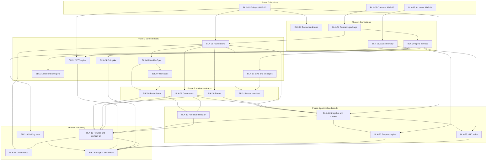

# Blocker Review: Entity IDs, Contract Schemas, Art Plan and Stage 1 Spikes

**Scope:** the three blockers from the [validation report](01-architecture-validation-report.md) (T-01, MS-01, S-02), the contract schemas they depend on, and the five Stage 1 spikes. Reviewed artifacts: GDD, TDD, backlog, planning documents and the generated repository scaffold.

**Outcome:** all three blockers are confirmed. The review also found that the existing TDD contract descriptions contain **14 findings** (§3.2), the first being that **the scaffold's import matrix has no legal home for the contract types** (F-01), and that the Stage 1 spikes lack pass/fail criteria, fallbacks and ordering (§5).

---

## 1. Summary

| # | Blocker | Why it blocks | Risk score (L×I) | Fix in one line | Issues |
|---|---|---|---|---|---|
| **B1** | **T-01 Entity ID layout** | Every ECS, event, command, snapshot and replay structure embeds entity IDs; changing the layout later invalidates stored replays and touches most of EP-2/3/5/6 | **12** | 16-bit index + 16-bit generation, FIFO free list, retire slots on generation exhaustion, commands address pads/slots instead of raw IDs | BLK-01, BLK-02 |
| **B2** | **MS-01 Contract schemas** | `sim`, `meta`, `app`, worker host, renderer and tools cannot be built in parallel without frozen DTOs; the scaffold has nowhere to put them | **20** | New `@gotn/contracts` package; frozen, versioned, validated schemas delivered in slices | BLK-03 … BLK-14 |
| **B3** | **S-02 Art production plan** | Art is the schedule's critical path (≈ 906 artist-days) and has no owner, inventory or pipeline contract | **25** | Assign an owner; produce inventory, style/technical spec, sourcing and staffing plan; define the asset manifest contract | BLK-15 … BLK-19 |
| **S** | **Stage 1 spikes** | They decide ECS, snapshot transport, determinism and render/HUD strategies, but as written they cannot fail cleanly and are mis-ordered | **12** | Add criteria, fallbacks, environment matrix and order; run after B1 and the snapshot contract | BLK-20 … BLK-26 |

---

## 2. Blocker B1: Entity ID Layout (T-01)

### 2.1 What the documents say

TDD §7.1 and backlog task US-2.2.1/1: **32-bit ID = 20-bit index + 12-bit generation**, `isAlive(id)` compares generation, freed indices return to a free list at end of tick, capacity 4,096 live entities.

### 2.2 Explanation of the problem

| Issue | Detail |
|---|---|
| **Generation too narrow** | 12 bits give 4,096 generations per slot. When a slot's generation wraps, an old ID becomes valid again (ABA): a stale reference (a projectile targeting a dead enemy, a taunt `forcedTargetId`, a Soul Binder link, a Leyline link) can silently address a *different* living entity. |
| **Index too wide** | 20 bits (1,048,576 slots) are allocated for a hard cap of 4,096 entities. Capacity is wasted at the expense of generation bits. |
| **Free-list policy unspecified** | A LIFO free list concentrates reuse on a few "hot" slots, so those wrap in far fewer spawns than the average. FIFO spreads reuse across all slots. |
| **IDs leak into every contract** | Events (`source`/`target`), commands, snapshots (`id` columns), the keyframe format, the replay command stream, component fields (`ownerId`, `targetId`, `forcedTargetId`, link tables). |
| **Allocation order is part of determinism** | An entity's ID depends on spawn order; any change to system order or command-buffer order changes IDs. A replay that references raw IDs in its command stream is therefore fragile. |
| **Snapshot ambiguity** | The snapshot header field named `generation` (TDD §6.3) collides conceptually with the entity generation. |
| **Sentinel undefined** | Events use "or `none`"; no null-ID encoding is specified. |

### 2.3 Wrap-time analysis (illustrative)

Assumptions: 4,096 preallocated slots; sustained spawn rate of 10 entities/s (Endless/Boss Rush, including projectiles).

| Layout and policy | Reuses before a slot wraps | Time until the *first* hot slot wraps | Notes |
|---|---|---|---|
| 12-bit gen, **LIFO** free list | 4,096 per slot, concentrated on a small hot set | Minutes to a few hours depending on live count | Unacceptable for Endless |
| 12-bit gen, FIFO | 4,096 per slot, spread across 4,096 slots ⇒ ≈ 16.8 M spawns | ≈ 19 days | Acceptable only by accident |
| **16-bit gen, FIFO** | 65,536 per slot ⇒ ≈ 268 M spawns | ≈ 310 days | Practically unreachable |
| 16-bit gen, FIFO, **retire on exhaustion** | Slot permanently retired at gen 65,535 | Never wraps | Capacity (65,536) ≫ cap (4,096), so retiring a few slots is free |

*Stale references are normally held for seconds, so ABA also requires holding a stale ID across a full wrap; retire-on-exhaustion removes the class of bug entirely.*

### 2.4 Options

| Option | Description | Pros | Cons | Verdict |
|---|---|---|---|---|
| A | Keep 20/12 | No change | ABA risk; wasted index bits | Reject |
| **B** | **16/16 packed in a `Uint32`**, FIFO, retire on exhaustion, sentinel `0xFFFFFFFF` | Fits `Uint32Array` components and snapshot columns; no wrap; simple | Hard cap of 65,536 entities (fine) | **Recommended** |
| C | Index in `Uint32`, generation in a separate `Uint32Array`, IDs as float-safe integers (index + gen × 2^16) up to 2^53 | Huge generation space | IDs no longer fit 32-bit typed columns; snapshot/event payloads double in width; slower comparisons | Reject for hot paths |
| D | Generation-free IDs with explicit despawn tombstones | No generation | Stale-reference checks need extra bookkeeping everywhere | Reject |

### 2.5 Risk Assessment

| Risk | L | I | Score | Detectability | Notes |
|---|---|---|---|---|---|
| R1.1 ABA/wrap bug in long sessions | 2 | 4 | 8 | Hard (non-deterministic appearance, rare) | Eliminated by retire-on-exhaustion |
| R1.2 Layout changed after ECS and snapshot exist | 3 | 4 | **12** | Easy, but costly | Touches every EP-2/3/5/6 task and invalidates all stored replays and suspend records |
| R1.3 Replays coupled to allocation order | 3 | 3 | 9 | Medium | Mitigated by addressing pads/slots in commands |
| R1.4 Snapshot/event column width mismatch | 2 | 3 | 6 | Easy | Fixed by 32-bit unsigned columns |

**Cost of delay:** before any ECS code, a decision is one session; after M0 it is weeks of rework; after public replays/leaderboards exist it is a breaking change.

### 2.6 Recommended Fix

1. **Layout:** `EntityId = (generation << 16) | index`, both 16-bit; stored as `Uint32`.
2. **Null:** `NULL_ENTITY = 0xFFFFFFFF`; index 0 is a valid slot.
3. **Free list:** FIFO ring; indices freed at end of tick (as already specified).
4. **Exhaustion:** when a slot's generation reaches 65,535 it is retired permanently; a dev assertion logs retirements; a battle ending with > 1% retired slots is reported by telemetry/QA.
5. **Cap:** 4,096 live entities remain the gameplay cap; the 65,536 slot space is a safety margin, not a capacity promise.
6. **Commands:** player commands address **pads, hero slots, spell slots and content IDs**, not raw entity IDs. Raw `EntityId` appears only where a command targets a specific entity (e.g., hero skill on a chosen enemy), and the sim validates liveness.
7. **Snapshots/keyframes:** columns are `Uint32`; rename the snapshot header field `generation` to `bufferSerial`.
8. **Determinism invariant:** ID allocation order is part of the simulation contract and covered by golden replays.

### 2.7 Artifacts to Amend (no code)

TDD §7.1, §4.2 (envelope), §6.3 (snapshot header), backlog US-2.2.1/1 and US-2.2.1/ID-related text, ADR-12.

---

## 3. Blocker B2: Contract Schemas (MS-01)

### 3.1 Why It Blocks

`BattleSetup`, `BattleResult`, `ModifierSpec`, `HeroSpec`, commands, events, snapshots, worker messages and the replay file are the **only** way the domain contexts, worker, renderer, tools and server talk. Until frozen and versioned:

- `sim` (consumer) and `meta` (producer of `HeroSpec`/`ModifierSpec`) cannot develop independently.
- The worker host and renderer cannot agree on message and snapshot layouts.
- Replay and save formats cannot be stamped or tested.
- The ECS spike and snapshot-transport spike have no layout to measure.

### 3.2 Review of Existing Contract Descriptions (Ambiguities and Contradictions)

| # | Document | Finding | Impact |
|---|---|---|---|
| F-01 | TDD §1.3 vs §2.1 | **No package can legally hold the shared contract types.** `meta` produces `HeroSpec`/`ModifierSpec`; `sim` consumes them; the import matrix forbids `sim`↔`meta` imports, and `render` may only import `kernel`/`content-schema` yet must read snapshot and event types ("shared protocol typings", TDD §1.3 rule 3). The scaffold's ESLint matrix inherits the gap. | Types would be duplicated or the matrix violated |
| F-02 | TDD §2.4 | `BattleSetup` field is "Meta modifiers"; TDD §8 says `BattleSetup.modifiers`. Loadout says "Tower ids (8–10)" while the MVP uses 4–5 slots. | Naming and hard-coded slot count |
| F-03 | TDD §2.4 / §5.7 | `BattleResult.replay` is a "replay file reference" while the replay embeds a `BattleResult` summary: **circular**. Result `time` does not say ticks vs wall-clock. | Ambiguous ownership; non-deterministic stat |
| F-04 | TDD §5.7 | Replay header duplicates `battleId`, seed, mode, difficulty, which are also in the embedded `BattleSetup`. | Two sources of truth that can disagree |
| F-05 | TDD §3.6 | `Init` carries "registry bundle id" although `BattleSetup` already holds `contentVersion` and `balanceVersion`. | Redundant/conflicting version selectors |
| F-06 | TDD §3.6 vs §3.7 | `Command` payload says "desired tick offset"; §3.7 says `requestedTick`. `CommandResult` has no correlation id. | UI cannot match results to commands |
| F-07 | TDD §3.6 | `Pump` is "max ticks to run": results must not depend on batching; unstated. | Hidden nondeterminism source |
| F-08 | TDD §3.6 | `Checkpoint` hash width/algorithm unspecified; JS numbers cannot hold 64 bits. | Cross-engine and server verification mismatch |
| F-09 | TDD §4.2 | `source`/`target` are "Entity ID or `none`": no null encoding; event payloads are not enumerated beyond the catalog names. | Renderer and telemetry cannot be typed |
| F-10 | TDD §6.3 | Snapshot header `generation` collides with entity generation; snapshot column types, version byte and enum code tables are not defined. | Reader/writer drift |
| F-11 | TDD §2.4 | `seed` type unspecified (JS safe-integer limits; JSON/BigInt). | Seeds corrupt across JSON |
| F-12 | TDD §2.4/§7.15 | `ModifierSpec` has no schema: layer, target stat key, scope (school/tower/hero/global), bucket, source id, duration and condition shape are all undefined. | Core meta-power path is unspecified |
| F-13 | TDD §9 | `HeroSpec` lacks field list; "content hash" is mentioned without algorithm or canonical form. | Reproducibility claim unverifiable |
| F-14 | TDD (global) | No `contractVersion` distinct from `simVersion`; no policy for unknown fields, size limits, numeric ranges, or structured-clone constraints. | Silent incompatibilities |

### 3.3 Scaffold Findings

| # | Finding | Consequence |
|---|---|---|
| F-15 | `@gotn/sim` exports `TICKS_PER_SECOND`; the backlog places tick constants in `kernel` (US-2.1.1). `meta`/`render` cannot import `sim`. | Constant must move (kernel or contracts) |
| F-16 | No runtime-validation library is installed, though the TDD names Zod "or equivalent". | Schema technology undecided |
| F-17 | `content-schema` is defined as definition *types*; contracts are a different concern with a different change cadence. | Mixing concerns blurs versioning |
| F-18 | `docs/adr/` and issue templates (spike, bug, etc.) do not exist yet. | Spike outputs have no destination |
| F-19 | Playwright/browser matrix is not installed and CI has no cross-browser job. | Determinism spike cannot run in CI |

### 3.4 Contract Inventory (Target)

| Contract | Producer → consumer | Transport / format | Validation | Notes |
|---|---|---|---|---|
| `ModifierSpec` | `meta` → `sim` (via `app`) | JSON inside `BattleSetup` | Boundary (dev + load) | Layer, stat key, scope, bucket, source id, optional expiry |
| `HeroSpec`, `SkillSpec` | `meta` HeroCompiler → `sim` | JSON inside `BattleSetup` | Boundary | Includes content hash |
| `BattleSetup` | `app` → `sim`, replay, verifier, bots | JSON / structured clone | Boundary + replay load | Immutable; hashed canonically |
| `Command` + envelope | client → `sim` | Structured clone; compact binary in replay | Hand-written fast validator | `clientSeq`, `executeTick` |
| `CommandResult` | `sim` → client | Structured clone | Types only (trusted) | Echoes `clientSeq`, typed reasons |
| Event envelope and payloads | `sim` → render/UI/telemetry | Batched; typed arrays for hot events | Types only | Versioned `schema` field |
| Snapshot | `sim` → render | Binary SoA (`Uint32`/`Float32`) | Layout table tests | Version byte, `bufferSerial` |
| Worker messages (`Init`, `Ready`, `HudPatch`, `Checkpoint`, `Fault`…) | host ↔ worker | Structured clone | Boundary (dev) | `Ready` carries static map view |
| `BattleResult` | `sim` → `app` → `meta` | JSON | Boundary | No embedded replay; `replayId` + `finalHash` |
| `ReplayFile` v0 | `app`/host → storage, verifier | Binary, deflate | Full validation on load | Header derives from setup (no duplicates) |
| Asset manifest and view mapping | tools → renderer | JSON | Build-time | Art pipeline contract (B3) |

### 3.5 Recommended Fix

**Package and architecture**

1. Create **`@gotn/contracts`**: types, runtime validators and codecs for every contract above. Allowed imports: `kernel`, `content-schema` only. It is **deterministic-safe** (same lint class as `sim`). Importable by `sim`, `meta`, `app`, `sim-host`, `render`, `stores`, `infra`, `testkit`, `tools`.
2. Amend the import matrix (TDD §1.3 and `tooling/eslint/layers.mjs`) accordingly; move `TICKS_PER_SECOND` into `kernel` (or `contracts`) and keep `SIM_VERSION` in `sim`.
3. Rename and fix contradictions F-02 … F-14 in the TDD in one pass (documentation only).

**Conventions**

| Topic | Decision |
|---|---|
| Time | Ticks only (`Tick` = non-negative safe integer); seconds exist only in definitions |
| Seed | 64-bit value encoded as a 16-character hex string; `BattleId` is a separate UUID |
| Hash | 64-bit as 16-hex (two 32-bit lanes); algorithm fixed in `kernel` and part of `contractVersion` |
| Canonical JSON | UTF-8, sorted keys, finite numbers only, no `-0`, no `undefined` (use `null`), arrays ordered; used for setup/hero hashes |
| Enums | String literals in JSON; numeric codes in binary snapshots and replay streams, generated from one enum registry |
| Versions | `contractVersion` (integer, breaking), `simVersion`, `contentVersion`, `balanceVersion`; every top-level contract carries all that apply |
| Unknown fields | Rejected in setup, commands and protocol messages; preserved only in saves |
| Structured-clone safety | Plain data only: no classes, functions, `Map`/`Set`, `BigInt`, `undefined` |
| Size limits | Setup ≤ 64 KB; command payload ≤ 1 KB; event batch capped per frame; replay ≤ 1 MB |
| Correlation | Every command carries `clientSeq`; results echo it |
| Result vs replay | `BattleResult` holds `replayId` and `finalHash`; `ReplayFile` embeds a result summary but no result→replay reference |
| Redundancy | Replay header is **derived** from the embedded setup; no duplicate fields |
| Entity references | Commands address pads, slots and content IDs; `EntityId` only for explicit entity targets |

**Validation technology (ADR-13):** schema-first validators for cold contracts (`BattleSetup`, `HeroSpec`, `ModifierSpec`, `BattleResult`, `ReplayFile` header); **hand-written typed codecs** for hot paths (commands, event batches, snapshots). Candidate libraries (Zod 4 vs Valibot vs hand-rolled) are chosen by worker bundle size, parse cost and TypeScript inference in a short benchmark inside BLK-03.

**Delivery:** freeze in slices (§7): foundations → `ModifierSpec` → `HeroSpec` → `BattleSetup` → commands → events → snapshot/protocol → result/replay → fixtures and compatibility CI. Freeze at "v0.1" for M0; allow additive changes only until Alpha via `contractVersion` bumps.

### 3.6 Risk Assessment

| Risk | L | I | Score | Mitigation |
|---|---|---|---|---|
| R2.1 Parallel streams diverge without frozen contracts | 5 | 4 | **20** | Contracts package + freeze before parallel work |
| R2.2 Replay/save incompatibility from late DTO changes | 4 | 4 | 16 | `contractVersion`, golden fixtures, compatibility CI |
| R2.3 Canonical hash mismatch across engines/servers | 3 | 5 | 15 | Canonical JSON rules; cross-engine fixtures; hash lanes |
| R2.4 Renderer coupled to sim internals | 3 | 3 | 9 | Contracts-only imports |
| R2.5 Validation cost at worker boundary | 2 | 3 | 6 | Fast codecs for hot paths; validators for cold contracts only |
| R2.6 Schema library lock-in | 2 | 3 | 6 | Thin adapter, schemas generated from types where possible |

### 3.7 Open Decisions (resolved in BLK-03)

Hash algorithm (xxhash32-style lanes vs FNV-1a lanes), seed expansion algorithm, schema library, binary replay encoding (custom varint vs MessagePack-like), enum registry source of truth.

---

## 4. Blocker B3: Art Production Plan (S-02)

### 4.1 Explanation

The backlog contains only **integration** tasks for art (EP-18, 37 tasks). There is no asset inventory, budget, style specification, sourcing decision or owner. The heuristic demand is **≈ 906 artist-days (≈ 182 artist-weeks)** for 120 enemies, ~90 tower visuals, 15 heroes, 20 bosses, 8 biomes, UI, VFX and comics; two artists cover ~110 artist-weeks of the planned schedule, leaving a **~42 artist-week shortfall** in Beta and Release (production plan §6).

### 4.2 Risk Assessment

| Risk | L | I | Score | Mitigation |
|---|---|---|---|---|
| R3.1 Art becomes the critical path; schedule slips 8–20 weeks | 5 | 5 | **25** | Front-load, contractor from Beta, reuse rules |
| R3.2 Style drift and rework without a style/technical spec | 4 | 3 | 12 | Style guide and technical art spec before production |
| R3.3 Art pipeline does not match `ViewDefinition`/atlas contract | 3 | 3 | 9 | Manifest contract owned jointly with engineering (BLK-18) |
| R3.4 Key-person dependency on one art lead | 3 | 4 | 12 | Documented specs, second artist, contractor onboarding pack |
| R3.5 Over-scoped asset list (variants not budgeted) | 4 | 3 | 12 | Per-asset budgets and reuse quotas (palette swaps, shared rigs) |

### 4.3 Recommended Fix (Deliverables)

1. **Owner:** a named art lead accountable for the plan and pipeline; sourcing model chosen (in-house, contractors, asset packs) and recorded in ADR-14.
2. **Asset inventory and budget model:** per Act, every asset class with count, complexity tier and artist-days (tower modules, enemies, bosses, heroes, tilesets, props, UI, VFX, comics), with explicit reuse quotas.
3. **Style guide and technical art spec:** silhouette, palette per faction, tile and sprite sizes, animation frame budgets, atlas rules, naming, texture formats, modular tower construction.
4. **Pipeline contract:** asset manifest and `ViewDefinition` mapping so programmer art swaps for final art with no code changes (depends on contract foundations).
5. **Staffing and capacity plan:** artists, contractors, composer and SFX, aligned to the production plan and re-forecast at each gate.

---

## 5. Stage 1 Spikes Review

### 5.1 General Findings

| # | Finding | Fix |
|---|---|---|
| SP-1 | No pass/fail thresholds or fallbacks in the backlog (goals only) | Per-spike criteria and decisions (§5.2) |
| SP-2 | No environment matrix (browsers, hardware, OS) | Matrix: Chromium, Firefox, WebKit via Playwright; real Safari check on macOS; Node (V8); x64 and arm64; integrated GPU for rendering |
| SP-3 | ECS spike precedes the ID layout and snapshot layout it must measure | Order: B1 → ECS spike; contracts (snapshot) → transport spike |
| SP-4 | Spike code may become throwaway or leak into production | Spikes live in an excluded workspace area; reusable harness parts are promoted by explicit tasks (determinism harness → `testkit` golden replays; stress scene → perf CI) |
| SP-5 | ADR numbering collides with new blocker decisions | Renumber: ADR-12 entity ID, ADR-13 contracts, ADR-14 art strategy, ADR-15 determinism, ADR-16 ECS, ADR-17 snapshot transport, ADR-18 Pixi, ADR-19 HUD |
| SP-6 | WebKit on Linux (Playwright) is not identical to Safari | Keep a manual Safari run as part of the determinism and Pixi spikes |
| SP-7 | The scaffold's Pixi stage and React providers have not been run in a browser | Validate in the Pixi spike, including React StrictMode double-mount |
| SP-8 | No timebox | Bound each spike in sessions (see issues); a spike that exceeds it escalates |

### 5.2 Spike Definitions

| Spike | Question | Method | Pass criteria | If it fails → fallback | Depends on | Output |
|---|---|---|---|---|---|---|
| **S1 Determinism** | Does a Float64 sim with restricted math produce identical hashes everywhere? | Synthetic sim (600 entities, PRNG streams, allowed ops only, state hash every 300 ticks), 10-minute runs; Node, worker, Chromium, Firefox, WebKit, x64 and arm64; cold and warm JIT; also record which banned functions (`pow`, `sin`, `exp`…) differ between engines to justify the lint rules | Identical 64-bit hashes across all engines and thread contexts | Fixed-point HP/positions (integer math) or lockstep-free fallback; document divergent functions | Harness (BLK-20) | ADR-15; reusable golden-replay harness |
| **S2 ECS** | Custom SoA ECS or a library? | Same workload (600 enemies, 120 projectiles, 40 towers, statuses, 30 Hz) on both; measure tick time, GC, iteration order, serialization, ID layout compatibility | Custom: ≤ 4 ms/tick p95. Library: only if deterministic iteration, serializable, 16/16 IDs, small bundle | Library adoption with an adapter, or reduce component object usage | B1 decision, harness | ADR-16 |
| **S3 Snapshot transport** | Transferable triple buffer or SharedArrayBuffer? | 1,200 entities at 30 Hz; measure latency, jitter, main-thread cost, allocations; assess COOP/COEP impacts (OAuth popups, embeds, Steam wrapper) | End-to-end latency ≤ 1 tick; ≤ 0.5 ms/frame main thread; zero per-frame allocations | Default to transferable buffers (no cross-origin isolation) | Snapshot layout (BLK-11), B1 | ADR-17 |
| **S4 Pixi** | Can Pixi sustain 1,200 animated sprites + 200 projectiles on integrated GPUs? | Atlas-batched scene, bitmap text, pooled graphics; also validate scaffold `createStage` with StrictMode | ≥ 60 FPS (p95 ≤ 20 ms), ≤ 200 draw calls, stable memory | Swarm LOD, instancing, simpler effects; quality tier defaults | Harness | ADR-18 |
| **S5 HUD updates** | Does React 19 + Zustand 5 handle 10 Hz HUD patches cheaply? | ~60 subscribed components, selector discipline, patch with partial changes | ≤ 2 ms commit per update; unchanged selectors do not re-render | Transient subscriptions for hot widgets; throttle to 5 Hz | Harness, `HudPatch` shape | ADR-19 |

---

## 6. Consolidated Risk Register

| ID | Risk | L | I | Score | Owner |
|---|---|---|---|---|---|
| R3.1 | Art critical path | 5 | 5 | 25 | Art lead / Director |
| R2.1 | Streams diverge without contracts | 5 | 4 | 20 | Lead architect |
| R2.2 | Replay/save incompatibility | 4 | 4 | 16 | Lead architect |
| R2.3 | Canonical hash mismatch | 3 | 5 | 15 | Sim engineer |
| R1.2 | ID layout changed late | 3 | 4 | 12 | Sim engineer |
| R4.1 | Spikes unbounded or become throwaway | 4 | 3 | 12 | EM |
| R3.2 / R3.4 / R3.5 | Style drift, key person, asset volume | 4/3/4 | 3/4/3 | 12 | Art lead |
| R1.3 | Replays coupled to allocation order | 3 | 3 | 9 | Sim engineer |
| R4.2 | Chromium-only pass hides WebKit failure | 2 | 4 | 8 | QA / Sim engineer |
| R1.1 | ABA wrap bug | 2 | 4 | 8 | Sim engineer |

## 7. Implementation Order

### 7.1 Dependency Graph

### 7.2 Ordered Plan

| Order | Step | Issues | Notes |
|---|---|---|---|
| 1 | **Decide** ID layout, contracts package and art ownership in parallel | BLK-01, BLK-03, BLK-15 | Three independent decisions; each ends in an ADR |
| 2 | **Align documents and scaffold** | BLK-02, BLK-04 | Amend TDD/backlog; add `@gotn/contracts` and amend the lint matrix |
| 3 | **Stand up the spike harness** (parallel with 2) | BLK-20 | Browser matrix, results template, ADR folder |
| 4 | **Contract foundations** | BLK-05 | Primitives, versions, canonical serialization, hash/seed rules |
| 5 | **Independent spikes start** | BLK-21 determinism, BLK-24 Pixi | Do not depend on contracts beyond foundations |
| 6 | **Meta-power contracts** | BLK-06 → BLK-07 | `ModifierSpec` first, then `HeroSpec` |
| 7 | **ECS spike** | BLK-22 | Requires the ID decision and harness |
| 8 | **Runtime contracts** | BLK-08, BLK-09, BLK-10 (parallel) | Setup, commands, events |
| 9 | **Art contracts** (parallel) | BLK-16, BLK-17, BLK-18 | Inventory → spec → manifest |
| 10 | **Protocol and results** | BLK-11, BLK-12 | Snapshot layout and worker messages; result and replay |
| 11 | **Transport and HUD spikes** | BLK-23, BLK-25 | Need the snapshot/HUD contract shapes |
| 12 | **Freeze and verify** | BLK-13, BLK-14 | Golden fixtures, compatibility CI, governance |
| 13 | **Staffing plan** | BLK-19 | Needs the inventory |
| 14 | **Stage 1 exit review** | BLK-26 | Executes spike fallbacks, updates TDD, records ADRs |

### 7.3 Exit Criteria for This Work Package

- [ ] ADR-12 … ADR-19 recorded (entity ID, contracts, art strategy, five spikes).
- [ ] `@gotn/contracts` v0.1 frozen with fixtures and compatibility CI green.
- [ ] TDD §1.3, §2.4, §3.6, §4.2, §5.7, §6.3, §7.1 amended; backlog task text updated; ADR numbering corrected.
- [ ] Art plan approved with a named owner.
- [ ] All five spikes concluded with documented decisions and any fallbacks queued in the backlog.
- [ ] Stage 2 (deterministic core) may start.

## 8. Required Amendments to Existing Artifacts (to be done in the issues, not here)

| Artifact | Amendment |
|---|---|
| TDD §1.1/§1.3 | Add `contracts` package and import matrix row/column |
| TDD §2.4 | Fix F-02 … F-05 (naming, slot count, result/replay circularity, duplicated header fields) |
| TDD §3.6/§3.7 | Fix F-05 … F-08 (Init, correlation id, pump independence, hash width) |
| TDD §4.2 | Null entity encoding and event payload schema ownership |
| TDD §5.7 | Derive replay header from setup; define replay file v0 |
| TDD §6.3 | Rename snapshot `generation`; define column types, version byte, enum tables |
| TDD §7.1 | 16/16 layout, FIFO, retire-on-exhaustion, sentinel, command addressing |
| TDD §9 | `HeroSpec` fields and content-hash definition |
| Backlog US-2.2.1, US-1.3.1, US-2.4.x | ID layout text; spike criteria; ADR numbering; contracts story ordering |
| `tooling/eslint/layers.mjs`, `docs/adr/`, issue templates | Contracts package rules; ADR folder; spike template |
