# First Playable Build: Implementation Plan

Architecture work is paused. This plan covers only the smallest playable version of Guardians of the Nexus, built on the existing repository scaffold.

**Scope (fixed):** 1 map · 1 biome · 3 towers · 5 enemy types · 1 boss · wave system · gold economy · tower placement · victory/defeat screen · save/load.

**Playable in one sentence:** defend the Nexus on one forest map by placing and upgrading three kinds of towers against 15 waves of five enemy types, finish by defeating the boss Sporemother Myra, see a victory or defeat screen, and continue after closing the tab.

---

## 1. Ground Rules

| # | Rule | Why |
|---|---|---|
| 1 | **Smallest thing that works**: plain TypeScript objects and arrays, no ECS, no worker, no schema library, no contracts package | The first playable proves the game is fun, not the architecture |
| 2 | **Keep three cheap habits** so nothing is thrown away: (a) the simulation is pure TypeScript with a fixed 30 Hz step and a seeded RNG, (b) all player actions are plain command objects, (c) content is data, not code branches | These make replays, tests, a worker and more content possible later without rewrites |
| 3 | **Simulation never touches rendering or the DOM** | Keeps it testable headlessly |
| 4 | **Headless first**: the whole game must be winnable by a scripted test before it is drawn | Fast tuning and no rendering bugs hiding logic bugs |
| 5 | **Respect the existing lint rules**: no `Date`, `Math.random`, `Math.pow`, `**`, or unsorted `.sort()` in `sim` and `content-core` | Already enforced in the scaffold |
| 6 | **Programmer art only** (shapes and colours) | Art is not part of the first playable |
| 7 | **No new packages**: use `sim`, `content-schema`, `content-core`, `app`, `infra`, `render`, `stores`, `ui`, `apps/web` as they are | Avoids further structure work |

## 2. Target Experience

A 10–15 minute run on **Greenwood Gate**:

1. Main menu: **New Game** (and **Continue** when a checkpoint exists).
2. Battle starts with 250 gold and 20 Nexus lives. The player places towers on 12 pads, reads the next wave preview, and starts each wave (or calls it early for bonus gold).
3. Waves 1–14 introduce enemies one at a time and ask for different towers (armor, flyers, healers, an elite).
4. Wave 15 is the boss: Sporemother Myra spawns pods that hatch into Thornlings unless destroyed.
5. Victory or defeat screen with stats, **Retry** and **Back to menu**.
6. The game saves a checkpoint at every wave break; closing the tab and returning offers **Continue**.

## 3. Content Specification

All numbers are starting values to be tuned in Slice 9.

### 3.1 Map: Greenwood Gate (Forest biome)

| Item | Value |
|---|---|
| Biome | Forest: green ground, brown path, dark tree-line props drawn as shapes |
| Path | One lane, ~40 tiles, 5 corners |
| Pads | 12 small pads placed along the path, 2–3 near corners |
| Nexus | Glowing marker at the path end |
| Spawn | Path start; flyers spawn there and fly straight to the Nexus |
| Starting gold / lives | 250 / 20 |

### 3.2 Towers (3), Tier I and Tier II

| Tower | Cost | Upgrade | Damage (I → II) | Attack speed | Range | Type | Special |
|---|---|---|---|---|---|---|---|
| **Arcane Tower** | 100 | 80 | 18 → 27 | 1.2/s | 5.0 | Arcane | Homing bolt; hits ground and air; ignores armor |
| **Ballista Post** | 130 | 105 | 55 → 82 | 0.6/s | 7.5 | Physical | Pierces up to 3 enemies; reduced by armor; hits ground and air |
| **Frost Spire** | 120 | 95 | 10 → 15 | 1.0/s | 5.0 | Frost | Slows target: 30% → 40% for 2 s; hits ground and air |

Rules: sell refund 70% of total spent; targeting is "furthest along the path"; towers cannot be moved.

### 3.3 Enemies (5)

| Enemy | HP | Speed (tiles/s) | Armor | Threat (lives) | Bounty | Behavior | Purpose |
|---|---|---|---|---|---|---|---|
| **Thornling Scout** | 80 | 1.6 | 0 | 1 | 8 | Fast and fragile | Teaches range and burst |
| **Bark Guard** | 220 | 0.8 | 20 | 1 | 20 | Armor reduces Physical damage | Teaches Arcane vs Ballista |
| **Druid Warden** | 160 | 0.9 | 0 | 2 | 18 | Heals allies within 2.5 tiles for 4% of their max HP per second | Teaches priority targets |
| **Mossback Brute** | 650 | 0.7 | 10 | 3 | 55 | Regenerates 3% max HP per second if undamaged for 3 s | Elite; teaches sustained damage and slow |
| **Pollen Wisp** | 100 | 1.4 | 0 | 2 | 12 | Flies straight from spawn to Nexus | Teaches anti-air coverage |

HP scaling per wave: `hp × (1 + 0.12 × (wave − 1))` (linear, no powers).

### 3.4 Boss: Sporemother Myra (wave 15)

| Item | Value |
|---|---|
| HP / speed / threat | 6,000 / 0.5 tiles/s / 20 (leaking her is an instant defeat) |
| Armor | 10 |
| Rules | Slow effects capped at 40%; shows a boss health bar |
| Phase 1 | Every 15 s spawns a **Spore Pod** beside the path. A pod has 150 HP and a visible 8 s timer; if it survives it hatches 3 Thornlings, otherwise it dies harmlessly |
| Phase 2 (below 50% HP) | Speed 0.65; a pod every 10 s |
| Escort | 6 Thornlings with her |
| Reward | Victory |

Pods count as part of the boss encounter (not an enemy type) and give no gold.

### 3.5 Waves (15)

| Wave | Composition | New element |
|---|---|---|
| 1 | 6 Thornling | – |
| 2 | 8 Thornling | – |
| 3 | 4 Thornling, 4 Bark Guard | Armor |
| 4 | 4 Pollen Wisp | Flyers |
| 5 | 5 Bark Guard, 4 Pollen Wisp | – |
| 6 | 6 Thornling, 3 Bark Guard, 1 Druid Warden | Healer |
| 7 | 10 Thornling, 3 Pollen Wisp | – |
| 8 | 6 Bark Guard, 1 Druid Warden, 4 Pollen Wisp | – |
| 9 | 6 Thornling, 1 Mossback Brute | Elite |
| 10 | 8 Bark Guard, 2 Druid Warden | – |
| 11 | 6 Thornling, 6 Pollen Wisp, 1 Mossback Brute | – |
| 12 | 6 Bark Guard, 1 Druid Warden, 2 Mossback Brute | – |
| 13 | 14 Thornling, 8 Pollen Wisp | – |
| 14 | 8 Bark Guard, 2 Druid Warden, 4 Pollen Wisp, 2 Mossback Brute | – |
| 15 | Boss Myra + 6 Thornling | Boss |

Spawn spacing: 0.8 s between enemies of a group; wave preview shows the next wave's composition.

### 3.5.1 Economy

| Item | Value |
|---|---|
| Starting gold | 250 |
| Kill bounty | per enemy table; no scaling |
| Wave bonus | `20 + 2 × wave` when a wave is cleared |
| Early call bonus | `min(30, round(1.5 × seconds remaining in the break))` when starting the next wave early |
| Sell refund | 70% of total gold spent on the tower |
| Break between waves | 20 s, auto-starting; the player may start early |
| Sinks | Placing towers, upgrading, nothing else |

## 4. Technical Approach

### 4.1 Where the Code Goes

| Package | Responsibility in the first playable |
|---|---|
| `content-schema` | TypeScript interfaces for tower, enemy, boss, map and wave definitions (types only) |
| `content-core` | The data for Greenwood Gate, 3 towers, 5 enemies, the boss and 15 waves |
| `sim` | Battle state and rules: step loop, path movement, waves, towers, projectiles, damage, slow, boss, commands, events, state hash, checkpoint capture/restore |
| `app` | `BattleSession` (fixed-step accumulator, speed and pause, command entry, event drain), save/load use cases, save document types |
| `infra` | `LocalStorageSaveStore` adapter (the in-memory store stays for tests) |
| `render` | Pixi scene that draws a plain `RenderState` (towers, enemies, projectiles, pods, pads, path) |
| `stores` | `battleView` store (gold, lives, wave, status, selection, speed) next to the existing `appFlow` and `settings` stores |
| `apps/web` | Composition root, rAF driver, input handling, HUD and screens |

### 4.2 Wiring Decisions That Avoid Friction With the Current Lint Rules

| Situation | Decision |
|---|---|
| `app` and `sim` may not import `content-core` | The composition root in `apps/web` imports the content and passes it into `BattleSession`/`createBattle` |
| `render` may not import `sim` | `render` declares the minimal read-only shape it draws; the sim state satisfies it structurally, so the web layer passes it directly |
| `stores` may not import `sim` | Store types come from `app` (the `BattleSession` view model) |
| HUD components need `ui`, `stores` and `app` | Build them in `apps/web/src/features` (web may import everything) |

### 4.3 Simulation Design (Lean)

| Concept | Approach |
|---|---|
| Step | Fixed 30 Hz; `step()` advances one tick; game speed 1× or 2× means more steps per frame |
| State | One plain object: tick, status, gold, lives, wave index and phase, towers, enemies, projectiles, pods, events, RNG state |
| IDs | Incrementing integers per battle |
| Randomness | Seeded RNG for the few random choices (e.g., pod position jitter); no `Math.random` |
| Path | Polyline with cumulative length; enemy stores distance `s`; position computed from `s`; flyers use a straight line |
| Commands | `PlaceTower`, `UpgradeTower`, `SellTower`, `StartWave` plain objects applied at the start of the next tick; each returns accepted or a typed rejection reason |
| Events | Per-tick array of simple events (`EnemyKilled`, `EnemyLeaked`, `TowerPlaced`, `WaveStarted`, `WaveCleared`, `BossPhase`, `Victory`, `Defeat`) drained by the session for UI, audio and stats |
| Determinism check | Same seed + same commands ⇒ same state hash (a test) |
| Result | `BattleResult`: outcome, waves cleared, kills, gold earned, lives left, ticks; used by the results screen and profile |

### 4.4 Rendering Design (Lean)

- One Pixi `Application` in the existing `createStage`; layers: ground, path and pads, towers, enemies and pods, projectiles, overlays (range ring, placement ghost, boss/pod timers).
- Shapes only: towers are coloured polygons by type, enemies are coloured circles by type with a ring for armor and a triangle for flyers, health bars as thin rectangles.
- Redraw from the latest sim state every frame; simple interpolation of positions using previous-tick values for smooth motion.
- Input: pointer position → tile → nearest pad; click selects a pad or tower; build mode places the chosen tower.

### 4.5 Save/Load Design

| Item | Decision |
|---|---|
| Storage | `localStorage` through the existing `SaveStore` port (`LocalStorageSaveStore`); IndexedDB later if needed |
| Document | One JSON envelope: `schemaVersion: 1`, `savedAt`, `profile`, `checkpoint` |
| Profile | `runs`, `clears`, `bestLivesLeft`, `bestTicks` |
| Checkpoint | Written at **every wave break**: map id, wave index, gold, lives, towers (pad, type, tier, gold spent), RNG state, tick count. Cleared on victory or defeat |
| Resume | `Continue` rebuilds the battle at the wave break and verifies a hash round-trip in tests |
| Safety | Validate on load; unknown or corrupt data is moved to a `…corrupt` key and ignored; version mismatch starts a new profile; write failures are shown as a small warning and never crash the game |
| Triggers | Wave break reached, results shown, and tab hidden (only if at a wave break) |

## 5. Work Breakdown

Size: **S** = one session, **M** = 2–3 sessions (split on pull). IDs are `FP-nn`.

### Slice 1: Headless Core (sim, content-core)

- [ ] **FP-01 (S)** Verify the scaffold end to end: `pnpm check` passes; `/play` shows the Pixi stage in a browser; note any issues. *Done when:* baseline is green and recorded.
- [ ] **FP-02 (S)** Seeded RNG and state-hash helper in `sim` with tests. *Done when:* same seed gives the same sequence and hash; different seeds differ.
- [ ] **FP-03 (S)** Definition types in `content-schema` (tower, enemy, boss, map, wave). *Done when:* types compile and are used by content.
- [ ] **FP-04 (S)** Map data and path model: Greenwood Gate polyline, pads, `positionAt(s)`, path length. *Done when:* tests cover positions at 0, mid, end.
- [ ] **FP-05 (S)** Battle shell: state shape, `createBattle(content, seed)`, `step()`, tick counter, status, command queue. *Done when:* stepping an empty battle is stable.
- [ ] **FP-06 (S)** Enemy spawn and ground movement along the path; leak removes lives. *Done when:* a Thornling reaches the Nexus and costs 1 life.
- [ ] **FP-07 (S)** Flying movement (straight line spawn to Nexus). *Done when:* a Wisp reaches the Nexus in the expected time.
- [ ] **FP-08 (M)** Wave runner: wave table, spawn schedule, break timer, start-next and early-call commands, wave bonus, wave cleared detection. *Done when:* waves 1–2 run to completion headlessly with correct gold.
- [ ] **FP-09 (S)** Win/lose rules and `BattleResult`. *Done when:* lives ≤ 0 gives defeat; clearing wave 15 gives victory.
- [ ] **FP-10 (S)** Determinism test with scripted commands. *Done when:* two runs produce identical hashes.

### Slice 2: Towers and Combat (sim)

- [ ] **FP-11 (S)** Tower data in `content-core` and tower state in sim. *Done when:* three definitions load.
- [ ] **FP-12 (S)** Place and sell commands with typed rejections (no gold, pad occupied, unknown pad). *Done when:* tests cover all rejections and refunds.
- [ ] **FP-13 (S)** Targeting and range tests ("furthest along path"). *Done when:* tower picks the leading enemy in range.
- [ ] **FP-14 (M)** Projectiles: travel, homing, hit, retarget or fizzle on target death, pierce for Ballista. *Done when:* tests for homing, pierce and fizzle pass.
- [ ] **FP-15 (S)** Damage rules: Physical reduced by armor with a floor of 10%, Arcane and Frost ignore armor. *Done when:* numeric tests match the examples in this plan (Ballista vs Bark Guard).
- [ ] **FP-16 (S)** Frost slow with duration and refresh; boss slow cap. *Done when:* movement speed multiplier applies and expires correctly.
- [ ] **FP-17 (S)** Upgrade command (Tier II). *Done when:* cost, stats and refund update correctly.

### Slice 3: Content and Headless Playthrough

- [ ] **FP-18 (S)** Five enemy definitions and HP scaling. *Done when:* spawned HP matches the formula.
- [ ] **FP-19 (S)** Regeneration (Brute) and heal aura (Warden). *Done when:* tests show regen only when undamaged and heal over time near allies.
- [ ] **FP-20 (S)** Wave table for waves 1–14 plus wave 15 placeholder. *Done when:* all waves are data-driven and previewable.
- [ ] **FP-21 (M)** Scripted auto-player test: a fixed build order beats waves 1–14; an empty build loses. *Done when:* both tests pass and the script is reused for tuning.

### Slice 4: Rendering (render, apps/web)

- [ ] **FP-22 (S)** Scene bootstrap: layers, tile-to-pixel transform, fit-to-container. *Done when:* resizing keeps the map centered.
- [ ] **FP-23 (S)** Draw the static map: ground, path, pads, Nexus marker. *Done when:* it matches the map data.
- [ ] **FP-24 (M)** Draw towers, enemies, health bars from sim state. *Done when:* a headless-run battle looks correct frame by frame.
- [ ] **FP-25 (S)** Projectiles, slow tint, range ring and placement ghost. *Done when:* hovering a pad shows validity and range.
- [ ] **FP-26 (S)** Game loop driver: rAF accumulator, fixed steps, 1×/2×/pause, interpolation. *Done when:* motion is smooth and speed changes work.
- [ ] **FP-27 (S)** Input: pad picking, hover, selection, build mode. *Done when:* clicks place towers through commands.

### Slice 5: HUD (apps/web, stores)

- [ ] **FP-28 (S)** `battleView` store fed by the session at most 10 times per second or on events. *Done when:* HUD values update without re-render storms.
- [ ] **FP-29 (S)** Top bar and wave panel: gold, lives, wave, countdown, next-wave preview, Start/Early-call. *Done when:* a full wave can be started and cleared from the UI.
- [ ] **FP-30 (S)** Build menu with three tower cards and disabled states. *Done when:* unaffordable towers are disabled with a reason.
- [ ] **FP-31 (S)** Tower panel: stats, upgrade, sell. *Done when:* both actions work with confirmation of refund.
- [ ] **FP-32 (S)** Speed and pause controls plus hotkeys (1–3 select tower, Space pause, U upgrade, S sell). *Done when:* hotkeys work and are shown in tooltips.

### Slice 6: Screens and Flow

- [ ] **FP-33 (S)** Flow wiring: main menu → battle → results using the existing `appFlow` store. *Done when:* a full loop menu → win/lose → menu works.
- [ ] **FP-34 (S)** Main menu: New Game, Continue (disabled without checkpoint), best result. *Done when:* buttons reflect save state.
- [ ] **FP-35 (S)** Results screen: Victory/Defeat banner, waves cleared, kills, gold earned, lives left, time, Retry, Back to menu. *Done when:* both outcomes display correctly.
- [ ] **FP-36 (S)** Pause menu: Resume, Restart, Quit to menu (checkpoint preserved). *Done when:* restart creates a fresh battle.

### Slice 7: Save/Load

- [ ] **FP-37 (S)** Save document types, validation and version handling in `app`. *Done when:* tests cover valid, invalid and unknown-version documents.
- [ ] **FP-38 (S)** `LocalStorageSaveStore` in `infra` with quota handling and corrupt-data quarantine. *Done when:* tests with a fake storage pass.
- [ ] **FP-39 (S)** Profile persistence: record each finished battle. *Done when:* runs, clears and bests persist across reloads.
- [ ] **FP-40 (M)** Checkpoint capture/restore in `sim`. *Done when:* a restored battle equals the original by hash and continues identically.
- [ ] **FP-41 (S)** Autosave triggers and Continue flow. *Done when:* closing and reopening the tab at a wave break offers Continue and resumes correctly.
- [ ] **FP-42 (S)** Save/load tests: round trip, corruption, version mismatch, and "resumed run equals uninterrupted run". *Done when:* all pass.

### Slice 8: Boss

- [ ] **FP-43 (S)** Myra definition, wave 15 script and boss health bar with intro banner. *Done when:* she spawns with escorts and the bar tracks HP.
- [ ] **FP-44 (M)** Spore Pods: stationary targetable entities with an 8 s timer; hatch into 3 Thornlings if not destroyed; visible countdown ring. *Done when:* tests cover destroy-before-hatch and hatch.
- [ ] **FP-45 (S)** Phase 2 below 50% HP: speed and pod cadence change with a visual cue. *Done when:* a test crosses the threshold and applies changes once.
- [ ] **FP-46 (S)** Boss rules: slow cap 40%, leak equals defeat, kill equals victory. *Done when:* both outcomes work end to end.

### Slice 9: Polish, Tuning and Release

- [ ] **FP-47 (M)** Balance passes using the auto-player and manual runs; record changes in a short tuning log. *Done when:* the planned build wins with a margin and a weak build loses.
- [ ] **FP-48 (S)** Four audio cues (place, hit, leak, win/lose) with a mute toggle. *Done when:* cues play without blocking input. *(P2)*
- [ ] **FP-49 (S)** Feedback polish: hit flashes, floating damage numbers, wave banners. *Done when:* combat is readable at 2× speed. *(P2)*
- [ ] **FP-50 (S)** Error boundary and fault screen with "copy debug info" (seed and commands). *Done when:* a forced error shows the screen instead of a blank page.
- [ ] **FP-51 (S)** Build, preview deployment and README play instructions. *Done when:* a public preview URL runs the game.
- [ ] **FP-52 (S)** Playtest protocol: 5 testers, short survey, bug triage list. *Done when:* results are recorded.
- [ ] **FP-53 (S)** Fix pass and tag `v0.1.0-first-playable`. *Done when:* the definition of done in §8 is met.

**Totals:** 53 tasks, 7 of them M (about 60–65 sessions overall).

## 6. Sequence and Milestones

```mermaid
flowchart LR
    S1[Slice 1 Headless core] --> S2[Slice 2 Towers and combat]
    S2 --> S3[Slice 3 Content and playthrough test]
    S3 --> A{{Milestone A Headless game winnable}}
    A --> S4[Slice 4 Rendering]
    S4 --> S5[Slice 5 HUD]
    S5 --> B{{Milestone B Visible and playable waves 1-14}}
    B --> S6[Slice 6 Screens and flow]
    S6 --> S8[Slice 8 Boss]
    S6 --> S7[Slice 7 Save and load]
    S8 --> C{{Milestone C Complete loop}}
    S7 --> C
    C --> S9[Slice 9 Polish, tuning, release]
    S9 --> D{{Milestone D First playable}}
```

| Milestone | Definition | Demo |
|---|---|---|
| **A: Headless game** | Scripted test beats waves 1–14; empty build loses; determinism test green | Test output |
| **B: Visible slice** | Place, upgrade, sell towers and play waves 1–14 in the browser | Screen recording |
| **C: Complete loop** | Menu, boss, victory/defeat, save/load all work | Playable build |
| **D: First playable** | Tuned, polished, deployed, playtested | Public preview URL |

Slices 7 and 8 are independent and may be done in either order or in parallel.

### First Tasks to Start

1. FP-01 (baseline verification).
2. FP-02 and FP-03 in parallel (RNG/hash, definition types).
3. FP-04 (map and path) as soon as FP-03 lands.
4. FP-05 → FP-06 → FP-08 on the critical path.

## 7. Verification Plan

| Level | What | Where |
|---|---|---|
| Unit | RNG, path positions, damage and armor, slow, regen, heal aura, wave bonus, sell refund | `sim` tests |
| Scenario | Scripted auto-player wins/loses; boss pod hatch/destroy; phase 2 trigger | `sim` tests |
| Determinism | Same seed and commands give the same hash; resumed checkpoint equals uninterrupted run | `sim` and `app` tests |
| Save | Round trip, corrupt data, wrong version, quota error | `app` and `infra` tests |
| Manual | Full run on desktop Chrome, Firefox and Safari; 2× speed; reload at a wave break | Playtest checklist |
| CI | `pnpm check` and `pnpm build` on every PR (already configured) | GitHub Actions |

## 8. Definition of Done: First Playable

| Requirement | Done when |
|---|---|
| 1 map | Greenwood Gate is selectable and playable start to finish |
| 1 biome | Forest visuals are used; no other biome exists |
| 3 towers | Arcane Tower, Ballista Post, Frost Spire can be placed, upgraded once and sold |
| 5 enemy types | Thornling Scout, Bark Guard, Druid Warden, Mossback Brute, Pollen Wisp appear in waves with their behaviors |
| 1 boss | Sporemother Myra with pods and a phase change can be defeated |
| Wave system | 15 waves with preview, break timer, start-early bonus and wave bonus |
| Gold economy | Gold from kills and waves, spent on towers and upgrades, refunded on sale |
| Tower placement | Click a pad, choose a tower; invalid actions explain why |
| Victory/defeat screen | Both outcomes show stats with Retry and Back to menu |
| Save/load | Profile persists; checkpoint at each wave break; Continue resumes identically; corrupt data never crashes |
| Quality | `pnpm check` and `pnpm build` green; no console errors in a full run; 60 FPS on a mid-range laptop |
| Playtest | 5 testers: at least 4 finish a run, at least 3 would play again, no data-loss bug |

## 9. Risks and Mitigations

| Risk | Likelihood | Mitigation |
|---|---|---|
| Balance is off (too easy or impossible) | High | Auto-player test from Slice 3; tuning slice; numbers kept in data |
| Boss pods feel confusing | Medium | Visible countdown ring, text hint on first appearance, tuning pass |
| Projectile edge cases (target dies, pierce counting) | Medium | Dedicated tests in FP-14 |
| Checkpoint restore drifts from a live run | Medium | Hash round-trip and "resumed equals uninterrupted" tests |
| Scope creep (hero, mana, more towers) | High | Section 10 is the contract; additions go to the backlog |
| Rendering/React coupling slows the HUD | Low | Throttled store updates; Pixi owns per-frame visuals |
| `localStorage` unavailable or full | Low | Warning banner; game still playable without saving |

## 10. Explicitly Out of Scope

Heroes, Mana and spells, evolutions, tiers beyond II, more maps/biomes/towers/enemies, research, relics, Citadel, progression systems, difficulty tiers, weather, hazards, path switches, flying-specific towers, worker thread, ECS, contract schemas, balance bundles, replays UI, leaderboards, services, localization, accessibility beyond readable shapes and hotkeys, final art and music, cloud save, mobile, Steam.

## 11. First Session Checklist

- [ ] Run `pnpm install`, `pnpm check`, `pnpm dev`; open `/play` and confirm the Pixi stage mounts (FP-01).
- [ ] Create the Slice 1 issues FP-01 … FP-10 in the tracker.
- [ ] Agree the numbers in §3 as the tuning baseline.
- [ ] Start FP-02 and FP-03.
