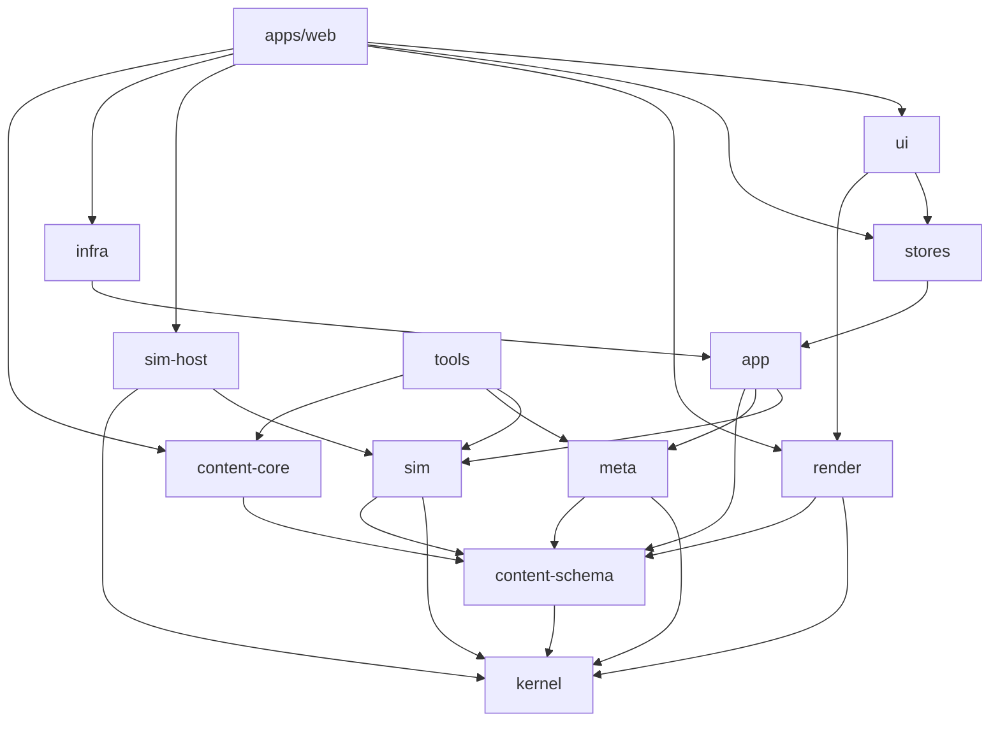
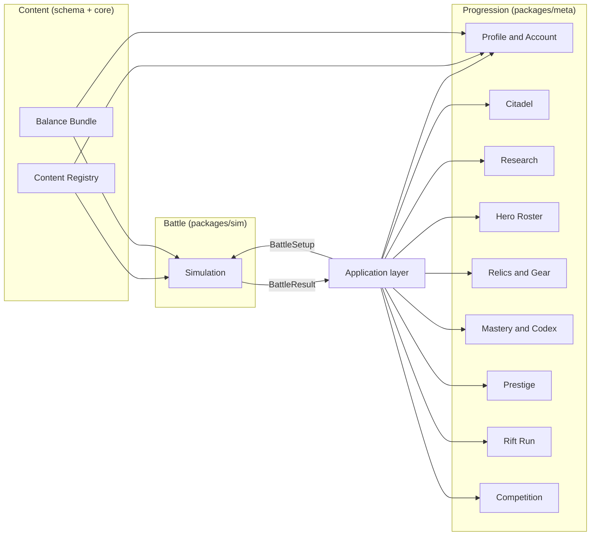
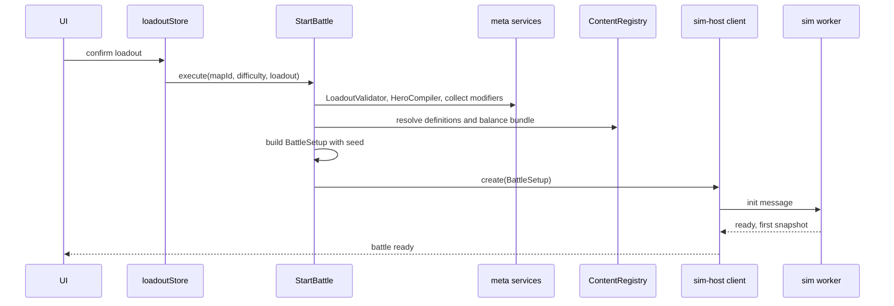

# 1. Folder Structure

## 1.1 Repository Layout

```
guardians-of-the-nexus/
├─ apps/
│  ├─ web/                          # Next.js App Router application
│  │  ├─ src/
│  │  │  ├─ app/                    # Routes, layouts, route handlers
│  │  │  │  ├─ (marketing)/         # Landing, news, press kit (SSR/SSG)
│  │  │  │  ├─ (game)/              # Client-only game shell
│  │  │  │  │  ├─ play/             # Boot, Citadel, loadout, battle, results
│  │  │  │  │  └─ layout.tsx        # Providers (stores, i18n, composition root)
│  │  │  │  └─ api/                 # Optional services: leaderboard, weekly, entitlement
│  │  │  ├─ features/               # Feature slices (UI + hooks, no business rules)
│  │  │  │  ├─ citadel/
│  │  │  │  ├─ loadout/
│  │  │  │  ├─ battle-hud/
│  │  │  │  ├─ results/
│  │  │  │  ├─ research/
│  │  │  │  ├─ heroes/
│  │  │  │  ├─ relics/
│  │  │  │  ├─ rift/
│  │  │  │  ├─ codex/
│  │  │  │  └─ settings/
│  │  │  ├─ composition/            # Composition root: builds adapters, wires ports
│  │  │  └─ styles/                 # Tailwind layers, design tokens
│  │  ├─ public/                    # Static assets, asset manifests
│  │  └─ tests/e2e/                 # Playwright suites
│  └─ desktop/                      # Tauri/Electron wrapper [Beta]
│
├─ packages/
│  ├─ kernel/                       # Shared primitives (no game rules)
│  │  └─ src/{ids,result,fixed-math,rng,ticks,collections,assert,log}/
│  │
│  ├─ content-schema/               # Definition TYPES + validation schemas + registry interfaces
│  │  └─ src/{towers,enemies,heroes,bosses,relics,maps,waves,effects,statuses,research,view}/
│  │
│  ├─ content-core/                 # The shipped game data ("core" pack)
│  │  └─ data/
│  │     ├─ towers/{arcane,martial,flame,frost,storm,nature,shadow,radiant,crystal,void}/
│  │     ├─ enemies/{verdant,ashen,ember,iron,frost,crystal,arcane,hollow,celestial,void}/
│  │     ├─ bosses/
│  │     ├─ heroes/
│  │     ├─ relics/
│  │     ├─ maps/act-01 … act-10/
│  │     ├─ waves/
│  │     ├─ statuses/ effects/ spells/
│  │     ├─ research/ citadel/ mastery/
│  │     ├─ balance/                # Tuning tables, curves, difficulty profiles
│  │     ├─ view/                   # Presentation bindings (sprites, VFX, SFX keys)
│  │     └─ i18n/en/…               # String bundles
│  │
│  ├─ sim/                          # Battle simulation bounded context (pure TS, worker-safe)
│  │  └─ src/
│  │     ├─ world/                  # World, entity store, component registry, queries
│  │     ├─ components/             # Component definitions
│  │     ├─ systems/                # Ordered systems (movement, targeting, combat, …)
│  │     ├─ archetypes/             # Entity assemblers from definitions
│  │     ├─ combat/                 # Damage pipeline, statuses, modifier stack
│  │     ├─ effects/                # Triggers, conditions, selectors, primitives
│  │     ├─ behaviors/              # Behavior registry (tower/enemy/hero/boss)
│  │     ├─ towers/ heroes/ enemies/ bosses/
│  │     ├─ waves/                  # Wave runtime and spawner
│  │     ├─ map/                    # Lanes, nav graph, pads, hazards
│  │     ├─ economy/                # In-battle resources
│  │     ├─ commands/               # Command types, validators, handlers
│  │     ├─ events/                 # Event types, bus, interceptors
│  │     ├─ snapshot/               # Render snapshot writer, keyframes
│  │     ├─ replay/                 # Command log, state hashing
│  │     └─ facade/                 # Public API of the package
│  │
│  ├─ meta/                         # Progression bounded context (pure TS)
│  │  └─ src/{profile,citadel,research,heroes,relics,mastery,prestige,
│  │          rewards,economy,codex,cosmetics,rift,competition}/
│  │
│  ├─ app/                          # Application layer: use cases, ports, DTOs
│  │  └─ src/{use-cases,ports,services,dto,flows}/
│  │
│  ├─ sim-host/                     # Worker host + protocol (platform code, no React)
│  │  └─ src/{worker,protocol,client,snapshot-reader,fallback-inline}/
│  │
│  ├─ render/                       # PixiJS renderer (no React)
│  │  └─ src/{stage,layers,view-sync,pools,vfx,telegraphs,camera,assets,quality,input}/
│  │
│  ├─ stores/                       # Zustand stores + persistence bindings
│  │  └─ src/{profile,citadel,roster,research,relics,loadout,settings,battle-view,ui,session}/
│  │
│  ├─ ui/                           # React design system + shared components
│  │  └─ src/{primitives,hud,panels,tooltips,icons,a11y}/
│  │
│  ├─ infra/                        # Adapters implementing app ports
│  │  ├─ storage-idb/ storage-memory/ storage-fs/
│  │  ├─ audio-webaudio/
│  │  ├─ telemetry/
│  │  ├─ platform-web/ platform-steam/ platform-mobile/
│  │  ├─ cloud-http/
│  │  └─ clock-system/
│  │
│  ├─ testkit/                      # Fixtures, builders, golden replays, fake adapters
│  └─ tools/                        # CLIs: content build, balance export, bot, replay verify, atlas pack
│     └─ src/{content-cli,balance-cli,bot,replay-verifier,atlas-packer,map-editor}/
│
├─ assets-src/                      # Source art/audio (not shipped directly)
├─ docs/{gdd,tdd,adr}/
├─ tooling/                         # ESLint config, dependency rules, tsconfig bases
└─ turbo.json, pnpm-workspace.yaml, package.json
```

## 1.2 Package Responsibilities

| Package | Responsibility | May run in worker | Platform APIs |
|---|---|---|---|
| `kernel` | IDs, `Result`, deterministic math, RNG, tick/time helpers, assertions | Yes | None |
| `content-schema` | Definition types, validation schemas, registry **interfaces** | Yes | None |
| `content-core` | Data files for the core pack, compiled into a typed registry bundle | Yes (data) | None |
| `sim` | Entire battle simulation | **Yes** | None |
| `meta` | Profile, Citadel, research, heroes (meta), relics, mastery, prestige, rewards, Rift run state | Yes | None |
| `app` | Use cases orchestrating `meta` and `sim`; port interfaces | No (main thread) | None |
| `sim-host` | Worker bootstrap, message protocol, snapshot reading | Both sides | Worker, SharedArrayBuffer |
| `render` | Pixi stage, view sync, VFX, camera, asset loading | No | WebGL/WebGPU, DOM |
| `stores` | UI/meta view state, persistence bindings | No | None (calls ports) |
| `ui` | React components | No | DOM |
| `infra/*` | Port implementations | Varies | IndexedDB, WebAudio, Steamworks, etc. |
| `tools` | Offline tooling | No (Node) | Node |
| `testkit` | Test builders/fakes | Both | None |

## 1.3 Dependency Rules

Arrows read "may import".



**Import matrix** (row may import column):

| ↓ imports → | kernel | schema | core | sim | meta | app | host | render | stores | ui | infra |
|---|---|---|---|---|---|---|---|---|---|---|---|
| kernel | – | | | | | | | | | | |
| content-schema | ✔ | – | | | | | | | | | |
| content-core | ✔ | ✔ | – | | | | | | | | |
| sim | ✔ | ✔ | | – | | | | | | | |
| meta | ✔ | ✔ | | | – | | | | | | |
| app | ✔ | ✔ | | ✔ | ✔ | – | | | | | |
| sim-host | ✔ | ✔ | | ✔ | | | – | | | | |
| render | ✔ | ✔ | | | | | | – | | | |
| stores | ✔ | ✔ | | | | ✔ | | | – | | |
| ui | ✔ | ✔ | | | | | | ✔ | ✔ | – | |
| infra | ✔ | ✔ | | | | ✔ | | | | | – |
| apps/web | all (composition root only wires `content-core` and `infra`) | | | | | | | | | | |

**Key rules**
1. `sim` and `meta` **never** import each other. They communicate only through plain DTOs created in `app` (`BattleSetup`, `BattleResult`).
2. `content-core` is injected at the composition root; no package imports it directly except `apps/web` and `tools`.
3. `render` receives **snapshots and events as plain data**; it never touches `sim` types beyond the shared protocol typings.
4. `ui` never calls `sim`/`meta`; it dispatches store actions that call use cases.
5. Public API = the package's `index` and `exports` map; **deep imports are forbidden**.

**Enforcement:** TypeScript project references (build-time), `exports` maps, an ESLint boundaries rule and a dependency-graph check in CI, plus a "banned APIs in sim" lint (no `Math.random`, `Date`, `performance`, DOM, `Math.pow` with non-integer exponent, `Array.sort` without comparator).

## 1.4 Feature Slice Conventions (apps/web)

| Rule | Detail |
|---|---|
| Slice contents | `components/`, `hooks/`, `view-models/`, `index.ts` |
| No business rules | Slices call store actions; stores call use cases |
| Route files thin | `page.tsx` composes slices only |
| Client boundary | All `(game)` routes are client components; `(marketing)` is server-rendered |
| Naming | `PascalCase.tsx` components, `useThing.ts` hooks, `thing.vm.ts` view-models |

## 1.5 Build Outputs

| Output | Source | Notes |
|---|---|---|
| Web bundle | `apps/web` | Route-level code splitting; Pixi and sim-worker lazy-loaded on first battle |
| Sim worker bundle | `sim` + `sim-host/worker` + `content-core` registry | Separate chunk; no React |
| Content bundle | `content-core` compiled by `tools/content-cli` | Hash-named; contains `contentVersion` and `balanceVersion` |
| Atlas bundles | `assets-src` via `tools/atlas-packer` | Per biome/act, KTX2 where supported |
| Replay verifier | `tools/replay-verifier` | Node build of `sim` + a **pinned** content/balance bundle per version |

---

# 2. Domain Architecture

## 2.1 Bounded Contexts



**Context map relationships**

| Upstream → Downstream | Relationship | Contract |
|---|---|---|
| Content → Battle | Conformist (Battle consumes definitions as-is) | Definition schemas |
| Content → Progression | Conformist | Definition schemas |
| Progression → Battle | **Customer/Supplier via Anti-Corruption Layer** (`app`) | `BattleSetup` (immutable input) |
| Battle → Progression | Published language | `BattleResult` (outcome, stats, loot rolls seeds) |
| Competition ↔ Battle | Shared kernel limited to the **replay format** | `ReplayFile` |

## 2.2 Battle Context (`sim`)

### Aggregates and Concepts

| Concept | Kind | Description |
|---|---|---|
| **BattleWorld** | Aggregate root | The whole simulation state; mutated only through commands and systems |
| Entity | Entity (ID + components) | Enemy, tower, hero, projectile, zone, summon, etc. (see ECS) |
| **Lane / NavGraph** | Value objects | Enemy routes, junctions, switches |
| **Pad** | Entity-like record | Build slot with size and terrain modifiers |
| **WaveScript** | Value object | Declarative wave/event timeline |
| **EconomyState** | Component of world | Gold, Mana, Nexus Energy, Integrity |
| **ModifierStack** | Value object | Layered stat computation (see combat doc) |
| **RngStreams** | Value object | Named deterministic RNG streams |
| **CommandLog** | Value object | Ordered commands with execution tick |
| **Keyframe** | Value object | Serialized world for rewind and resume |

### Domain Services (stateless, inside `sim`)

| Service | Purpose |
|---|---|
| `DamagePipeline` | Resolves a `DamageRequest` into HP/shield changes |
| `StatusEngine` | Applies, stacks, ticks, expires and dispels statuses |
| `TargetingService` | Picks targets by mode and filters |
| `EffectInterpreter` | Executes Trigger → Condition → Effect definitions |
| `PathService` | Route choice, progress advancement, displacement |
| `PlacementService` | Pad/tower validation |
| `WaveDirector` | Advances wave scripts and spawns enemies |
| `BossDirector` | Runs boss phases and objectives |
| `EconomyService` | Gold/Mana/Energy rules, interest, refunds |
| `SnapshotWriter` | Writes render snapshots and events |

### Invariants

1. World mutation happens only inside `step()` or when applying a validated command.
2. Same `BattleSetup` + same seed + same command log ⇒ identical state hash at every checkpoint.
3. Integrity ≥ 0; battle ends the tick it reaches 0 (after interceptors such as *Unbreakable Nexus*).
4. A tower occupies exactly one pad (or the footprint of a Large pad); a pad hosts at most one tower or one objective lantern.
5. No entity references a dead entity ID without a generation check.

## 2.3 Progression Context (`meta`)

| Sub-domain | Aggregate | Key entities / value objects | Invariants |
|---|---|---|---|
| **Profile** | `Profile` | Account level/XP, Nexus Points, skill-tree allocation, settings link, stats | Points spent ≤ points earned; level ≤ 100 |
| **Currencies** | `Wallet` | Shards, Soul Essence, Research Data, Echo Points, Prism Tokens | No negative balances; spend is atomic and all-or-nothing |
| **Citadel** | `Citadel` | `BuildingState` ×N (level, construction cycles remaining), Nexus Core attunement | Level ≤ 20; cost curve from balance bundle |
| **Research** | `ResearchBook` | `ResearchNode` state, queue slots, doctrine choices | Prerequisites satisfied; exclusive doctrines respected; cycles advance per battle |
| **Heroes** | `HeroRoster` | `HeroProfile` (level, XP, tree allocation, gear, mastery) | Points ≤ level; gear slots typed |
| **Relics & Gear** | `RelicVault`, `Armory` | `RelicInstance` (id, level), `GearItem` | Slots ≤ vault level; duplicate-protection counters |
| **Mastery & Codex** | `MasteryBook`, `Codex` | Tower/hero/map mastery counters, codex levels | Monotonic counters |
| **Prestige** | `Ascension` | Cycle number, Echo Boons selected | Boons ≤ 8 |
| **Rift** | `RiftRun` | Node graph, boons, carried state, seed | Deterministic from seed + choices |
| **Competition** | `ChallengeEntry` | Weekly seed, submissions, replay refs | Replay must validate before submit |

### Domain Services (stateless, inside `meta`)

`RewardCalculator` (Shards, XP, Data, Soul Essence, relic rolls with bad-luck protection), `ProgressionCurves`, `ResearchScheduler` (battle-cycle advancement), `HeroCompiler` (hero profile → battle hero spec), `LoadoutValidator`, `UnlockResolver`, `AscensionService`, `RiftGenerator` (seeded), `CostCalculator`.

## 2.4 Application Layer (`app`)

### Use Cases by Capability

| Area | Use cases |
|---|---|
| **Session/boot** | `BootGame`, `LoadProfile`, `CreateProfile`, `SwitchSlot`, `ImportProfile`, `ExportProfile` |
| **Citadel** | `UpgradeBuilding`, `CollectConstruction`, `SetCoreAttunement` |
| **Research** | `QueueResearch`, `CancelResearch`, `ChooseDoctrine`, `RespecDoctrine` |
| **Heroes** | `AllocateHeroPoint`, `RespecHero`, `EquipGear`, `ForgeGear`, `UpgradeGear` |
| **Relics** | `EquipRelic`, `FuseRelics` |
| **Skill tree** | `AllocateNexusPoint`, `RespecNexusTree` |
| **Loadout** | `BuildLoadout`, `ValidateLoadout`, `SaveLoadoutPreset` |
| **Battle** | `StartBattle` (build `BattleSetup`), `ResumeBattle`, `AbandonBattle`, `FinishBattle` (apply `BattleResult`) |
| **Rift** | `StartRift`, `ChooseRiftNode`, `PickBoon`, `ContinueRift` |
| **Prestige** | `Ascend`, `PickEchoBoon` |
| **Competition** | `StartWeekly`, `SubmitReplay`, `FetchLeaderboard` |
| **Commerce** | `RefreshEntitlements`, `ApplyCosmetic` |
| **Settings** | `UpdateSettings`, `RebindInput` |

### Use-case Conventions

1. Each use case is a class/function with a single `execute`.
2. Input and output are DTOs; never domain objects.
3. Use cases read the registry and balance bundle from injected ports.
4. Persistence is requested through `SaveStore`; **domain objects never persist themselves**.
5. A use case emits **application events** (`Application.ProfileChanged`, `Application.ResearchCompleted`) after success.

### `StartBattle` Orchestration



### `BattleSetup` (Immutable Input DTO)

| Field group | Contents |
|---|---|
| Identity | `simVersion`, `contentVersion`, `balanceVersion`, `battleId`, `seed` |
| Map | `mapId` (or generated map spec for Rift), weather and event schedule, difficulty profile id, Mythic level and affixes, cycle modifiers |
| Loadout | Tower ids (8–10) and unlocked evolution ids, Nexus Spells (3) with levels, relics (with levels), Nexus Surge type |
| Hero(es) | Compiled `HeroSpec` ×1–2 (final stats, skills with patches, passives, equipment-derived effects) |
| Meta modifiers | Flat list of `ModifierSpec` from skill tree, research, mastery, Echo Boons, bonds (each with source id and layer) |
| Rules | Assist options, mode (Campaign, Endless, Survival, BossRush, Rift stage), starting resources, restrictions (e.g., banned schools) |
| Entry state | For Rift stage: carried towers/hero state/energy |

**Important:** the sim never reads the profile. All meta power arrives as `ModifierSpec` entries with source tracking, which also lets bots and replay verifiers reconstruct a battle with only the setup.

### `BattleResult` (Output DTO)

| Field | Description |
|---|---|
| `outcome` | Victory/Defeat/Abandoned |
| `stats` | Waves cleared, leaks, Integrity remaining, kills by enemy id, damage by tower id/school, gold earned/spent, mana spent, hero deaths, time |
| `objectives` | Star conditions evaluated (Victory, Pristine, Challenge) |
| `drops` | Reward *seeds and tables to roll* (rolling happens in `meta` for bad-luck protection) |
| `mastery` | Counters per tower/hero/enemy for Mastery and Codex |
| `replay` | Replay file reference (setup + command log + checkpoints) |
| `finalHash` | State hash for verification |

## 2.5 Ports (Interfaces Owned by `app`)

| Port | Responsibility | Adapters |
|---|---|---|
| `SaveStore` | Read/write/list save documents, backups, atomic swap | IndexedDB, in-memory (tests), filesystem (desktop) |
| `ReplayStore` | Persist replays and suspended battles | IndexedDB, filesystem |
| `SettingsStore` | Device-level settings | localStorage/IndexedDB |
| `ContentProvider` | Load content and balance bundles by version | Bundled, CDN |
| `Clock` | Wall-clock for UI/telemetry only (never in sim) | System, fake |
| `RandomSeedSource` | Produce battle seeds | Crypto, fixed (tests) |
| `AudioPlayer` | Play cues/music | WebAudio, null |
| `Telemetry` | Emit opt-in analytics | HTTP, null |
| `LeaderboardGateway` | Submit/fetch ranked results | HTTP, mock |
| `CloudSync` | Push/pull saves | HTTP, none |
| `Entitlements` | Ownership of DLC/cosmetics | Steam, web store, mock |
| `Achievements` | Unlock achievements | Steam, web, none |
| `PlatformInfo` | Capabilities (workers, SAB, haptics, input type) | Web, Steam, Mobile |
| `Logger` | Structured logs | Console, remote |

## 2.6 Composition Root

- Lives in `apps/web/src/composition/`.
- Constructs adapters, loads the registry, builds use cases via **manual constructor injection** (no reflection-based container).
- Exposes a typed `AppServices` object consumed by stores at creation time.
- Separate compositions for **web**, **steam**, **tests** (`testkit`) and **tools** (Node).

## 2.7 Cross-Context Consistency

| Concern | Mechanism |
|---|---|
| Content references (e.g., tower id in a save) | Stable IDs + alias table resolved at load |
| Balance coupling | Both contexts read the same `BalanceBundle`; costs, curves and caps are never duplicated in code |
| Unlock gating | `UnlockResolver` in `meta` is the only authority; `LoadoutValidator` rejects locked content |
| Versioning | Every cross-context DTO carries `simVersion`, `contentVersion`, `balanceVersion` |
