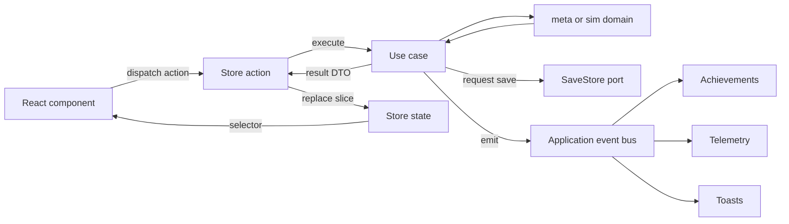
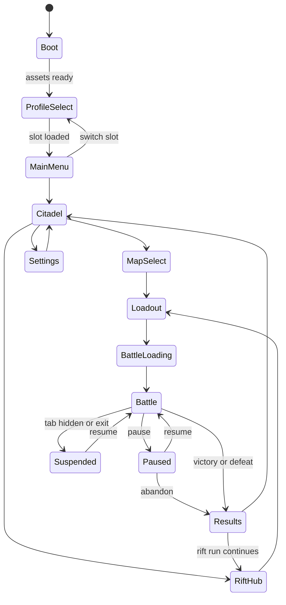
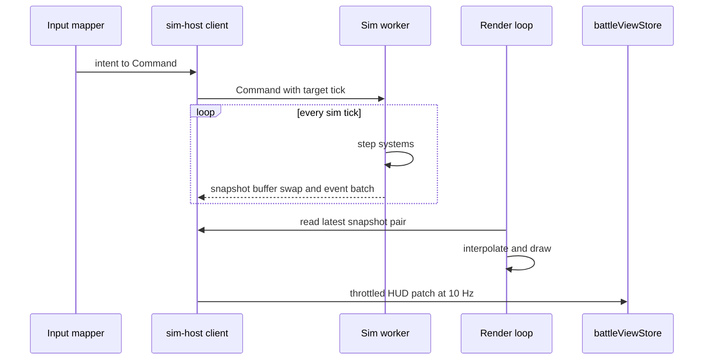
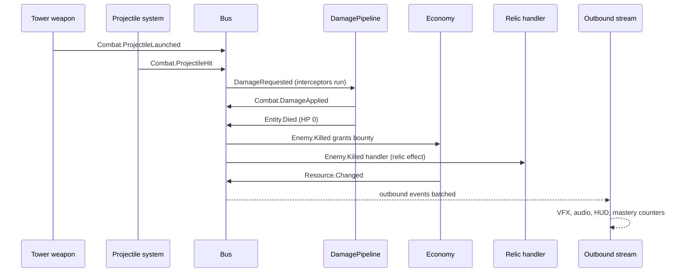
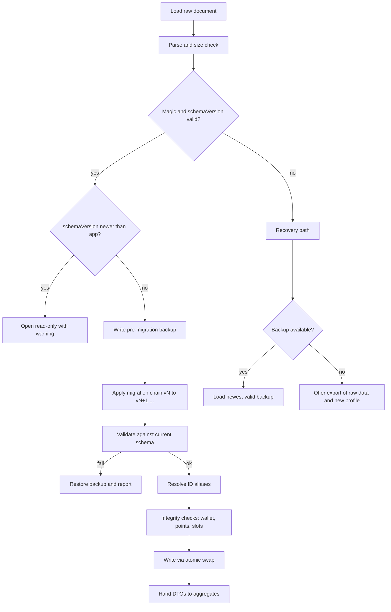
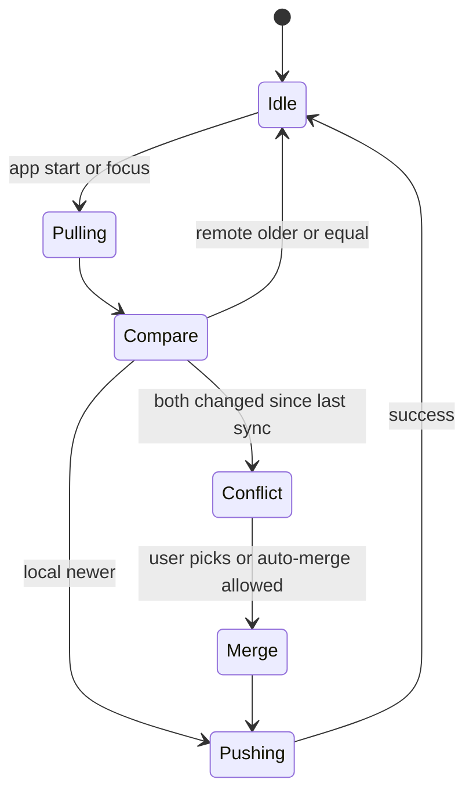

# 3. State Management

## 3.1 State Taxonomy

| State | Owner | Lives in | Update rate | Persisted |
|---|---|---|---|---|
| **Simulation state** (entities, economy, RNG, wave state) | `sim` BattleWorld | Worker | 30 Hz | Only as replay/keyframes |
| **Render snapshot** (positions, hp fractions, anim ids) | `sim` SnapshotWriter | Shared/transferred buffers | Per tick, read at frame rate | No |
| **Outbound event batches** | `sim` | Message channel | Per frame | No |
| **Battle view-model** (Gold, Mana, wave number, hero cooldowns, selection info) | `battleViewStore` | Main thread | ≤ 10 Hz (throttled) | No |
| **Profile/meta state** | `meta` aggregates mirrored in stores | Main thread | On change | **Yes (save)** |
| **App flow state** (screen, modal, routing intent) | `uiStore` + flow machine | Main thread | On change | No |
| **Settings** (audio, input bindings, accessibility, quality) | `settingsStore` | Main thread | On change | **Yes (device)** |
| **Content registry / balance bundle** | Registry singleton | Main + worker | Load time | No (bundled) |
| **Session cache** (leaderboard pages, entitlement cache) | `sessionStore` | Main thread | On fetch | Optional |

## 3.2 Principles

1. **Single source of truth per datum.** The sim owns battle truth; `meta` aggregates own progression truth; stores are *projections*.
2. **Stores hold plain, serializable snapshots** of aggregates (DTOs), not class instances or sim objects.
3. **Stores contain no business rules.** Actions call use cases and then replace the affected slice with the result DTO.
4. **Fast data bypasses React.** Per-frame values (cooldown rings, health bars) are rendered by Pixi or updated via transient subscriptions, never via React re-renders.
5. **Throttle at the boundary.** The host publishes HUD updates at ≤ 10 Hz and only when values change.
6. **Selectors are mandatory.** Components subscribe to narrow selectors; whole-store subscriptions are lint-banned.
7. **One writer for persistence.** Only the persistence middleware (through the `SaveStore` port) writes saves.

## 3.3 Store Catalog

| Store | Slices / data | Actions (call use cases) | Persistence |
|---|---|---|---|
| `profileStore` | Account level/XP, Nexus Points, skill-tree allocation, wallet, unlocks, stats, ascension | `allocateNexusPoint`, `respecNexusTree`, `ascend` | Save document |
| `citadelStore` | Building states, construction queue, core attunement | `upgradeBuilding`, `collect` | Save document |
| `rosterStore` | Heroes (profile), gear, bonds | `allocateHeroPoint`, `equipGear`, `forgeGear` | Save document |
| `researchStore` | Node states, queue, doctrines | `queueResearch`, `chooseDoctrine` | Save document |
| `relicStore` | Relic instances, equipped slots, duplicate counters | `equipRelic`, `fuse` | Save document |
| `loadoutStore` | Current draft loadout, presets, validation result | `setTowerSlot`, `setHero`, `confirm` | Presets in save |
| `riftStore` | Active run graph, boons, carried state | `chooseNode`, `pickBoon` | Save document |
| `battleViewStore` | HUD snapshot, selection, build mode, speed, paused | `select`, `enterBuildMode`, `issueCommand` | None |
| `uiStore` | Screen stack, modals, toasts, tooltips | `push`, `pop`, `toast` | None |
| `settingsStore` | Audio, video quality, accessibility, bindings, language | `update` | Device settings |
| `sessionStore` | Leaderboards, entitlements, network status | `refresh` | Optional cache |

## 3.4 Data Flow

## 3.5 App Flow State Machine

## 3.6 Battle Host and HUD Projection

### Worker Protocol (Message Types)

| Direction | Message | Payload | Notes |
|---|---|---|---|
| Main → Worker | `Init` | `BattleSetup`, registry bundle id, buffer handles | Worker builds world, replies `Ready` |
| Main → Worker | `Command` | Command, desired tick offset | Validated in sim; accepted tick echoed |
| Main → Worker | `SetSpeed` | 0, 0.5, 1, 2, 3 | Changes ticks per frame request |
| Main → Worker | `Pump` | Max ticks to run | Frame-driven stepping; keeps worker idle when paused |
| Main → Worker | `RequestKeyframe` | – | For suspend or debug |
| Main → Worker | `Dispose` | – | |
| Worker → Main | `Ready` | Map static data (lanes, pads, hazards) | Render builds terrain |
| Worker → Main | `SnapshotReady` | Buffer index, tick | Double/triple-buffered |
| Worker → Main | `EventBatch` | Ordered events since last batch | Filtered by `outbound` flag |
| Worker → Main | `HudPatch` | Changed HUD fields | ≤ 10 Hz |
| Worker → Main | `CommandResult` | Accepted/rejected + reason | For UI feedback |
| Worker → Main | `Checkpoint` | Tick, state hash | For replay recording |
| Worker → Main | `BattleEnded` | `BattleResult` | |
| Worker → Main | `Fault` | Error info, last tick, hash | Triggers crash report with replay |

**Fallback:** if Workers are unavailable, `fallback-inline` runs the same host interface on the main thread with a per-frame time budget.

## 3.7 Command Scheduling

| Rule | Detail |
|---|---|
| Commands target a tick | `executeTick = max(currentTick + 1, requestedTick)` |
| Deterministic order | Same-tick commands sorted by `(sequence number)` assigned by the host |
| Latency | One tick (33 ms) between intent and effect; UI shows "ghost" placement immediately |
| Rejection | Invalid commands return `CommandResult` with typed reason (e.g., `InsufficientGold`, `PadOccupied`) |
| Pause | While paused, build commands are accepted and queued for the next tick (Normal difficulty); hero/spell commands queue unless the mode disallows |
| Replay | The host records `(executeTick, command)` as confirmed by the worker |

## 3.8 Multi-Tab and Concurrency

- A **Web Lock** (or `BroadcastChannel` fallback) ensures a single active writer per profile; a second tab opens read-only with a banner.
- Saves use a monotonic `revision` for optimistic concurrency; a stale writer is rejected and prompts a reload.

---

# 4. Event Bus

## 4.1 Three Buses, Three Purposes

| Bus | Where | Semantics | Examples |
|---|---|---|---|
| **Sim Event Bus** | Inside the worker | Synchronous, deterministic, in-tick, ordered. Drives gameplay rules (relics, abilities, statuses). | `Combat.DamageApplied`, `Wave.Started` |
| **Outbound Event Stream** | Worker → main | Filtered, batched per frame, **non-authoritative** (cannot change the sim) | VFX/audio/UI cues |
| **Application Event Bus** | Main thread | Async-friendly, decoupled notifications for non-sim concerns | `Application.ResearchCompleted` |

The sim never depends on outbound or application events; they are strictly consumers.

## 4.2 Event Envelope

| Field | Purpose |
|---|---|
| `seq` | Monotonic sequence number within the battle (total order) |
| `tick` | Simulation tick |
| `type` | Namespaced type string (`Combat.EnemyKilled`) |
| `schema` | Event schema version (for telemetry and tooling only) |
| `source` | Entity ID (with generation) or `none` |
| `target` | Entity ID or `none` |
| `payload` | Typed payload (small, flat, numbers/ids) |
| `flags` | `outbound`, `telemetry`, `achievement`, `replayAssert` |

Events carry **IDs and numbers only**; no object references, to keep them cloneable and cheap.

## 4.3 Dispatch Semantics (Sim Bus)

1. **Queue-based breadth-first.** Emitting an event appends to the tick's queue; the bus drains the queue after each system phase, preserving causality.
2. **Phases per event kind:**

| Phase | Purpose | Can mutate sim? | Can cancel/modify? |
|---|---|---|---|
| **Interceptors** | Modify or veto a *request* (e.g., `DamageRequested`, `LeakRequested`, `StatusRequested`, `PlacementRequested`) | Only the request object | Yes (ordered by priority) |
| **Handlers** | React to a *fact* (e.g., `DamageApplied`, `EnemyKilled`) | Yes (enqueue effects) | No |
| **Observers** | Collect stats, achievements, telemetry | No | No |

3. **Ordering:** handlers run by `(priority, registrationOrder)`; registration order is deterministic (definition order, then entity index).
4. **Loop protection:** each causal chain has a depth counter; depth > 8 raises a dev error and drops the event in release builds (logged with the replay).
5. **Registration lifetime:** handlers are owned by a `Subscription` bound to an entity, relic, status or battle; they are removed automatically when the owner dies or the status expires.
6. **Purity rule:** handlers may only change the world via the same primitives as the Effect Engine (never by direct component writes outside systems), preserving invariants and replays.

## 4.4 Event Catalog (Core)

| Category | Event | Key payload | Typical consumers |
|---|---|---|---|
| **Battle** | `Battle.Started`, `Battle.Ended`, `Battle.Paused` | mode, outcome | HUD, audio, replay |
| **Wave** | `Wave.PreviewChanged`, `Wave.Started`, `Wave.Completed`, `Wave.EarlyCalled` | wave index, composition | HUD, economy, relics |
| **Spawn** | `Enemy.Spawned`, `Summon.Spawned` | def id, lane | Render, Codex |
| **Movement** | `Enemy.ReachedNode`, `Enemy.Leaked`, `Enemy.Teleported` | lane, s | Economy, VFX |
| **Combat** | `Combat.AttackStarted`, `Combat.ProjectileLaunched`, `Combat.ProjectileHit`, `Combat.DamageRequested` *(interceptable)*, `Combat.DamageApplied`, `Combat.Healed`, `Combat.ShieldBroken`, `Combat.Dodged`, `Combat.Crit` | source, target, amount, type, flags | Relics, VFX, stats |
| **Death** | `Entity.Died`, `Enemy.Killed`, `Corpse.Created`, `Hero.Died` | killer, bounty | Economy, Soul Essence, abilities |
| **Status** | `Status.Requested` *(interceptable)*, `Status.Applied`, `Status.Refreshed`, `Status.Expired`, `Status.Dispelled` | status id, stacks | Immunities, VFX |
| **Tower** | `Tower.Built`, `Tower.Upgraded`, `Tower.Evolved`, `Tower.Sold`, `Tower.Disabled`, `Tower.Enabled`, `Tower.Overcharged` | tower id, tier | HUD, mastery |
| **Hero** | `Hero.SkillCast`, `Hero.UltimateCast`, `Hero.Respawned`, `Hero.Moved` | skill id | HUD, VFX |
| **Resource** | `Resource.Changed` | kind, delta, reason | HUD, achievements |
| **Nexus** | `Nexus.IntegrityChanged`, `Nexus.SurgeReady`, `Nexus.SpellCast` | amount | HUD, boss logic |
| **Boss** | `Boss.PhaseChanged`, `Boss.ObjectiveSpawned`, `Boss.ObjectiveCleared`, `Boss.Telegraph` | phase, shape, duration | Render telegraphs, HUD bar |
| **Map** | `Map.WeatherChanged`, `Map.HazardTelegraph`, `Map.HazardTriggered`, `Map.EventTriggered`, `Map.SwitchToggled`, `Map.PathChanged` | ids | Render, enemy AI |
| **Relic** | `Relic.Triggered` | relic id | HUD, stats |
| **Debug** | `Debug.InvariantViolated` | message | Dev overlay |

## 4.5 Example Causal Chain

## 4.6 Outbound Stream Rules

| Rule | Detail |
|---|---|
| Filtering | Only events flagged `outbound` in their definition are sent; high-frequency events (e.g., `ProjectileHit`) are aggregated per frame when possible |
| Batching | One `EventBatch` per rendered frame (or per pump) |
| Back-pressure | If the main thread lags, low-priority cosmetic events are dropped first (never gameplay-relevant ones like `Boss.Telegraph`) |
| Determinism | Dropping cosmetics never affects the sim |

## 4.7 Application Event Bus

| Event | Emitted by | Consumers |
|---|---|---|
| `Application.ProfileChanged` | Any meta use case | Autosave, UI |
| `Application.CurrencyChanged` | Wallet operations | HUD, achievements |
| `Application.BuildingUpgraded` / `ConstructionCompleted` | Citadel | Toasts, Keeper dialogue |
| `Application.ResearchCompleted` | Research scheduler | Toasts, unlock banners |
| `Application.BattleFinished` | `FinishBattle` | Results, achievements, telemetry |
| `Application.UnlockGranted` | `UnlockResolver` | Banners, Codex |
| `Application.SaveWritten` / `SaveFailed` | Persistence | Status indicator |
| `Application.EntitlementsChanged` | Entitlements port | Shop UI |

Subscribers are registered at the composition root; the bus is typed and disposes automatically with scopes.

## 4.8 Event-Driven Features Matrix

| Feature | Driven by |
|---|---|
| Relics | Sim handlers/interceptors registered from relic definitions at battle start |
| Mastery counters | Observers aggregating `DamageApplied`, `Enemy.Killed`, `Tower.Evolved` into `BattleResult.mastery` |
| Codex discovery | `Enemy.Spawned` / `Enemy.Killed` aggregated into `BattleResult` |
| Achievements | Outbound events + `BattleResult` evaluated in `app` (replays re-verifiable) |
| Audio | Outbound events mapped via view definitions |
| Tutorial prompts | Flow rules subscribing to outbound events |
| Telemetry | `telemetry`-flagged events sampled and summarized |

---

# 5. Save System

## 5.1 Storage Layout (IndexedDB)

| Object store | Key | Value | Notes |
|---|---|---|---|
| `profiles` | `slotId` | Current `SaveEnvelope` | 3 slots |
| `backups` | `slotId#n` | Previous envelopes | Rolling 3 + pre-migration |
| `pointer` | `slotId` | `{ activeKey, revision }` | Atomic swap target |
| `replays` | `replayId` | Compressed replay | LRU-capped (e.g., last 50 + pinned) |
| `suspend` | `slotId` | Suspended battle record | One per slot |
| `settings` | `device` | Device settings | Independent of profile |
| `cache` | key | Leaderboard/entitlement cache | Disposable |

## 5.2 Save Envelope

| Field | Type | Purpose |
|---|---|---|
| `magic` | string | File/format identifier |
| `schemaVersion` | integer (monotonic) | Drives migrations |
| `contentVersion` | string | Content pack version the save last saw |
| `balanceVersion` | string | Balance bundle last saw |
| `appVersion` | string | Informational |
| `profileId` | UUID | Stable identity |
| `slotId` | string | |
| `revision` | integer | Optimistic concurrency / cloud sync |
| `createdAt`, `updatedAt` | ISO timestamps | |
| `payload` | object | The sections below |
| `extensions` | object | Unknown/forward-compat data preserved verbatim |
| `checksum` | string | Integrity (non-cryptographic) |

### Payload Sections

| Section | Contents |
|---|---|
| `account` | Level, XP, Nexus Points, skill-tree allocation, titles |
| `wallet` | Shards, Soul Essence, Research Data, Echo Points, Prism Tokens |
| `unlocks` | Towers, evolutions, heroes, spells, maps, cosmetics (IDs only) |
| `campaign` | Per-map, per-difficulty stars and best results |
| `citadel` | Building levels, construction cycles remaining, core attunement |
| `research` | Node states, queue, doctrines |
| `heroes` | Per hero: level, XP, tree allocation, gear, mastery, bond flags |
| `gear` | Gear items with affixes and levels |
| `relics` | Owned instances, levels, equipped slots, duplicate counters |
| `mastery` | Tower/hero/map counters |
| `codex` | Enemy sighting/kill counters, lore unlocks |
| `prestige` | Cycle number, Echo Boons, cycle history |
| `rift` | Active run (graph, boons, carried state, seed) or none |
| `loadouts` | Presets |
| `competition` | Weekly entries and pending submissions |
| `stats` | Lifetime stats and achievements progress |
| `flags` | Tutorial completion, narrative choices, ending |
| `cosmeticsEquipped` | Equipped cosmetics |
| `entitlementsCache` | Non-authoritative cache of purchases |

Entities in the save refer to content only by **ID**; no definition data is copied into saves.

## 5.3 Versioning Policy

| Version | Meaning | Changes when |
|---|---|---|
| `schemaVersion` | Shape of the save payload | Any structural change |
| `contentVersion` | Content pack | Content added/changed/removed |
| `balanceVersion` | Tuning bundle | Numbers changed (does not affect save shape) |
| `simVersion` | Simulation rules | Any change that alters simulation outcomes (invalidates old replays/suspends) |

**Rules**
1. **Never edit a published migration.**
2. **Additive first:** adding an optional field needs no migration if a default exists.
3. **IDs are forever.** Renames go in the **alias table**; removals map to a replacement or a refund rule.
4. **Saves from newer versions open read-only** with a warning and preserve unknown fields.
5. **Every schema bump ships with a fixture** save from the previous version in `testkit`.

## 5.4 Migration Pipeline

**Migration function contract:** pure, takes the old payload and returns the new one, no I/O, no clocks, no randomness, idempotent when re-run on a migrated document (guarded by version).

**Integrity checks (post-migration "repair" pass):** wallet non-negative, skill points ≤ earned, relic slots ≤ vault capacity, equipped items exist, orphaned IDs mapped via aliases or removed with a refund entry logged in `flags.migrationNotes`.

## 5.5 Write Strategy

| Concern | Strategy |
|---|---|
| **Atomicity** | Write new envelope to a fresh key, verify read-back and checksum, then swap `pointer.activeKey` in one transaction |
| **Debounce** | 1 s trailing debounce on `ProfileChanged`; immediate on battle finish and purchases |
| **Flush on exit** | `visibilitychange`, `pagehide`, and `beforeunload` trigger a best-effort flush |
| **Backups** | Keep last 3 successful saves plus the pre-migration backup per schema bump |
| **Quota** | Check storage estimate; prune caches and replays first; warn before profile data is at risk |
| **Single writer** | Web Lock per profile; second tab read-only |
| **Failure handling** | `SaveFailed` event → persistent UI indicator and retry with backoff; the game continues in memory |

## 5.6 Battle Suspend and Resume

| Item | Detail |
|---|---|
| Record | `{ setup, seed, commandLog, tick, latestKeyframe?, simVersion, contentVersion, balanceVersion }` |
| Save trigger | Tab hidden for > 5 s, exit to menu with "Suspend", or every 60 s autosave during battle |
| Resume | If `simVersion` matches: load keyframe and replay commands since; else offer **Restart from replay** (if the old sim is still bundled) or **Abandon** |
| Keyframes | Binary world serialization every 30 s of game time; used for fast resume and rewind |
| Size target | ≤ 300 KB per suspend record |

## 5.7 Replay File Format

| Section | Content |
|---|---|
| Header | Magic, `simVersion`, `contentVersion`, `balanceVersion`, `battleId`, seed, mode, difficulty |
| Setup | The full `BattleSetup` (so a verifier needs nothing else) |
| Commands | Delta-encoded `(tickDelta, commandType, payload)` stream |
| Checkpoints | State hash every 300 ticks |
| Result | `BattleResult` summary and final hash |
| Compression | Deflate-class; typical size target ≤ 100 KB for a 30-minute battle |

**Verification:** `tools/replay-verifier` loads the pinned sim + content + balance bundle for the header's versions, re-simulates headlessly, compares checkpoints and the final hash, and recomputes `BattleResult`.

## 5.8 Cloud Sync [Beta]

| Section | Merge rule |
|---|---|
| `unlocks`, `codex`, `mastery`, `relics` (ownership) | **Union / max** (safe to merge) |
| `wallet` | Last writer wins by `revision` (prompt shows both) |
| `account`, `citadel`, `research`, `heroes` | Last writer wins by `revision` |
| `rift`, `suspend` | Device-local; never synced |
| `settings` | Device-local |

## 5.9 Import / Export and Security

| Rule | Detail |
|---|---|
| Format | Same envelope, compressed text for sharing |
| Validation | Strict schema validation; size ≤ 5 MB; nesting depth limit; numeric range checks; no executable content ever evaluated |
| Provenance | Imported saves are marked `imported` and excluded from leaderboards unless replays verify |
| Privacy | Export strips device identifiers and entitlements cache |

## 5.10 Testing the Save System

| Test | Purpose |
|---|---|
| **Migration fixtures** | Every historical schema version migrates to current with expected output |
| **Round-trip property tests** | `serialize(deserialize(x)) = x` for generated profiles |
| **Corruption fuzzing** | Truncated, bit-flipped and oversized documents never crash; recovery path engaged |
| **Atomicity tests** | Simulated crash between write and pointer swap leaves a valid save |
| **Alias tests** | Renamed/removed content resolves per policy |
| **Concurrency tests** | Two tabs contending for the lock |
