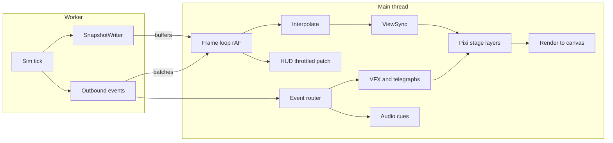
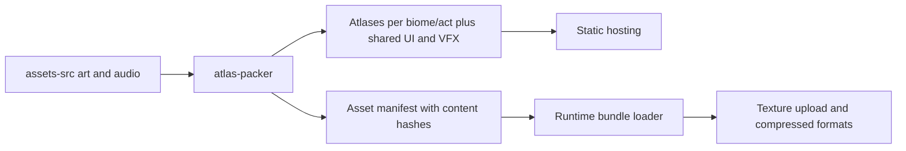
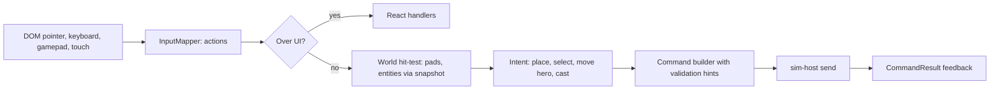

# 6. Rendering Pipeline

## 6.1 Overview

The renderer is a **pure consumer** of simulation output. It never mutates sim state and has no knowledge of rules; presentation mappings come from **view definitions** in content data.

## 6.2 Responsibilities and Boundaries

| Concern | Owner |
|---|---|
| Game truth (positions, HP, statuses) | `sim` |
| Presentation mapping (which sprite/animation/VFX/SFX) | `content-core/data/view` bound by definition ID |
| Interpolation, culling, sorting, drawing | `render` |
| UI chrome (panels, tooltips) | React `ui` above the canvas |
| Pad picking and placement ghost | `render/input` using static map data from `Ready` |

## 6.3 Snapshot Design

**Principle:** *Static or rarely-changing state travels as events; dynamic state travels as a per-tick snapshot.*

### Snapshot Layout (Struct-of-Arrays, per kind)

| Section | Fields per entity | Notes |
|---|---|---|
| Header | `tick`, `tickTimeMs`, counts per section, `generation` | One header per buffer |
| **Movers** (enemies, soldiers, summons, hero) | `id`, `defIndex`, `x`, `y`, `prevX`, `prevY`, `facing`, `hpFrac`, `shieldFrac`, `animState`, `animPhase`, `flags` (flying, stealthed, burrowed, phased, boss), `statusMask`, `tint` | `prev*` enables interpolation without a second buffer read |
| **Projectiles** | `id`, `defIndex`, `x`, `y`, `prevX`, `prevY`, `angle`, `progress` | Pooled quads |
| **Zones/areas** | `id`, `shape`, `x`, `y`, `r`, `w`, `h`, `angle`, `colorId`, `lifeFrac` | Auras, lava pools, fog |
| **Towers (dynamic)** | `id`, `animState`, `animPhase`, `aimAngle`, `chargeFrac`, `cooldownFrac`, `disabledFlag` | Position and tier come from events |
| **Objectives** | `id`, `kind`, `x`, `y`, `hpFrac` | Lanterns, pods, conveyors |
| **Beams** | `id`, `x1`, `y1`, `x2`, `y2`, `widthIdx`, `colorId` | Channelled beams |

### Static/Event-Driven State

| Item | Delivery |
|---|---|
| Tower built/upgraded/evolved/sold (position, tier, def) | Events (`Tower.*`) |
| Pad states, lane geometry, hazards, weather | `Ready` message and `Map.*` events |
| Telegraphs | `Boss.Telegraph`, `Map.HazardTelegraph` |
| Floating damage numbers | Aggregated `Combat.DamageApplied` events (per target per frame) |

### Buffer Management

| Aspect | Design |
|---|---|
| Transport | Transferable `ArrayBuffer`s in a triple-buffer pool; `SharedArrayBuffer` when cross-origin isolated |
| Ownership | Worker writes buffer *N*, posts `SnapshotReady`; render holds the latest two ticks for interpolation; unused buffers return to the pool |
| Size | ≤ ~250 KB at max load (1,200 enemies × ~48 B plus extras) |
| Garbage | Zero per-frame allocation: reader views are reused |

## 6.4 Frame Loop

| Step | Description |
|---|---|
| 1. Pump | If running, request up to *k* ticks (k from speed and catch-up cap) |
| 2. Acquire | Take latest `SnapshotReady`; keep previous tick as `A`, newest as `B` |
| 3. Interpolate | `alpha = (now − tickTime(A)) / tickDuration` clamped to [0, 1]; paused ⇒ alpha frozen |
| 4. Route events | Drain `EventBatch` to VFX, audio and HUD mappers |
| 5. ViewSync | Create/destroy/update display objects by entity ID |
| 6. VFX update | Advance particles and telegraphs by frame delta |
| 7. Camera & culling | Update transform; cull off-screen views |
| 8. Draw | Pixi renders layers |
| 9. HUD patch | Publish HUD changes (throttled) |
| 10. Quality controller | Sample frame time; adjust quality tier if needed |

**Game speed** changes how many ticks the worker steps per frame; interpolation always runs on real time between the latest two ticks, so 3× looks smooth.

## 6.5 View Synchronisation

| Concept | Design |
|---|---|
| **View registry** | Map from entity ID → view handle, per section |
| **Lifecycle** | Spawned when an ID first appears (or via `Enemy.Spawned`), removed when it disappears (or via `Entity.Died` after the death animation) |
| **Pools** | Pre-sized pools per archetype family (small enemy, large enemy, flyer, projectile, zone, tower pieces) |
| **View definition** | `defIndex → ViewDefinition` (atlas frames, clips per `animState`, scale, anchor, shadow, health-bar mode, tint rules, death VFX, SFX keys) |
| **Animation** | Frame/clip chosen from `animState` + `animPhase`; no per-frame allocations |
| **Death handling** | On `Entity.Died` the view detaches from the snapshot and plays its death clip from a lightweight "ghost" record |
| **Status visuals** | `statusMask` bits map to overlays (burn flicker, frost tint, shock sparks) via view data |

## 6.6 Scene Graph and Layers

| Z | Layer | Contents | Batching |
|---|---|---|---|
| 0 | Terrain | Baked per-map tile layer (cached texture) | Single sprite/tile map |
| 1 | Decals | Scorch, blood-free stains, snow tracks | Pooled sprites |
| 2 | Ground zones | Lava, fog, auras, roots | Instanced/quads |
| 3 | Pads and towers | Pad sockets, tower bodies | Sprites with tier modules |
| 4 | Ground units | Enemies, soldiers, hero (Y-sorted) | Y-sort buckets |
| 5 | Projectiles | Bolts, shells | Batched |
| 6 | Air units | Flyers with shadow on layer 1 | Y-sorted |
| 7 | Beams and channels | Lasers, lightning | Meshes |
| 8 | VFX | Particles, flashes, impact rings | Particle containers |
| 9 | Telegraphs | Danger shapes, boss warnings | Graphics pooled |
| 10 | World overlays | Range rings, placement ghost, target lines | Graphics |
| 11 | World-space UI | Health bars, damage numbers, status pips | Bitmap-text + batched bars |
| — | Screen UI | React DOM above the canvas | – |

**Y-sorting:** bucketed by integer Y strips to avoid per-frame full sorts.

## 6.7 Coordinate Systems and Camera

| Space | Unit | Use |
|---|---|---|
| Tile space | tiles (float) | Sim and snapshots |
| World space | px = tile × `tilePx` | Rendering (per-map scale) |
| Screen space | CSS px × DPR | Input and UI |

- Camera is **fit-to-map** by default (letterboxed), with optional pan/zoom on large maps. Zoom range 0.75×–1.5×.
- Resize handling: debounce, recompute fit; DPR capped at 2.
- Input hit-testing uses inverse camera transform and the static pad grid on the main thread.

## 6.8 Assets Pipeline

| Item | Design |
|---|---|
| **Bundles** | `boot`, `ui`, `shared-vfx`, `biome:<name>`, `act:<n>` (faction units), `heroes`, `audio:<act>` |
| **Loading** | Boot bundle first; battle bundles loaded at loadout confirmation with progress; next-act bundles prefetched during idle |
| **Formats** | KTX2/Basis where supported; PNG/WebP fallback; texture size cap 2048 on mobile |
| **Manifest** | Hash-named files, long-term caching, versioned by `contentVersion` |
| **Memory** | Bundle unload on act change; texture budget tracked and logged |
| **Palette swaps** | Faction variants via tint LUT shader rather than duplicate art |

## 6.9 Visual Composition of Towers

Towers are **modular**: `base socket` + `tier modules (I, II, III)` + `evolution add-on`. The view definition lists layers per tier and per evolution; upgrading swaps modules with a short assemble animation. This keeps art cost proportional to *modules*, not 90 unique sprites.

## 6.10 VFX and Audio Routing

| Layer | Mechanism |
|---|---|
| **Declarative mapping** | View data maps `(eventType, defId, tags)` → VFX recipe and SFX cue (e.g., `Combat.DamageApplied` + Fire → ember burst + sizzle) |
| **VFX recipes** | Particle emitters, sprite flashes, screen shake (capped), decals; each has `priority` and `budget cost` |
| **Budgeting** | Per-frame particle and flash caps by quality tier; lowest priority culled first |
| **Aggregation** | Many hits on one target merge into one flash and one number per frame |
| **Audio** | Cue priority, voice limiting, per-damage-type signature, positional pan from x |
| **Screen shake** | Capped amplitude; disabled in reduced-motion/accessibility mode |

### Quality Tiers

| Tier | Particles | Post FX | Weather | Shadows | Target |
|---|---|---|---|---|---|
| Low | 25% | Off | Simple overlay | Blob | Integrated GPUs, mobile |
| Medium | 60% | Off | Particles | Blob | Default for unknown HW |
| High | 100% | Bloom (light) | Particles + shader | Soft | Dedicated GPUs |
| Ultra | 150% | Bloom + color grade | Full | Soft | Showcase |

## 6.11 Telegraph System

Every telegraph is requested by a sim event (`Boss.Telegraph`, `Map.HazardTelegraph`, `Enemy.AbilityWindup`) with `shape`, `x`, `y`, `size`, `startTick`, `durationTicks`, `severity`, `targetKind`.

| Severity | Colour language | Example |
|---|---|---|
| Threat to towers | Red | Slag Shot, Lance Dive |
| Threat to path/integrity | Amber | Lava flood, Unmaker rewrite |
| Beneficial zone | Blue | Sanctify Ground, Aegis Dome |
| Neutral info | White | Rift tear spawn point |

Telegraphs fill over their duration, are shape-coded as well as colour-coded (accessibility), and respect the GDD rule of ≥ 2 s warning for tower-disabling effects (verified by content lint).

## 6.12 Health Bars, Numbers and Overlays

| Element | Strategy |
|---|---|
| Health bars | One batched mesh for all bars; shown only when damaged, for elites/bosses always |
| Shield/ward | Segment overlay on the bar |
| Damage numbers | Bitmap-font pool; merged per target per frame; crit styling; size scaled by magnitude tier; can be disabled |
| Range rings | Drawn on selection/placement; `tilePx × rangeTiles`; shows elevated bonuses |
| Placement ghost | Valid/invalid colour + shape-coded cue |

## 6.13 Performance Controls

| Technique | Detail |
|---|---|
| **Adaptive quality controller** | Rolling 120-frame average; if > 17.5 ms for 3 s, step down a tier; step up only after 20 s under 12 ms |
| **Culling** | Skip views outside the camera; always draw bosses and telegraphs |
| **Batching** | Single atlas per layer where possible; ≤ 200 draw calls |
| **No per-frame allocation** | Reuse typed arrays, pooled display objects, bitmap fonts |
| **Swarm LOD** | Beyond N units of the same type, render with simplified animation and no shadows |
| **Context loss** | Handle `webglcontextlost/restored`: rebuild textures and views from the latest snapshot and static state |
| **Background tab** | Pause rendering; sim pause policy per mode (campaign pauses, Endless suspends) |
| **Frame pacing** | Use rAF timestamps; avoid layout thrash by keeping React updates off the render path |

## 6.14 Input Pipeline

- **Actions, not keys:** `Select`, `Place`, `Cancel`, `Skill1..3`, `Ultimate`, `Spell1..3`, `PauseToggle`, `SpeedCycle`, `CallWave`, `CycleTarget`.
- **Touch adapter [Post]:** long-press for info, drag to place, larger hit areas.
- **Client-side hints:** placement validity preview uses static pad data and cached costs; the sim remains authoritative.

## 6.15 Debug and Tooling

| Tool | Purpose |
|---|---|
| Entity inspector | Click an entity to view components and modifier stacks with sources |
| Sim overlay | Tick time, entity counts per archetype, system timings |
| Hitbox/range/pathing overlays | Verify geometry |
| Replay viewer | Scrub, speed control, jump to checkpoint, compare hashes |
| Frame capture | Fixed-tick screenshot for golden-frame tests |
| Telegraph test scene | Previews all telegraph shapes and severities |

## 6.16 Rendering Tests

| Test | Method |
|---|---|
| Golden frames | Headless Chromium renders a replay at fixed ticks; pixel diff with tolerance |
| Perf scenes | Stress replays (max enemies, max VFX) with frame-time budgets |
| Accessibility | Automated palette checks for colour-blind modes |
| Context-loss | Simulated loss/restore scenario |
