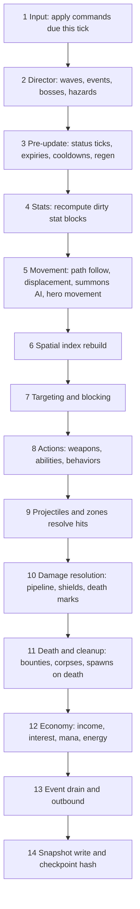
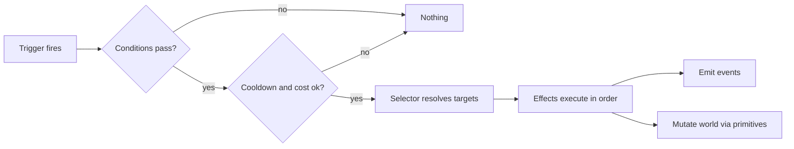
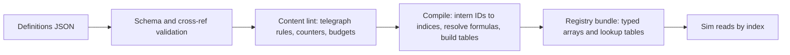

# 7. Entity System

The entity system has two halves: the **ECS** (what exists and how it is stored/updated) and the **Effect Engine** (how content defines behavior). All towers, heroes, enemies, bosses, relics and spells are built from these two.

## 7.1 ECS Design

### Choice and Rationale (ADR-03)

| Requirement | How the ECS meets it |
|---|---|
| Determinism | Iteration always by ascending entity index; structural changes deferred to phase boundaries; no hash-map iteration in hot paths |
| Throughput | Struct-of-arrays typed storage; systems iterate dense arrays |
| Serialization | Every component has a binary serializer; whole world → keyframe |
| Small API | Entities are IDs; components are data; systems are functions over queries |
| Debuggability | Component inspectors; invariant checks in dev builds |

### Entity Identity

| Aspect | Design |
|---|---|
| ID layout | 32-bit: 20-bit index + 12-bit generation |
| Validity | `isAlive(id)` compares generation; stale IDs in components are safe to hold |
| Recycling | Freed indices are returned to the free list **at end of tick** (never mid-tick) |
| Capacity | 4,096 total live (enemies ≤ 1,200); preallocated |
| Ordering | System iteration by index ascending; ties never depend on insertion time |

### Component Storage Kinds

| Kind | Used for | Representation |
|---|---|---|
| **Dense numeric** | Hot data present on many entities (transform, health, path progress) | One typed array per field, indexed by entity index |
| **Sparse numeric** | Data on few entities (weapon, zone, projectile) | Sparse-set arrays with dense packing |
| **Flag/tag** | Booleans and tags (Flying, Boss, Mechanical) | Bitset words per entity |
| **Object** | Complex low-count data (ability books, behavior state, status lists) | Pooled structs with explicit serializers |

### Core Component Catalog

| Component | Fields (conceptual) | Storage | Present on |
|---|---|---|---|
| `Identity` | `kind`, `defIndex`, `team`, `faction`, `spawnTick` | Dense | All |
| `Transform` | `x`, `y`, `prevX`, `prevY`, `facing`, `radius`, `layer` (ground/air/underground) | Dense | Mobile + placed |
| `PathFollower` | `laneId`, `edgeId`, `s` (distance along edge), `nodeQueue`, `speedBase`, `moveMode` | Dense | Ground/air path units |
| `Health` | `hp`, `maxHp`, `regenAccumulator` | Dense | Damageable |
| `ShieldPool` | up to *N* pools: `amount`, `maxAmount`, `priority`, `typeMask`, `expireTick` | Sparse/Object | Shielded |
| `StatBlock` | Pointer to base stat array + **ModifierStack** handle, dirty flags, cached final values | Object + Dense cache | All stat-bearing |
| `Resists` | `resist[9]`, `immuneMask`, `armor` | Dense | Damageable |
| `StatusSet` | Active status instances (id, stacks, expiry, source, tick accumulators) | Object | Any |
| `Weapon` | `cooldownAcc`, `targetId`, `targetMode`, `windupTicks`, `ammo/charge` | Sparse | Towers, enemies with attacks, heroes |
| `Targeting` | Mode, retarget timer, filters, cached candidate | Sparse | Towers, ranged enemies |
| `AbilityBook` | List of abilities with cooldown ticks, charges, trigger subscriptions | Object | Enemies, heroes, bosses |
| `Behavior` | Behavior id, state-machine state, private state blob | Object | Specials |
| `Blocker` / `Blockable` | Block slots, engaged partners, `blockRadius` | Sparse | Soldiers, hero, barricades / ground enemies |
| `Tower` | `padId`, `tier`, `evolutionId`, `investedGold`, `disabledUntilTick`, `overchargeUntilTick` | Sparse | Towers |
| `Hero` | `heroSpecIndex`, `respawnTick`, `ultimateReady`, `stance` | Sparse | Hero |
| `Projectile` | `ownerId`, `targetId/targetPos`, `speed`, `homing`, `payloadIndex`, `pierceLeft`, `bouncesLeft` | Sparse | Projectiles |
| `Zone` | `shape`, `r/w/h`, `ownerId`, `tickInterval`, `effectsIndex`, `expireTick`, `membership` | Object | Auras, lava, fog |
| `Summon` | `ownerId`, `leashRadius`, `ttl`, `rally` | Sparse | Soldiers, beasts, thralls |
| `Lifetime` | `expireTick`, `onExpireEffects` | Sparse | Temporary entities |
| `Bounty` | `gold`, `soul`, `energy` | Dense | Enemies |
| `Threat` | `integrityCost` | Dense | Enemies |
| `Corpse` | `sourceDef`, `expireTick`, `consumed` | Sparse | Corpse entities |
| `Objective` | `kind`, `groupId`, `onDestroyEffects` | Sparse | Lanterns, pods, conveyors |
| `Anim` | `animState`, `animPhase` | Dense | Visible |
| `Tags` | Bitset (see below) | Flags | All |

### Tag Catalog

`Flying`, `Ground`, `Boss`, `Elite`, `Swarm`, `Mechanical`, `Crystalline`, `Undead`, `Ethereal`, `Stealthed`, `Burrowed`, `Phased`, `Summoned`, `Hero`, `Tower`, `Objective`, `Targetable`, `Invulnerable`, `Blocking`, `Disabled`, `Revealed`, `Immobile`.

Tags drive targeting filters, resist rules, effect conditions and rendering flags.

## 7.2 Archetypes (Assemblers)

An **archetype** is a function that builds an entity from a *definition* + *context* (scaling, owner, position). It is not a class hierarchy.

| Archetype | Core components | Built from |
|---|---|---|
| **Enemy (standard)** | Identity, Transform, PathFollower, Health, StatBlock, Resists, StatusSet, Blockable, Bounty, Threat, Anim, Tags, AbilityBook? | `EnemyDefinition` + wave scaling |
| **Swarm unit** | Reduced set (no AbilityBook, minimal StatBlock) | `EnemyDefinition.swarm` |
| **Boss** | Enemy + Behavior + Objective links + phase state | `BossDefinition` |
| **Tower** | Identity, Transform, Tower, Weapon, Targeting, StatBlock, StatusSet, AbilityBook?, Behavior?, Anim | `TowerDefinition` + tier/evolution |
| **Soldier / Beast / Thrall** | Identity, Transform, Health, StatBlock, Resists, StatusSet, Blocker, Weapon, Summon, Anim | Summon spec in tower/hero/ability |
| **Hero** | Identity, Transform, Health, StatBlock, Resists, StatusSet, Hero, Weapon, AbilityBook, Blocker?, Anim | `HeroSpec` |
| **Projectile** | Identity, Transform, Projectile, Lifetime, Anim | Weapon attack spec |
| **Zone** | Identity, Transform, Zone, Lifetime | Effect `SpawnZone` |
| **Trap/Rune** | Identity, Transform, Zone (trigger), Lifetime | Rune Warden etc. |
| **Objective** | Identity, Transform, Health, Objective, Tags | Boss/map script |
| **Corpse** | Identity, Transform, Corpse, Lifetime | On enemy death (when enabled by map/faction) |
| **Hazard emitter** | Identity, Transform, Behavior, Zone | Map hazard spec |
| **Portal/Spawner** | Identity, Transform, Behavior, Lifetime | Wave events, boss abilities |

## 7.3 Systems and Schedule

### Phase Order Per Tick

### System Catalog

| # | System | Reads | Writes | Notes |
|---|---|---|---|---|
| 1 | `CommandSystem` | Command queue | World via handlers | Validates, emits `Tower.Built` etc. |
| 2 | `WaveDirector`, `EventDirector`, `BossDirector`, `HazardSystem` | Scripts, tick | Spawns via command buffer | Scripted content timeline |
| 3 | `StatusSystem` | StatusSet | Health (DoT), StatusSet | Tick accumulators at 0.5 s |
| 3 | `CooldownSystem` | AbilityBook, Weapon | Cooldown fields | Integer ticks |
| 4 | `StatSystem` | ModifierStacks | Cached stats | Dirty-flag recompute |
| 5 | `PathMovementSystem` | PathFollower, stats | Transform, `s` | Speed from final stat; slows and displacement applied here |
| 5 | `SummonSystem` | Summon, targets | Transform | Leash, rally, engage |
| 5 | `HeroMovementSystem` | Hero, nav | Transform | Deterministic A*/flow |
| 6 | `SpatialIndexSystem` | Transform, layer | Grid | Per-tick rebuild for movers; static for pads |
| 7 | `TargetingSystem` | Spatial, Targeting, tags | Targeting | Re-evaluated every 3 ticks or on invalidation |
| 7 | `BlockingSystem` | Blocker, Blockable | Engagement links | Assigns block slots |
| 8 | `WeaponSystem` | Weapon, Targeting, stats | Projectiles, instant hits | Attack timing |
| 8 | `AbilitySystem` | AbilityBook, triggers | Effect requests | Cooldowns and casting |
| 8 | `BehaviorSystem` | Behavior | Varies | Specials (e.g., Riddle Shell) |
| 8 | `AuraSystem` | Zone/aura sources | Modifier memberships | Membership updated every 5 ticks |
| 9 | `ProjectileSystem` | Projectile | Hits → damage requests | Travel, homing, pierce |
| 9 | `ZoneSystem` | Zone | Effects on members | Interval ticks |
| 10 | `DamageSystem` | Damage requests | Health, shields | Runs `DamagePipeline` |
| 11 | `DeathSystem` | Health ≤ 0 | Destroy, spawn corpse, bounty | Emits `Entity.Died` |
| 11 | `LeakSystem` | PathFollower end | Integrity | Interceptable |
| 12 | `EconomySystem` | Events | Resources | Interest and regen |
| 13 | `EventBusDrain` | Queue | Handlers | Breadth-first |
| 14 | `SnapshotSystem` | Many | Buffers | No sim mutation |

### Structural Changes

- Creating/destroying entities during a phase writes to a **command buffer**; the buffer is applied at the end of the phase (in request order) so iteration never sees half-built entities.
- Entities created in phase *k* first update in phase *k+1* of the same tick or in the next tick (documented per archetype).

## 7.4 Spatial Queries

| Aspect | Design |
|---|---|
| Structure | Uniform grid; cell size = 1 tile; separate layers: ground, air, underground, soldiers, towers, objectives |
| Rebuild | Movers every tick (cheap: counting sort); static layers once |
| Queries | `circle`, `ring`, `cone`, `line(width)`, `lane segment`, `nearestN`, `all(tag filter)` |
| Ordering | Results sorted by `(distance, index)` to make ties deterministic |
| Range test | Distance from tower centre to enemy centre minus enemy radius ≤ range |
| Cost control | Targeting caches the current target and revalidates cheaply; full queries run only on invalidation |

## 7.5 Relations and Ownership

| Relation | Representation | Death policy |
|---|---|---|
| Summon → owner | `Summon.ownerId` | Configurable per summon: `dieWithOwner`, `persist`, `despawnAfterTTL` |
| Projectile → source | `Projectile.ownerId` | Projectile persists; credit attributed by ID, falls back to team if owner dead |
| Zone → source | `Zone.ownerId` | Per zone spec |
| Linked towers (Leyline Nexus, Glyph Labyrinth) | Link table in the behavior state, validated each tick | Breaks cleanly if a member dies/sold |
| Objective → boss | `Objective.groupId` | Boss logic reacts to `Boss.ObjectiveCleared` |
| Taunt/aggro | `Targeting.forcedTargetId` with expiry | Cleared on death |

## 7.6 Time, Timers and RNG

| Aspect | Design |
|---|---|
| Time | Integer **tick**; all durations stored as ticks; seconds converted at load |
| Timers | Min-heap scheduler keyed by `(dueTick, seq)`; used for delayed effects (Echo Spire, Paradox Loom), telegraph → effect, boss scripts |
| RNG | Named **streams** split from the battle seed: `spawn`, `combat`, `status`, `ai`, `loot`, `events`, `procgen`; each stream is a small-state generator advanced in a fixed, documented order |
| RNG hygiene | One stream per concern so adding a combat roll never changes spawn randomness; consumption order follows system order and entity index |
| Cosmetic randomness | Render-only RNG is separate and never touches the sim |

## 7.7 Serialization, Hashing, Keyframes

| Item | Design |
|---|---|
| **Keyframe** | Binary world dump: entity table, component arrays, object-component serializers, RNG states, timers, director states, economy, event sequence counter |
| **State hash** | Fast non-cryptographic hash over a canonical ordered subset (positions, HP, resources, RNG states, entity counts) |
| **Versioned** | Keyframes are valid only for the same `simVersion` |
| **Use cases** | Resume, rewind (ring), replay checkpoints, desync diagnosis, bug reports |

## 7.8 Invariants and Debug Aids (Dev Builds)

- No NaN/Infinity in numeric components (checked per tick in dev).
- `hp ≤ maxHp`, `s` within edge bounds, tags consistent with layer.
- Entity count ≤ cap; free list consistency.
- Order-independence test: shuffle command arrival order within a tick must not change the hash (commands are sorted, so this validates the sort).

---

# 7B. Effect Engine

## 7.9 Concept

All gameplay behavior that is not hard-coded engine mechanics is expressed as:

**Trigger → Condition(s) → Selector → Effect(s)**, plus **Cost / Cooldown / Duration / Stacking** metadata.

The same machinery powers **tower perks, evolutions, enemy abilities, boss phases, hero skills and passives, relics, spells, hazards and weather**.

## 7.10 Triggers

| Group | Triggers |
|---|---|
| Lifecycle | `OnSpawn`, `OnDeath`, `OnBuild`, `OnUpgrade`, `OnEvolve`, `OnSell`, `OnExpire` |
| Time | `OnInterval(ticks)`, `OnDelay(ticks)`, `OnWaveStart`, `OnWaveEnd`, `OnBattleStart` |
| Combat (self as source) | `OnAttack`, `OnHit`, `OnCrit`, `OnKill`, `OnMiss`, `OnShieldBreak` |
| Combat (self as target) | `OnDamaged`, `OnHealed`, `OnHpBelow(pct)`, `OnStatusApplied`, `OnStatusExpired` |
| Spatial | `OnEnterZone`, `OnLeaveZone`, `OnReachNode`, `OnBlocked`, `OnLeak` |
| Player | `OnCast(skillId)`, `OnNexusSpell(spellId)`, `OnCommand(type)` |
| Global events | `OnEvent(eventType, filter)` |
| Meta | `OnResourceThreshold(kind, value)`, `OnPhaseEnter(bossPhase)` |

## 7.11 Conditions

| Group | Conditions |
|---|---|
| Target facts | Has tag, lacks tag, has status, status stacks ≥ n, HP% < / > x, is boss/elite, is flying |
| Self facts | Resource ≥ n, cooldown ready, stacks ≥ n, in phase p |
| Spatial | Count in radius ≥ n, distance < d, within lane, adjacent to tower of school s |
| Probability | `Chance(p, stream)` (uses the named RNG stream) |
| Context | Damage type is t, source school is s, hit is crit, first hit this wave, wave index ≥ n |
| Logic | `All`, `Any`, `Not` |

## 7.12 Selectors

`Self`, `Owner`, `EventSource`, `EventTarget`, `NearestN(filter, radius)`, `RandomN(filter, radius)` (RNG `combat`), `InRadius`, `InCone`, `InLine`, `InLane`, `AllWithTag`, `LinkedTowers`, `AdjacentTowers`, `Hero`, `Nexus`, `MapWide`, `ChainFrom(target, n, radius, falloff)`.

## 7.13 Effect Primitives (≈ 26)

| # | Primitive | Purpose | Example users |
|---|---|---|---|
| 1 | `Damage` | Issue a `DamageRequest` (type, amount formula, flags) | Every attacker |
| 2 | `Heal` | Restore HP | Druid Warden, Sanctuary Shrine |
| 3 | `ApplyStatus` | Add/stack/refresh a status | Burn, Slow, Curse |
| 4 | `RemoveStatus` / `Cleanse` | Dispel by category/tag | Cleansing Light, Purge |
| 5 | `ModifyStat` | Timed or aura stat modifier with source | Overclock, Chord Aura |
| 6 | `Shield` | Add shield pool | Aegis Dome, Faith Shield |
| 7 | `SpawnProjectile` | Launch a projectile | Ballista, Mortar |
| 8 | `SpawnZone` | Area with periodic effects | Lava pool, Sanctify Ground |
| 9 | `SpawnEntity` | Summons, objectives, portals | Barracks, Gate Portal |
| 10 | `Displace` | Knockback, pull, teleport along lane, blink | Gale Perch, Rift Stalker |
| 11 | `Stun` / `Root` / `Silence` / `Disable` | Control (via statuses with CC tags) | Thunder Drum, Slagthrower |
| 12 | `GrantResource` / `SpendResource` | Gold, Mana, Energy, Integrity | Bounty Hunter, Greed's Bargain |
| 13 | `Execute` | Kill below threshold (respects boss rules) | Sigil Executioner |
| 14 | `Revive` | Return an entity with HP% | Canopic Wraith, Altar |
| 15 | `Transform` | Swap definition/form/behavior | Thorn shapeshift, evolution swap |
| 16 | `SetTargetMode` | Force/scramble targeting | Mind Seize |
| 17 | `Reveal` | Remove stealth/phase flags temporarily | Truth Lantern |
| 18 | `Mark` | Add vulnerability mark | Marked Shot, Truth Lantern |
| 19 | `Taunt` | Force target | Gorrum's Roar |
| 20 | `TimeScale` | Local time dilation (speed/attack rate) | Chrono tower, Time Dilation |
| 21 | `Echo` | Re-emit a recorded effect after delay | Echo Spire, Paradox Loom |
| 22 | `ConvertDamage` | Change damage type of a request | Prismatic Lantern |
| 23 | `Link` | Establish linked-tower relation | Leyline Nexus, Glyph Labyrinth |
| 24 | `RestoreKeyframe` | Rewind to ring-buffer keyframe | Second Chance (single user) |
| 25 | `ScriptBehavior(id, params)` | Invoke a registered behavior hook | Specials |
| 26 | `Emit(event)` | Emit a custom event/telegraph | Boss scripts |

### Amount Formulas

Effect amounts are **formulas over named inputs**, not literals: `base × coefficient(stat) × tierScalar × levelScalar`, evaluated by a small expression evaluator restricted to `+ − × ÷ min max clamp lerp` and table lookups (no loops, no transcendental functions). This lets designers express "damage scales +0.5% per 10 Mana" safely and deterministically.

## 7.14 Status Definition

| Field | Meaning |
|---|---|
| `id`, `category` | `Buff`, `Debuff`, `Control` |
| `tags` | `Dispellable`, `HardCC`, `SoftCC`, `DoT`, `Slow`, `Stun`, `Root`, `Silence`, `Disable`, `Vulnerability` |
| `stacking` | `Refresh`, `StackToMax(n)`, `Independent(maxInstances)`, `StrongestWins` |
| `duration` | Ticks, extendable rules |
| `tick` | Interval + effect (e.g., Burn damage) |
| `modifiers` | Stat modifiers while active (e.g., Slow → `move.speed` multiplier) |
| `immunityTags` | Tags that block application |
| `tenacity` | Whether tenacity/DR applies |
| `view` | Overlay/icon keys |

Examples: *Burn* (`DoT`, `StackToMax(5)`, tick 0.5 s, prevents regeneration), *Curse* (`Vulnerability`, `StrongestWins`), *Brittle* (`Vulnerability`, consumed on Physical/Sonic hit), *Freeze* (`HardCC`, tenacity applies).

## 7.15 Modifier Stack

| Layer | Operation | Example |
|---|---|---|
| 0 **Base** | Starting value from definition/tier | Tower damage 18 |
| 1 **Flat** | Add | +2 damage from a relic |
| 2 **Additive %** | Sum of percentages, then multiply once | +15% (Curse) + 10% (Mark) |
| 3 **Multiplicative** | Each "more" multiplies | ×1.25 (Chord) ×1.10 (Doctrine) |
| 4 **Override** | Last-by-priority replaces | Set attack speed to X |
| 5 **Clamp** | Min/max caps | Attack rate ≤ 15/s, resist ≤ 75% |

| Property | Detail |
|---|---|
| Source tracking | Every modifier carries `sourceId` (entity, status, relic, research node, skill-tree node) and a `label` key for tooltips |
| Duration | Optional expiry tick; auras add/remove on membership change |
| Caching | Final value recomputed lazily when the stack is dirty (add/remove/expire) |
| Meta caps | Meta modifiers carry a **bucket** (`skilltree`, `research`, `mastery`, `relic`, `gear`) with a per-bucket cap enforced at setup (GDD Power Ledger) |
| Explainability | `explain(stat)` returns the layered breakdown for UI tooltips and the entity inspector |

### Stat Key Families

`weapon.damage`, `weapon.attack_speed`, `weapon.range`, `weapon.crit_chance`, `weapon.crit_mult`, `weapon.pierce`, `weapon.aoe_radius`, `weapon.armor_pierce`, `weapon.penetration.<type>`, `move.speed`, `health.max`, `health.regen`, `defense.armor`, `resist.<type>`, `evasion`, `accuracy`, `heal.power`, `heal.received`, `tenacity`, `cost.build`, `cost.upgrade`, `mana.regen`, `mana.cap`, `income.gold`, `cooldown.rate`, `duration.mult.<kind>`, `status.chance`, `summon.hp`, `summon.damage`.

## 7.16 Behavior Registry (Escape Hatch)

Some content cannot be expressed as data compositions without making the engine opaque. These use **named behaviors** implemented once in code and parameterized by data.

| Rule | Detail |
|---|---|
| Contract | A behavior implements lifecycle hooks: `init`, `onTick`, `onEvent`, `onDestroy`, `serialize`, `deserialize` |
| Determinism | No I/O, no wall clock, RNG only through named streams |
| Parameters | All numbers come from definitions; behaviors never hard-code tuning |
| State | Private state is a small serializable blob (included in keyframes) |
| Registration | Behavior IDs are registered at startup; content validation fails on unknown IDs |
| Decision rule | If the mechanic needs **persistent custom state or cross-entity coordination**, use a behavior; otherwise compose primitives |
| Budget | Target ≤ 60 behaviors for 1.0 (see roster in 05) |

### Behavior Roster (Preview)

`riddle_shell`, `adaptive_armor`, `rune_plating`, `phalanx_formation`, `soul_bind`, `corpse_feeder`, `leyline_links`, `glyph_network`, `prismatic_convert`, `echo_replay`, `planar_lock_bubble`, `gem_exchange`, `spellforge_overcharge`, `phoenix_ash`, `rootwall_reroute`, `day_night_cycle`, `rage_charge`, `chord_crystals`, `spectrum_phase`, `spell_mirror`, `counterspell_circle`, `soul_link_lanterns`, `verdict_scales`, `unmaker_rewrite`, `train_cars`, `thin_ice`, `axiom_shift`, `form_shift`.

## 7.17 Content → Runtime Compilation

| Compile step | Benefit |
|---|---|
| ID interning | Systems use small integer indices, not strings |
| Formula compilation | Expressions become small bytecode programs evaluated without allocation |
| Curve baking | `pow`/`exp` curves precomputed into lookup tables (ADR-06) |
| Cross-ref resolution | Missing references fail at build time |
| Dependency graph | Evolutions → parents, summons → defs, statuses → effects are validated |
