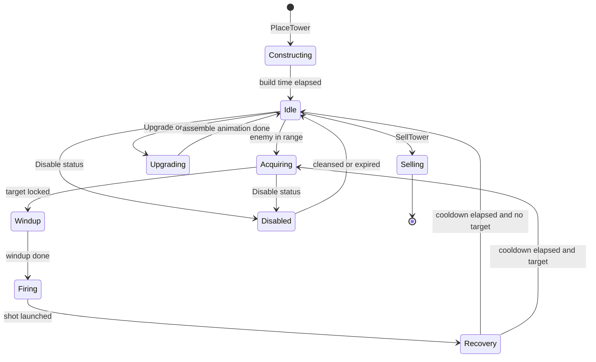
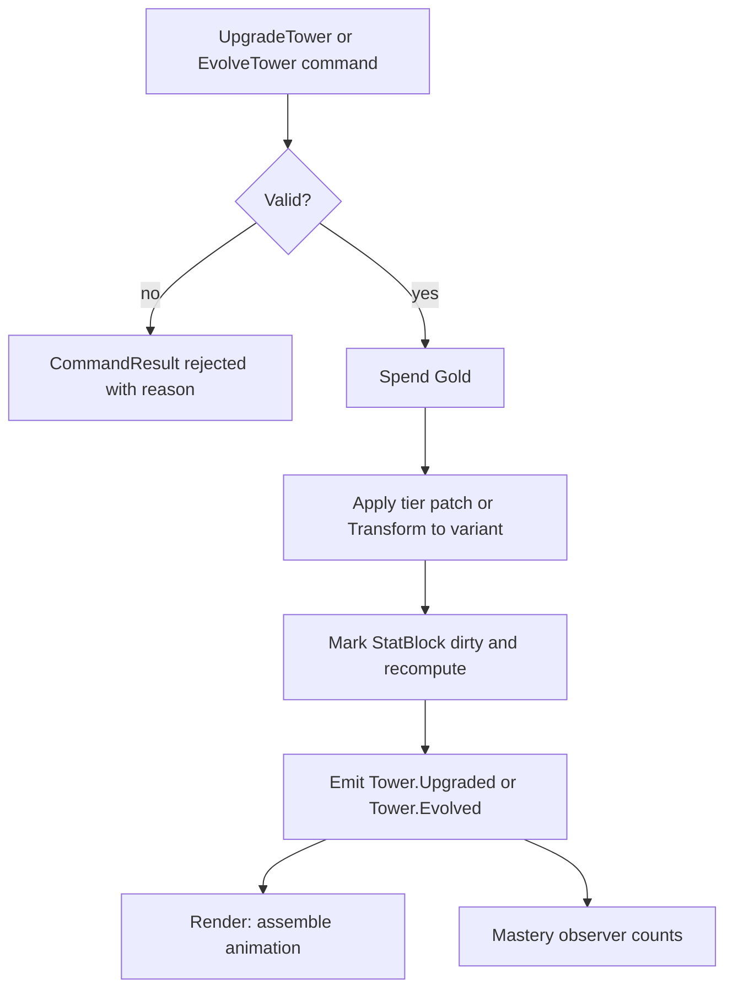
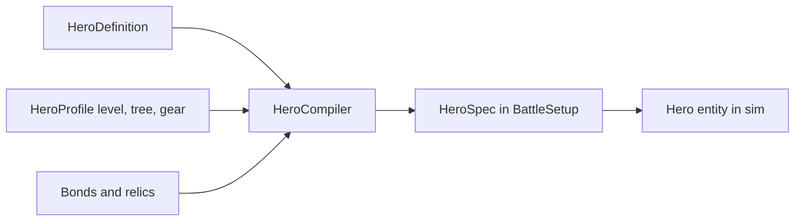
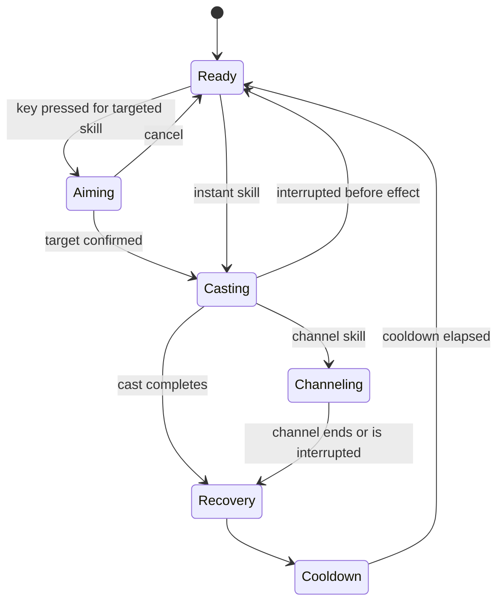
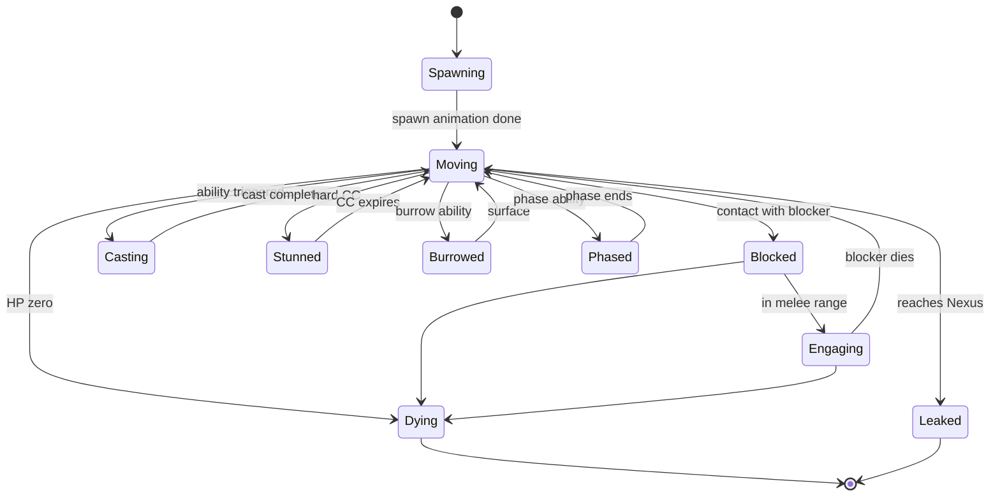
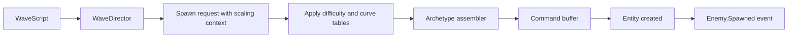
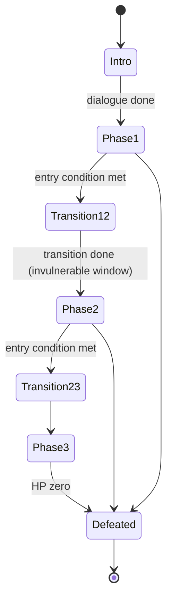

# 8. Tower Framework

## 8.1 Goals

- Express all **30 base towers and 60 evolutions** through **definitions + ~14 weapon archetypes + the Effect Engine**, using behavior code only for a small set of special cases.
- Make tiers, evolutions, Overcharge, mastery and meta modifiers uniform.
- Keep placement, upgrade and disable/cleanse rules in one place.

## 8.2 TowerDefinition (Schema)

| Group | Field | Description |
|---|---|---|
| Identity | `id`, `school`, `role`, `loreKey`, `nameKey`, `descKey` | Role ∈ {Damage, Control, Support, Summon, Economy} |
| Placement | `padSize` (Small/Large), `terrainRules`, `maxPerMap?` | Large pads limited per map |
| Cost | `buildCost`, `tierCostMult` [II, III, IV], `sellRefund` | Costs from the balance bundle by reference |
| Archetype | `weaponArchetype` + `archetypeParams` | See 8.4 |
| Base stats | `damage`, `damageType`, `attackSpeed`, `range`, `targets` (Ground/Air/Both), `aoeRadius`, `pierce`, `chain`, `projectile` spec, `armorPierce`, `critChance?` | Tier I values |
| Targeting | `allowedModes`, `defaultMode`, `filters` | Evolutions may add modes |
| Tiers | `tiers[II, III]`: stat patches (modifiers) + perk effects | Named perks with lore |
| Evolutions | `evolutions[A, B]`: each a full **TowerVariant** (below) | Two per tower |
| Overcharge | `overchargeSpec` (mana cost, duration, cooldown, effect) or `replacedBy` an evolution active | Default: +50% rate for 6 s |
| Effects | Extra Trigger → Effect entries active at tier ≥ n | Perks and unique mechanics |
| Behaviors | Optional `behaviorId` + params | Escape hatch |
| Summons | Summon specs (soldiers, beasts, whelps) | For Summon archetype |
| Mastery | `masteryPerks[1..20]` | Sidegrade modifiers and cosmetics, capped by bucket |
| Unlock | `unlockAct`, `shardCost` | Used by `UnlockResolver` |
| Balance | `roleWeights`, `powerTags`, `balanceNotes` | Feeds power-budget lint (doc 07) |
| View | `viewId` → modules per tier/evolution, aim pivot, muzzle points, SFX | Presentation only |

### TowerVariant (Evolution)

| Field | Description |
|---|---|
| `id`, `nameKey`, `loreKey` | Evolution identity |
| `costMult` | From `tierCostMult[IV]` unless overridden |
| `statPatch` | Modifiers applied on top of Tier III |
| `archetypeOverride?` | Swap weapon archetype or parameters (e.g., Ballista → charged shot) |
| `effects` | Additional/replacement Trigger → Effect entries |
| `behaviorId?` | Variant-specific behavior (e.g., `glyph_network`) |
| `targetModesAdded` | e.g., *Manual Aim* for Nexus Artillery |
| `active?` | Player-triggered ability (Howitzer salvage, Overcharge replacement) |
| `padSizeOverride?` | Becomes Large (◼) |
| `view` | Add-on module |

## 8.3 Tower Runtime

### Entity Composition

`Identity + Transform + Tower + Weapon + Targeting + StatBlock + StatusSet [+ AbilityBook] [+ Behavior] [+ Zone for auras] + Anim`.

### State Machine

**Notes**
- *Constructing* lasts ≤ 1 s and is cancelable for a 100% refund during preparation or an 85% refund for 10 s afterwards.
- *Disabled* is a status (`Disable`, tag `Disabled`), not a separate component; weapons and abilities check the tag; Overcharge and cooldowns pause.
- **Upgrade** keeps the entity ID and swaps definition/tier in place; **Evolve** swaps to the variant definition (`Transform` primitive) while preserving investment tracking, targeting mode and kills/mastery counters.

## 8.4 Weapon Archetypes

| Archetype | Mechanism | Parameters | Used by |
|---|---|---|---|
| **Projectile** | Spawns a projectile with homing/ballistic travel | speed, homing, hit shape, pierce, bounce | Arcane Tower, Ballista, Frost Spire, Plague Bloom, Gale Perch, Crystal Cannon, Wyrmling whelps |
| **Chain** | Instant hit that jumps between targets | chain count, radius, falloff | Tesla Coil |
| **Cone** | Instant cone each attack | angle, length, tick | Flame Forge |
| **Lob (Artillery)** | Ballistic arc with ground impact AoE | arc time, AoE, minRange | Mortar, Ember Brazier, Hailstorm (volley) |
| **Pulse** | Radial burst on interval | radius, interval, effect | Thunder Drum, Resonance Pylon |
| **Aura** | Persistent zone applying effects each interval | radius, interval, effects | Permafrost Totem, Mana Font, Sanctuary Shrine, Eclipse Pillar |
| **Beam** | Line hit with duration/ramp | width, length, tick, ramp | Sun Beacon, Judgment Beam, Prism Destroyer, Solar Pyre |
| **Trap Layer** | Places up to *n* triggers on lane | n, trigger radius, rearm | Rune Warden |
| **Summoner** | Maintains *n* summons with rally | summon def, respawn, rally radius | Garrison Barracks, Beastcaller, Wyrmling Roost, Nightblade Den |
| **Gravity** | Applies continuous displacement + damage | pull strength, radius, tick | Void Rift |
| **Debuffer** | Low damage + status application per hit | status, chance | Cursed Idol, Truth Lantern, Chrono Pendulum, Anchor Pillar |
| **Generator** | Produces resources | rate, aura bonuses | Shard Harvester, Mana Font (secondary) |
| **Root/Vine** | Periodic root on nth attack | n, duration | Nature Grove |
| **Siphon** | Damage + resource/stack gain on kill | gain rule | Shadow Obelisk |

## 8.5 Mapping: 30 Base Towers

| # | Tower | Archetype | Key effects / hooks | Behavior needed? |
|---|---|---|---|---|
| 1 | Arcane Tower | Projectile (homing) | Perk: Dual Bolt every 4th shot (`OnAttack` counter) | No |
| 2 | Rune Warden | Trap Layer | Runes as Zone triggers; Echo Glyph re-arm on kill | No |
| 3 | Mana Font | Generator + Aura | `GrantResource(Mana)` on interval; aura boosts Overcharge duration | No |
| 4 | Ballista Post | Projectile (pierce) | Pierce 3, Bleed at III | No |
| 5 | Garrison Barracks | Summoner | 3 soldiers, rally, respawn between waves | No |
| 6 | Mortar Emplacement | Lob | AoE r1.2, minRange, armor shred at III | No |
| 7 | Flame Forge | Cone | Burn status stacks | No |
| 8 | Ember Brazier | Lob | Ground fire zone (burn) | No |
| 9 | Wyrmling Roost | Summoner (flying) | Patrol summons with Projectile weapon | No |
| 10 | Frost Spire | Projectile | Slow on hit; Brittle at III | No |
| 11 | Permafrost Totem | Aura | Slow + DoT aura | No |
| 12 | Hailstorm Battery | Lob (volley ×5) | Frost AoE volley | No |
| 13 | Tesla Coil | Chain | Chain 3 (−20%/jump) | No |
| 14 | Gale Perch | Projectile + Displace | Knockback 0.4 tile; air priority | No |
| 15 | Thunder Drum | Pulse | Stun r2.5; surface burrowed at III | No |
| 16 | Nature Grove | Root/Vine | Root every 4th hit | No |
| 17 | Plague Bloom | Projectile + status | Poison stacks to 5; heal reduction at III | No |
| 18 | Beastcaller Lodge | Summoner | 2 beasts, Bleed at III | No |
| 19 | Shadow Obelisk | Siphon | Soul counter (`OnKill`), damage scaling modifier | `soul_counter` (light) |
| 20 | Nightblade Den | Summoner (stealth hunters) | Backstab bonus if target unengaged; Assassinate execute | `assassin_ai` |
| 21 | Cursed Idol | Debuffer | Curse (StrongestWins) | No |
| 22 | Sun Beacon | Beam | Pierce line | No |
| 23 | Sanctuary Shrine | Aura | Heal Integrity/units; periodic Cleanse | No |
| 24 | Truth Lantern | Debuffer + Aura | Reveal + Mark | No |
| 25 | Crystal Cannon | Projectile (heavy) | Armor pierce 40%; bounce at III | No |
| 26 | Resonance Pylon | Pulse | Bonus vs `Crystalline`/`Mechanical` tags | No |
| 27 | Shard Harvester | Generator | Kill-gold aura, passive Gold, end-of-battle shards counter | No |
| 28 | Void Rift | Gravity | Pull + tick damage | No |
| 29 | Chrono Pendulum | Debuffer | Slow; 5% Displace-backward chance | No |
| 30 | Anchor Pillar | Debuffer + Aura | Anti-blink/phase aura (tags `NoTeleport`), evasion strip | No |

## 8.6 Mapping: 60 Evolutions by Implementation Class

| Class | Definition | Count (est.) | Examples |
|---|---|---|---|
| **P — Parametric** | Stat patch / archetype param change only | ~14 | Siege Repeater, Drake Brood (more summons), Dawnbreaker Prism (split beams), Frostbite Gatling |
| **C — Compositional** | New Trigger → Effect compositions with existing primitives | ~30 | Inferno Foundry (OnDeath → spread Burn), Glacier Citadel (freeze chance + shatter vuln), Storm Conductor, Overload Pylon, Doomsayer Effigy, Withering Throne (aura % max HP) |
| **B — Behavior** | Requires registered behavior | ~16 | Listed below |

### Evolutions Requiring Behaviors

| Evolution | Behavior | Why code |
|---|---|---|
| Leyline Nexus | `leyline_links` | Maintains a link graph; shares strongest buff among members |
| Glyph Labyrinth | `glyph_network` | Rune pairing and chain bursts along links |
| Spellforge Engine | `spellforge_overcharge` | Converts surplus global Mana into a continuously changing modifier |
| Phoenix Kiln | `phoenix_ash` | Counter + summoned phoenix entity with scripted dive |
| Siege Howitzer / Nexus Artillery | `manual_aim` | Adds a player-aimed targeting mode and active command |
| Cyclone Tower | `tornado_loop` | Moving zone that steers enemies in a circular path |
| Resurrection Altar | `rebuild_once` | Tracks destroyed/disabled tower; rebuilds free once |
| Aegis Sanctum | `aegis_barrier` | Per-target one-hit barrier with recharge |
| Prismatic Lantern | `prismatic_convert` | Applies `ConvertDamage` to towers in range with chosen type |
| Gem Exchange | `gem_exchange` | Currency conversion UI contract + reserve |
| Prismatic Reactor | `reactor_overcharge` | Consumes shard counter, grants free Overcharge to neighbors |
| Event Horizon Gate | `horizon_gate` | Portal pairs; displaces along lane by N tiles |
| Singularity Engine | `singularity` | Growing gravity well with execute threshold |
| Epoch Engine | `time_stop_pulse` | Local freeze with elite/boss exceptions |
| Paradox Loom | `echo_replay` | Records neighbors' attacks and replays after delay (via `Echo`) |
| Planar Lock | `planar_lock_bubble` | Bubble with overload meter and sabotage reflection |

## 8.7 Placement and Pads

| Concept | Design |
|---|---|
| **Pad** | `{ id, x, y, size, terrainTags, elevationBonus, reserved? }` loaded from map data |
| **Large pad** | Footprint of 2×2 smalls; counted separately; limited per map |
| **Validation** (`PlacementService`) | Pad exists and free; size compatible; unlocked in loadout; Gold sufficient; per-map limits; map rules (restrictions, banned school) |
| **Terrain modifiers** | Elevated: +10% range; Lens pad: beam range extension; Oasis: Frost range bonus — implemented as modifiers attached on build |
| **Objectives on pads** | Soul Lanterns occupy pads; the placed tower is sold with full refund by the boss effect |
| **Ghost preview** | Client-side validity hints using static pad data |

## 8.8 Upgrade, Evolve, Sell Pipeline

| Rule | Detail |
|---|---|
| Cost | `buildCost × tierCostMult[tier]` with `cost.upgrade` modifiers |
| Refund | 70% of `investedGold`; 100% during preparation; 85% for 10 s after build |
| Evolution choice | Permanent for the battle; respec by selling and rebuilding |
| Hero/spell interactions | Overclock, Chord, etc. are `ModifyStat` entries and are preserved across upgrades via source IDs |

## 8.9 Targeting Strategies

| Mode | Rule | Tie-break |
|---|---|---|
| First | Greatest path progress | Entity index |
| Last | Least progress | Entity index |
| Strongest | Highest current HP | Progress, index |
| Weakest | Lowest current HP | Progress, index |
| Fastest | Highest effective speed | Progress, index |
| Closest | Smallest distance | Index |
| Flying-first | Air layer first, then First | Index |
| Marked | Has `Mark` from this school/hero first | Progress |
| Evolution-specific | `ManualAim`, `HighestHPInCluster`, etc. | Documented per variant |

**Stickiness:** a tower keeps its target until it dies, leaves range or invalidates (untargetable); retarget cooldown of 3 ticks avoids jitter. Filters respect `Stealthed`, `Burrowed`, `Phased` (target must be `Targetable` or revealed).

## 8.10 Attack Execution

| Hit type | Resolution |
|---|---|
| **Instant** (chain, cone, pulse, hitscan) | Hits applied in the same tick as the attack |
| **Projectile** | Entity travels at `speed` (tiles/s); homing steers toward target; on arrival applies payload; if the target dies, retarget within radius or fizzle per spec |
| **Beam** | Applies damage each `tickInterval` while channel is alive; ramp multiplier grows with continuous time on the same target |
| **Area/Lob** | Impact at a predicted position (lead calculation using target velocity and lane tangent) |
| **Contact** (summons) | Melee range check and attack cooldown |

Attack timing, cooldown accumulation and haste rules are in doc 06.

## 8.11 Overcharge and Actives

- **Overcharge:** `OnCommand(Overcharge)` → check Tier ≥ III → spend 20 Mana → add `ModifyStat(+50% attack_speed or effect rate)` for 6 s → set cooldown 30 s.
- Evolutions can **replace** Overcharge with a unique active (e.g., Howitzer salvo, Phoenix burst) using the same command path and UI slot.
- Overcharge is paused while `Disabled`.

## 8.12 Disable, Cleanse and Immunity

| Mechanic | Implementation |
|---|---|
| Tower disable | `ApplyStatus(Disable)` with `immunityTags` check; Planar Lock, Oath of Light and Lockdown grant immunity or reduce duration through `tenacity`-like stat `disable.resist` |
| Cleanse | `Cleanse(tag: Disable)` from Sanctuary, Cleansing Light, Brannoc's Field Repair |
| Telegraph | Any enemy ability that disables towers must emit a telegraph ≥ 2 s (content lint) |

## 8.13 Summon Sub-Framework (Soldiers, Beasts, Whelps, Thralls)

| Aspect | Design |
|---|---|
| Spec | `SummonSpec`: def, count, HP, damage, speed, leash, respawn rule, rally mode, blocking behavior, layer |
| Rally | Position on lane; moveable by dragging (Barracks) or fixed |
| Blocking | Occupies block slots on the lane at the rally point; engages enemies within block radius |
| Respawn | Between waves or after delay; costs nothing unless specified |
| AI | Simple FSM: Return → Engage → Chase (bounded by leash) → Return |
| Perf | Cap summons per tower; swarm summons use a reduced component set |

## 8.14 Meta Modifiers and Mastery on Towers

At battle start the `BattleSetup.modifiers` list is compiled into **loadout modifiers** attached per school/tower id. They are applied as `ModifyStat` entries with `bucket` caps, so towers never read the profile.

---

# 9. Hero Framework

## 9.1 Two-Layer Model

| Layer | Context | Contents |
|---|---|---|
| **HeroProfile** | `meta` | Level, XP, tree allocation, gear, mastery, bonds |
| **HeroSpec** | DTO built by `HeroCompiler` | Final base stats, compiled skills (with patches), passives, ultimate, equipment-derived modifiers |
| **Hero entity** | `sim` | Instantiated from `HeroSpec` at battle start |

The sim never sees the profile or tree; **tree nodes and gear are already folded into the `HeroSpec`**, which is also hashed into the replay header.

## 9.2 HeroDefinition (Schema)

| Group | Field | Description |
|---|---|---|
| Identity | `id`, `class`, `role`, `origin`, story/lore keys, unlock rule | |
| Base stats | `hp`, `armor`, `moveSpeed`, `attack` (damage, type, speed, range, ranged/melee) | Level-1 values |
| Growth | `growthCurves` (per stat, referencing balance curves) | Level 1–30 |
| Skills | `Q`, `W`, `E` **SkillDefinition** | See 9.3 |
| Passives | `passives[2]` | Trigger → Effect or auras |
| Ultimate | **SkillDefinition** with energy cost | |
| Forms | Optional alternate kits (Thorn: Bear/Hawk) | `FormDefinition[]` |
| Tree | `branches[3]` → `tiers[3]` → `nodes[]` | See 9.6 |
| Equipment | Slot rules, signature item ids | |
| Bonds | `[heroId → bonus]` | |
| View | `viewId`, animation set, voice lines | |

### SkillDefinition

| Field | Description |
|---|---|
| `id`, `slot`, `nameKey`, `descKey`, `icon` | |
| `castType` | `Instant`, `Targeted`, `GroundTarget`, `Direction`, `Channel`, `Toggle` |
| `range`, `radius`, `shape` | For previews and selectors |
| `castTimeTicks`, `channelTicks`, `recoveryTicks` | |
| `cooldownTicks`, `charges` | |
| `cost` | None for skills; Ultimate: Nexus Energy |
| `interrupt` | Moves cancel? Stun cancels? |
| `effects` | Trigger → Effect list (usually `OnCast`) |
| `patchPoints` | Named parameters tree nodes/Sigils can modify (e.g., `projectiles`, `radius`, `cooldown`) |
| `telegraph` | Preview shape and severity |

## 9.3 Skill Cast State Machine

- Aim and preview exist **client-side**; the sim only receives the final `CastHeroSkill(slot, target)` command.
- Cooldowns are integer ticks; `cooldown.rate` modifies progress per tick (accumulator), not the duration constant.
- Interrupts: stun, silence (blocks new casts, not channels unless specified), death.

## 9.4 Hero Runtime

| Aspect | Design |
|---|---|
| **Entity** | Identity, Transform, Health, StatBlock, Resists, StatusSet, Hero, Weapon, AbilityBook, optional Blocker |
| **Movement** | Click-to-move on a **walkable nav layer** (grid with deterministic A* and tie-break by coordinates; path cached; local steering only as a post-step) |
| **Auto-attack AI** | When idle or after a move, acquire nearest valid target within attack range (leash to last stance position); `Stance`: `Aggressive`, `Hold`, `Follow` |
| **Commands** | `MoveHero`, `CastHeroSkill(slot, target)`, `CastUltimate`, `SetHeroStance` |
| **Death** | Hero is knocked out: removed from collisions, respawn timer starts (30 s, modifiable); `Hero.Died` event |
| **Instant revive** | Spends Gold `50 + 10 × level` (`ReviveHero` command) |
| **XP** | Accrued as battle statistics only; level-ups happen in `meta` after the battle |
| **Second hero** | Same framework; share cooldown UI; separate entity |

## 9.5 Stat Aggregation (HeroCompiler)

Order (all as modifier layers with source labels and bucket caps):

1. Base stats from definition at **level L** (growth curves).
2. Tree stat nodes (flat then percent).
3. Gear (weapon, armor, trinket) — gear bucket cap ±15% over baseline.
4. Bonds (when paired heroes are in the roster).
5. Relics (hero-targeting relics).
6. Heroic Mastery sidegrades (capped).

Skill patches from tree nodes/Sigils are merged into `SkillSpec` parameters (`patchPoints`) at compile time. Output `HeroSpec` includes a **content hash** for reproducibility.

## 9.6 Progression Tree Schema

| Level | Structure |
|---|---|
| Hero | 3 branches × 3 tiers (≈ 12 nodes each, ≈ 36 total); point cap 30 at level 30 |
| Node | `id`, `tier`, `prereqs`, `cost` (1), `kind`, `effects` |

| Node kind | Effect on spec |
|---|---|
| `StatNode` | Adds modifiers to hero stats |
| `SkillModNode` | Patches a skill parameter (radius, cooldown, projectiles) |
| `SkillAddNode` | Adds a Trigger → Effect to a skill (e.g., Barrage applies Mark) |
| `PassiveNode` | Adds or upgrades a passive |
| `KeystoneNode` | Rule change (exclusive per branch), e.g., "Blink leaves a decoy" |

Validation: prerequisites, tier gating (points in lower tiers), one keystone per branch.

## 9.7 Equipment

| Concept | Design |
|---|---|
| Slots | Weapon, Armor, Trinket, Sigil, Banner |
| `GearItem` | `base`, `rarity`, `affixes[]` (stat or effect modifiers with ranges), `level`, `setTag?` |
| Sigil | Targets one skill; modifies a `patchPoint` or adds an effect |
| Banner | Aura effect on towers/allies (uses `Aura` archetype for the hero) |
| Crafting | `meta`; produces `GearItem` using seeded RNG stored in the save for reproducibility |
| Application | Folded into `HeroSpec` by `HeroCompiler` |

## 9.8 Special Hero Mechanics → Framework Support

| Hero | Special mechanic | Supported by |
|---|---|---|
| Aelara | Mana Rift zone, cooldown reduction on cast | `SpawnZone`, `OnCast` → `ModifyStat(cooldown.rate)` |
| Rook | Marked Shot, Bounty Hunter | `Mark`, `GrantResource` on `OnKill` |
| Gorrum | Taunt, knockback immunity | `Taunt`, `Immune` tags |
| Thorn | Shapeshift Bear/Hawk | `Transform` with `FormDefinition` (kit swap), `form_shift` behavior |
| Nefari | Dash-strike, decoy/invisibility | `Displace`, `SpawnEntity(decoy)`, `Stealthed` tag |
| Kyra | Burning Blood, Cauterize | Counter-based modifier, `OnDamaged` interceptor with once-per-battle flag |
| Brannoc | Sentries, Overclock, cost reduction | `SpawnEntity(turret)` with cap, `ModifyStat(cost.build)` |
| Isolde | Ice Wall path block | `SpawnEntity(barricade)` + `Map.PathChanged` (nav recompute) |
| Lyric | Chord buffs, harmony per school | `Aura` + condition on adjacent schools |
| Orrin | Rewind, Second Chance, Foresight | `RestoreKeyframe`, tower state restore effect, wave preview range stat |
| Morrigan | Thralls from corpses, Soul Lantern | Corpse system, `SpawnEntity`, `GrantResource(Soul)` |
| Seraphine | Aegis Dome, Consecrate | `Shield`/`SpawnZone` |
| Zephyra | Lightning Dive, windborne | `Displace` (dash), ignore-terrain flag |
| Vael | Rift Step along lane, Collapse execute | `Displace(AlongLane)`, `Execute` with boss exemption |
| Auren Echo | Axiom Shift per wave | `axiom_shift` behavior swapping the active kit from 10 Axiom kits |

## 9.9 Rewind (Second Chance) Design

| Aspect | Design |
|---|---|
| Ring buffer | Keyframe every 30 ticks, 16 keyframes (≈ 15 s) kept in memory in the worker |
| Trigger | Ultimate casts `RestoreKeyframe(−450 ticks)` |
| Restored | Entities, resources, Integrity, statuses, cooldowns (except the Ultimate itself and Rewind flag) |
| RNG | Restored with the keyframe, then **reseeded with a deterministic salt** (so the same enemy RNG outcomes do not repeat exactly); logged for replay |
| Replay | The command log contains the cast; the verifier reproduces identical keyframes and thus identical results |
| Limits | Once per battle; unavailable in Boss Rush and Mythic ≥ 10 (design option) |
| Memory | Keyframe size × 16 must stay ≤ 8 MB |

---

# 10. Enemy Framework

## 10.1 EnemyDefinition (Schema)

| Group | Field | Description |
|---|---|---|
| Identity | `id`, `faction`, `categories[]` (I/E/M/F/Mc/D), `nameKey`, `loreKey`, `codex` thresholds | |
| Base stats | `hp`, `speed`, `armor`, `resist[9]`, `immuneMask`, `radius`, `threat`, `bountyOverride?` | HP/speed at wave-1 scale |
| Layer/move | `moveMode` (Walk, Fly, Burrow, Phase), `layer` | Flyers ignore blockers |
| Tags | `Flying`, `Mechanical`, `Undead`, `Crystalline`, `Ethereal`, `Swarm`, `Elite`, … | Drives resist rules and targeting |
| Abilities | `abilities[]`: each `{ trigger, conditions, selector, effects, cooldown, telegraph?, priority }` | Data-driven |
| Behaviors | `behaviors[]` with params | For specials (e.g., `adaptive_armor`) |
| Attack | Optional ranged/melee weapon spec (Slagthrower, Halo Archer) with `targetPriority` | |
| Swarm | `swarm: { groupSize, bodyHp }` | Spawn as group |
| On-death | Effects/spawns/corpse rule | Spore Cloud, Geode Heart, Gate Portal |
| Counters | `counterHints[]` | Codex text; content lint requires ≥ 3 |
| View | `viewId` | Presentation |

## 10.2 Enemy Runtime

`Identity + Transform + PathFollower + Health + StatBlock + Resists + StatusSet + Blockable + Bounty + Threat + Anim + Tags [+ AbilityBook] [+ Behavior] [+ Weapon]`.

### State Machine

Special states are mostly **tags + statuses** (`Burrowed`, `Phased`, `Stunned`) rather than separate machines; the state diagram above is conceptual and rendered through `Anim.animState`.

## 10.3 Pathing and Lanes

| Concept | Design |
|---|---|
| **Nav graph** | Nodes (spawn, junction, switch, nexus) and edges (polyline with length); lanes are edge chains |
| **Progress** | `PathFollower` holds `edgeId` and `s` (tiles along the edge); position derives from the polyline |
| **Branching** | At junction nodes the route is chosen by policy: `Fixed`, `Switch(state)`, `Weighted` (RNG `ai`), `ShortestCost` (cost includes tower density and blockers) |
| **Path Switch** | Player toggles a switch node; affects enemies **when they arrive at the node** |
| **Dynamic reroute** | `Map.PathChanged` invalidates cached routes; enemies recompute at the next node; if the current edge becomes blocked, enemies reverse to the previous node or take the nearest open edge |
| **Fail-safe** | If all routes are closed, the shortest route reopens automatically (GDD rule) and `Map.PathChanged` warns |
| **Flying** | Straight/curved path to the Nexus with an offset; not affected by lane blocking |
| **Burrow** | `layer = underground` along the same path; only `Pulse` or Thunder Drum surface effects can target |
| **Displacement** | Knockback/pull adjust `s` within clamps; blink adds forward `s` unless `NoTeleport` is present at source or destination |
| **Speed** | `speed = base × stat modifiers × slow rules`; per tick advance = `speed / 30` |

## 10.4 Blocking and Engagement

| Aspect | Design |
|---|---|
| **Blockers** | Soldiers, hero, barricades, thralls with `Blocker` components claim block slots at their `s` |
| **Contact** | A ground enemy within `blockRadius` of an unoccupied block slot stops and **engages** that blocker |
| **Bypass** | `Leap`, `Phase`, `Flying`, `Burrowed`, `Charge` (ignores first block) skip contact |
| **Engagement cap** | Each blocker engages up to *n* enemies (default 2); extras queue behind |
| **Ranged enemies** | Do not block; stop when a valid target (tower/soldier/hero) is within weapon range, per `targetPriority` |
| **Saboteurs** | Select targets by rule: nearest tower, highest DPS tower, last-built tower, etc. |

## 10.5 Enemy Ability Scheduling

| Element | Rule |
|---|---|
| Cooldown | Integer ticks; starts after cast resolves |
| Priority | Higher priority ability preempts lower when multiple are ready |
| Cast model | Telegraph (windup) → effect → recovery; interrupts by stun/silence; Anchor/Silence blocks casters |
| Telegraph | Auto-emitted from ability spec; **≥ 60 ticks** required when the effect disables towers (lint) |
| Targeting | Via the standard selectors; may use `forcedTargetId` for taunts |

## 10.6 Swarms and Performance

| Concern | Design |
|---|---|
| Representation | Each body is an entity with a reduced component set; a shared `groupId` supports synchronized behaviors |
| Spawn | Group spawn with small deterministic offsets in `s` and lateral lane offset |
| Caps | Max 1,200 enemies; if exceeded, spawning is delayed (never culled) |
| Rendering | Simplified animation and no shadows above a count threshold |
| AI | Swarm units share targeting decisions per group per tick |

## 10.7 Corpse System (Hollow Court, Ghouls)

- On death, if the map/faction enables corpses, a `Corpse` entity (lifetime set per definition, default 20 s) is created with `sourceDef`.
- Consumers: `Feed` (Ghoul), `Raise` (Lich Acolyte, Morrigan), `Ossuary` (Bone Collector), `Mass Raise` (Malgrave).
- Cleared by Fire/Radiant damage in an area via a dedicated `CorpseBurn` effect tag or by timer.
- Cap: 200 corpses; oldest removed first (deterministic).

## 10.8 Adaptive and Rotating Defenses

| Mechanic | Implementation |
|---|---|
| Sphinx Guard *Riddle Shell* | `riddle_shell`: map `damageType → expiryTick`; adds temporary `resist.<type>` modifiers (max 3 active) |
| Void Carapace *Adaptive Armor* | `adaptive_armor`: hit counters per type; when ≥ 5 grants +40% resist; re-evaluated every 8 s |
| Rune Golem *Rune Plating* | `rune_plating`: rotation list, 6 s each, emits a telegraph (colour glow) |
| Battlemage Phalanx | `phalanx_formation`: counts allies within radius; applies `ModifyStat` |
| Soul Binder | `soul_bind`: link table; damage redistribution via an `DamageRequested` interceptor |

## 10.9 Wave Scripting

### WaveScript (Schema)

| Field | Description |
|---|---|
| `waves[]` | Ordered list; each wave: `index`, `groups[]`, `events[]`, `tags`, `reward overrides` |
| **Group** | `enemyId`, `count`, `lane/entryNode`, `delayTicks`, `intervalTicks`, `modifiers` (HP×, speed×, affixes), `formation?` |
| **Event** | `trigger` (time, wave start, HP threshold, objective cleared), `action` (spawn, weather, hazard, dialogue, boss phase) |
| `previewRules` | What the wave preview reveals (hide boss reveal if needed) |
| `mechanicTag` | The single new mechanic introduced (lint: ≤ 1 per wave) |
| `earlyCallValue` | Bonus rules for early calling |
| `difficulty` | References profile, Mythic affixes and cycle modifiers applied at spawn |

### Spawn Pipeline

**Scaling context:** `hp = baseHp × waveScalar(w) × difficultyMult × affixMult`, with `waveScalar` from a baked table; speed unscaled except affix effects (Swift) and capped; bounty from base HP (not scaled).

### Wave Preview

Derived from the script by the host (not the sim): list of enemy IDs, counts, lanes and flagged traits (revealed according to Codex level), updated through `Wave.PreviewChanged`.

## 10.10 Ability Mapping Examples

| Enemy ability | Composition |
|---|---|
| Spore Cloud (Spore Carrier) | `OnDeath` → `SpawnZone(r1.5, 4 s, ModifyStat towers attack_speed −20%)` |
| Slag Shot (Slagthrower) | `OnInterval(6 s)` + condition tower in range → telegraph 60 ticks → `ApplyStatus(Disable, 3 s)` |
| Torch (Cinder Raider) | `OnHit` on tower proxy → `ApplyStatus(Overheat)` |
| Rot Bloom (Gloomcap) | `OnInterval` → `ApplyStatus(RangeDown)` to nearest tower |
| Soul Jar (Canopic Wraith) | `OnInterval(15 s)` + condition dead ally nearby → `Revive` |
| Geode Heart (Quartz Colossus) | `OnDeath` → `SpawnEntity(Geode Crawler ×4)` |
| Judgment (Radiant Avatar) | `OnInterval(15 s)` → selector `HighestDpsTower` → `ApplyStatus(Disable, 5 s)` |
| Gate Portal (Hollow Gatekeeper) | `OnInterval(15 s)` → `SpawnEntity(Portal)` → delayed spawn along path; Anchor aura blocks (`NoTeleport`) |
| Mind Seize (Psion Husk) | `OnInterval` → `SetTargetMode(scrambled)` on a tower; `ApplyStatus(Stun)` on hero |
| Mana Drain (Leech) | Attached state → `OnInterval(1 s)` → `SpendResource(Mana, 8)` |

All map onto the primitives in doc 04; **no enemy requires engine changes** unless it adds a new primitive.

---

# 10B. Boss Framework

## 10.11 Boss Definition

A `BossDefinition` is an `EnemyDefinition` plus:

| Field | Description |
|---|---|
| `tenacityProfile` | Hard CC immunity, slow cap 40%, CC diminishing returns parameters |
| `phases[]` | Each: `id`, `entry` (HP threshold, time, event, objective state), `rules` (statuses, immunities, modifiers), `abilities` (enabled set), `script` (timeline), `arena` (objectives/hazards to spawn) |
| `objectives[]` | Specs for lanterns, pods, conveyors, cars, rootwalls (entities with HP and effects on destroy) |
| `ui` | Boss bar segments, objective counters, special meters (Rage, Verdict) |
| `telegraphs` | Mandatory shapes/durations for all dangerous abilities |
| `rewards` | Relic table, Soul Essence, unlocks |
| `mythicAddon` | Additional ability/phase for Mythic and Boss Rush |

## 10.12 Boss Phase Machine

- **Transitions** grant a short invulnerability window (≤ 3 s) with a clear VFX and a `Boss.PhaseChanged` event.
- **Script timeline:** declarative entries like `every 30 s → Emit(telegraph) → after 2 s → SpawnEntity(rootwall)`; implemented with the timer scheduler.
- **Objectives** are real entities; destroying them emits `Boss.ObjectiveCleared`, which phases and abilities can subscribe to.

## 10.13 Boss Roster → Required Systems

| # | Boss | Required systems / behaviors |
|---|---|---|
| 1 | Sporemother Myra | Objective pods (`SpawnEntity`), network nodes (healing links) |
| 2 | Old Gnarl | `rootwall_reroute` (`Map.PathChanged`), weak-point exposure window, fire-spread hazard |
| 3 | Anuket-Zar | Rotating immunity glyphs (`riddle_shell` variant), optional quiz interaction (UI flow event) |
| 4 | Khet-Ra | `day_night_cycle` (shade zones as map state; vulnerability toggle) |
| 5 | Grashka | `rage_charge` (meter, charge path with tower trample, interrupt rule) |
| 6 | Pyrrax | Air/ground phase switch, lane flood hazard (lane state with tower disable) |
| 7 | Foreman Mk-7 | Conveyor objectives, `tower_hijack` (temporary team swap on a tower) |
| 8 | Leviathan Mk-IX | `train_cars` (multi-entity boss with module effects, civilian car choice) |
| 9 | Jarl Skadi | Duel arena (`arena_lock` scoped interaction hero↔boss), ice floor lane modifier |
| 10 | Wintermaw | `thin_ice` (tile destruction affecting pads/towers with refund) |
| 11 | Cantor Prime | `chord_crystals` (ordered objective interaction) |
| 12 | Grand Prism | `spectrum_phase` (damage group vulnerability table), reflection beam hazards on lanes |
| 13 | Archmagus Veyron | `spell_mirror` (reads highest-DPS tower attack spec and replays against it) |
| 14 | High Archon Thaumos | `counterspell_circle` (hero occupancy objective), global silence status, sequence puzzle |
| 15 | Lich-Baron Malgrave | Mass-raise via corpse system, phylactery objectives with damage reduction link |
| 16 | Hollow Queen Nythra | `soul_link_lanterns` (objectives that occupy pads), memory-field replays of earlier enemies |
| 17 | Seraph Auriel | Shield cycle (invulnerability windows with Shadow/Void bypass), sanctify zones |
| 18 | The Arbiter | `verdict_scales` (rolling per-school damage tracker → resist modifier), Appeal spell hook, Condemned tower status |
| 19 | Hivemother Xyrrith | Egg objectives with spawn-rate coupling, devour heal, global Mana-regen suppression |
| 20 | The Unmaker | `unmaker_rewrite` (pad removal/re-add, path rewrite, echo boss spawns, final duel window requiring Surge+Ultimate) |

**Scope note:** ~18 boss-specific behaviors are the largest bespoke engineering cost in the project; schedule each with its Act (see the [GDD roadmap](../gdd/12-roadmap-and-milestones.md)).

## 10.14 Boss Tenacity and Fairness

| Rule | Implementation |
|---|---|
| Hard CC | Boss tag `HardCCImmune`; `Stun/Freeze/Root` rejected |
| Slow cap | `move.speed` slow component clamped to 40% |
| CC diminishing returns | Each successful soft-CC on a boss increments a counter for 10 s; duration × 0.7^n |
| Pull/knockback | Immune unless the boss definition opts in |
| Execute | Percent execute effects are disabled on bosses (flat-damage alternative from definition) |
| Telegraph lint | All boss abilities with tower/Integrity impact require ≥ 60 ticks of telegraph |
| Reproducibility | Boss scripts use only the `ai`/`events` RNG streams |

## 10.15 Content Lint Rules (Enemies and Bosses)

| Rule | Check |
|---|---|
| Counters | ≥ 3 `counterHints`, ≥ 1 resolvable from the Act's unlocked tower set |
| Telegraph | Disabling abilities ≥ 60 ticks |
| Single mechanic per wave | `mechanicTag` unique per wave |
| Introduction | New enemy appears ≥ 1 wave before it is dangerous (e.g., not first in a boss wave) |
| Resist cap | No resist > 75 unless it is an explicit `immuneMask` entry |
| Behavior references | All `behaviorId`s registered |
| Boss rules | Hard CC immunity declared; phases have entry conditions; rewards defined |
