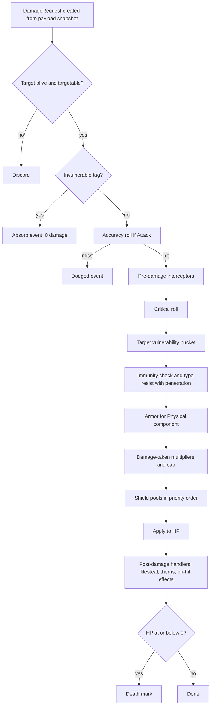
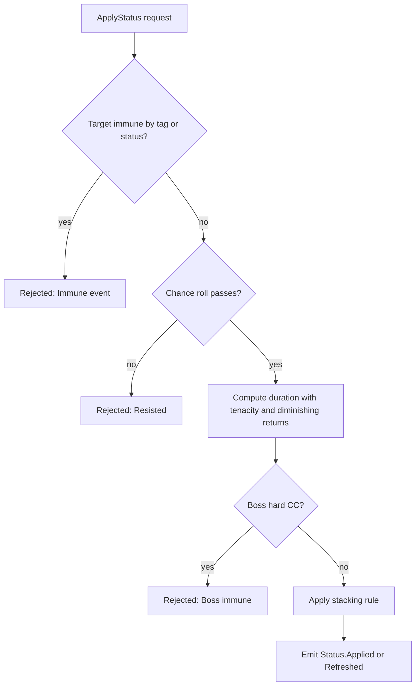

# 11. Combat Calculations

This document defines the exact order and formulas for every combat computation in the simulation. It refines GDD §2.6 and is the reference for unit tests, the balance bot and tooltip explanations.

## 11.1 Conventions

| Item | Rule |
|---|---|
| Time | Integer ticks at 30 Hz; seconds only in definitions (converted at compile time) |
| Distance | Tiles (float64) |
| Numeric type | **Float64** in the sim; Float32 appears only in render snapshots |
| Allowed math | `+ − × ÷ sqrt min max floor ceil round abs clamp lerp`, table lookups. **No** `pow`, `exp`, `sin`, `cos`, `atan2`, `log` inside the sim (ADR-06) |
| Integer quantities | Gold, Soul Essence, Integrity (fractional accumulators carry remainders) |
| Probabilities | Always rolled from a named RNG stream; a roll is only consumed when its probability is strictly between 0 and 1 |
| Percentages | Stored as fractions (0.15 = 15%) |
| Rounding for display | Round half up to integer for damage numbers; internal values are never rounded except where stated |
| Tie-breaking | Always by ascending entity index unless a rule states otherwise |

## 11.2 Stat Evaluation

For any stat `S` with source modifiers:

```
S_final = clamp( override_or( (S_base + Σ flat) × (1 + Σ additive%) × Π multiplicative ), min, max )
```

| Layer | Rule |
|---|---|
| Flat | Summed |
| Additive % | Summed, then applied once (e.g., +15% and +10% ⇒ ×1.25) |
| Multiplicative | Each factor multiplies |
| Override | Highest priority wins; replaces the computed value before clamp |
| Clamp | Per-stat min/max from the balance bundle (see 11.15) |

**Snapshot semantics:** the source's **offensive** stats are evaluated when an attack **launches** and stored in the projectile/effect payload; **target** stats (resist, armor, vulnerability, damage taken) are evaluated at **impact**. This makes in-flight projectiles stable and avoids exploits from buff timing.

## 11.3 Attack Timing

| Quantity | Formula |
|---|---|
| Shots per tick | `rate = clamp(attack_speed, 0, 15) × cooldown.rate / 30` |
| Cooldown accumulator | `acc += rate` each tick while ready to fire and a target exists; when `acc ≥ 1`, fire and `acc −= 1` (multiple shots per tick allowed up to 2) |
| Windup | `windupTicks` delays the effect; the cooldown starts at fire time |
| Haste effects | Change `rate` instantly, applying fractional progress correctly (no rounding of intervals) |
| Idle | Accumulator saturates at 1.0 so towers do not bank shots |
| Example | `attack_speed 1.2` ⇒ `rate 0.04/tick` ⇒ one shot every 25 ticks; `0.9` ⇒ 0.03/tick ⇒ alternating 33/34 tick gaps averaging 33.33 |

## 11.4 Targeting and Range

| Rule | Formula / behavior |
|---|---|
| In-range test | `dist(centerTower, centerTarget) − radiusTarget ≤ range` (squared comparison to avoid `sqrt` where possible) |
| Elevation | `range × 1.10` on elevated pads (modifier) |
| Layer filter | Target `layer` ∈ weapon `targets`; `Stealthed/Burrowed/Phased` need `Revealed` or a weapon with `hitsHidden` |
| Pulse/aura radius | Measured to target centre (not edge) |
| Mortar min range | `dist ≥ minRange` required |
| Retarget | Keep current valid target; revalidate every tick (cheap), re-search every 3 ticks or on invalidation |
| Lead prediction | For projectiles of speed `v`: solve interception using target velocity along its lane tangent; uses a single `sqrt`; if no solution, aim at current position |

## 11.5 Hit Resolution

| Hit type | Resolution |
|---|---|
| **Instant (chain, cone, pulse)** | Targets selected; one `DamageRequest` per target in `(distance, index)` order |
| **Projectile** | Moves `v / 30` tiles per tick; on reaching the target's radius applies payload; homing adds a steering vector (normalize, no trig) |
| **Pierce** | Projectile continues; each additional target takes `× (1 − pierceFalloff)^k` (default falloff 0 ⇒ full damage) until `pierceLeft` is exhausted |
| **Chain** | Jump `k` (starting at 0 for the first target) deals `base × (1 − chainFalloff)^k`; next target = nearest unhit within `chainRadius` (default 2.5 tiles), tie by index; default falloff 0.20 |
| **Beam** | Applies damage every `beamTick` (5 ticks ⇒ 6×/s): `perTick = dps / 6`; ramp multiplier `1 + rampRate × secondsOnTarget` capped at `rampMax` |
| **Area (lob/pulse)** | Targets within radius of the impact point; optional falloff `lerp(1, edgeFactor, dist/radius)` (Lob default `edgeFactor 0.5`, Pulse default flat) |
| **Cone** | Targets within angle and length from the tower facing; no falloff |
| **DoT zone** | Applies tick damage to members every `interval` ticks |

### Accuracy and Evasion

Only attacks flagged `Attack` (not `Periodic`, `Area`, or `Pure`) roll accuracy:

```
hitChance = clamp(1 + accuracy_source − evasion_target, 0.05, 1.0)
```

Examples: *Pollen Wisp's Dust* sets the *tower's* accuracy to −0.30; *Dune Skirmisher's Sand Veil* gives +0.25 evasion on sand tiles; heroes' evasion (*Between Worlds*) is 0.10. A miss emits `Combat.Dodged`.

## 11.6 The Damage Pipeline



### Step-by-Step Definitions

| Step | Name | Formula / rule |
|---|---|---|
| 0 | **Request** | `raw = payloadDamage` (already includes the source's offensive stat evaluation and hit coefficient) with `type`, `flags`, `sourceId`, `schoolTag` |
| 1 | **Pre-checks** | Dead/untargetable/phased targets discard; `Invulnerable` absorbs |
| 2 | **Accuracy** | See 11.5 |
| 3 | **Interceptors** | Ordered by priority; may scale, redirect (Soul Bind), convert type (Prismatic Lantern), or cancel |
| 4 | **Crit** | If `crit_chance > 0`: roll `combat` stream; on success `raw × crit_mult` (default 1.5, plus bonuses) |
| 5 | **Vulnerability** | `raw × (1 + clamp(Σ vuln, −0.5, +1.0))`; contributions are **tag-scoped** (e.g., Curse: all; Brittle: Physical/Sonic; Dry Wraps: Burn; Mark: marker's school) and additive with each other |
| 6 | **Immunity** | If `immuneMask` has `type` and the request lacks `IgnoreImmunity` ⇒ damage 0 (`Combat.Immune` event) |
| 7 | **Resist** | `effRes = clamp(resist[type] − penetration[type] if resist>0 else resist[type], −1.0, 0.75)`; `x = raw_afterVuln × (1 − effRes)` |
| 8 | **Armor (Physical only)** | `armorEff = max(0, armor − shred) × (1 − armorPierce)`; `x = max(0.10 × x_beforeArmor, x_beforeArmor − armorEff)` |
| 9 | **Damage taken** | `x × Π (1 − DR_i)` with total DR clamped to ≤ 0.80 (e.g., Banner −20%, Phalanx −30%) and `damage_taken` multipliers ≥ 1 for debuffs |
| 10 | **Shields** | Pools sorted by `priority`; each absorbs `min(x_remaining, pool)`; type-specific bypass (e.g., Shadow ignores 50% of Divine Shield: that fraction skips this step) |
| 11 | **Apply** | `hp −= x_remaining`; `overkill = max(0, −hp)`; emit `DamageApplied` |
| 12 | **Post** | Lifesteal, reflect (thorns; reflected damage carries `Reflected` flag and cannot reflect again), on-hit status application, mastery counters |

**Clarification of the GDD's armor rule:** the floor is **10% of the damage entering the armor step** (after resistance), so heavily resisted attacks cannot be reduced to zero by armor, but they also cannot beat the floor via armor stacking.

### Damage Flags

| Flag | Meaning |
|---|---|
| `Attack` | Subject to accuracy |
| `Periodic` | DoT/zone tick; skips accuracy and crit (unless a relic allows) |
| `Area`, `Chain`, `Beam`, `Pierce` | Source geometry; used by interceptors and shields (e.g., Shieldmaiden's Frontal Block ignores `Chain`/`Area`) |
| `Pure` | Bypasses resist and armor (rare; Nexus true-damage effects) |
| `IgnoreImmunity` | Bypasses `immuneMask` (reserved for specific effects) |
| `Reflected` | Cannot reflect again |
| `Execute` | Percent/execute effects; boss rules apply |
| `FromHero`, `FromTower`, `FromSummon`, `FromSpell` | Attribution for stats and interceptors |

### Execute and Percent Damage

- **Execute (kill below threshold):** applies only if target lacks `HardCCImmune`/`Boss` unless the effect states otherwise; otherwise converted to its **boss alternative** (flat or % max HP per second with a cap, from the effect definition).
- **% max HP damage:** `x = raw% × maxHp × bossFactor` where `bossFactor` is 1 for non-bosses and the definition's value (default 0.25) for bosses.

## 11.7 Damage Over Time and Healing Over Time

| Quantity | Rule |
|---|---|
| Tick interval | 15 ticks (0.5 s) by default |
| Burn | `perTick = burnDpsPerStack × stacks × 0.5`; each tick is a `DamageRequest(Fire, Periodic)` subject to steps 5–12 |
| Poison | Same, with `Nature`; also applies `heal.received × (1 − healReduction)` (cap −75%) |
| Refresh vs stack | By status definition (see 04 §7.14) |
| Regeneration blocked | Burn status tag `PreventRegen` zeroes `health.regen` while active |
| HoT | `Heal` requests per tick: `heal = base × (1 + heal.power_source) × (1 + heal.received_target)` where `heal.received` may be negative (Rot) with floor −0.75; capped at `maxHp` |

## 11.8 Status Application



| Quantity | Formula |
|---|---|
| Application chance | `p = clamp(baseChance × (1 + status.chance_source) − status.resist_target, 0, 1)`; no roll if `p ∈ {0,1}` |
| Duration | `d = max(1 tick, floor(baseTicks × durationMult_source × (1 − tenacity_target) × drFactor))` |
| Tenacity | Elites 0.30; Bosses: hard CC immune, soft CC uses the same formula |
| **Diminishing returns (bosses)** | `drFactor = 0.7^n` where `n` = control applications on that boss in the last 300 ticks; evaluated from a lookup table `{1, 0.7, 0.49, 0.343, 0.24}` (n ≥ 4 uses the last value) |
| Stacking | `Refresh` sets expiry to the max; `StackToMax(n)` adds a stack and refreshes; `Independent` creates separate instances; `StrongestWins` keeps the highest magnitude |

### Movement Modifiers

| Quantity | Rule |
|---|---|
| Slow combination | `slowTotal = max(s_i) + 0.25 × (Σ s_i − max(s_i))`, clamped to `[0, slowCap]` with `slowCap = 0.60` (bosses 0.40) |
| Speed | `speedFinal = base × (1 − slowTotal) × (1 + haste)` where haste is the sum of additive speed bonuses, capped at +100% |
| Freeze/Stun | Speed 0, uses the control duration rule |
| Example | Slows 30%, 25%, 20% ⇒ `0.30 + 0.25×(0.45) = 0.4125` ⇒ speed ×0.5875 |
| Knockback/pull | Displacement `Δs` applied to path progress, clamped to the edge; immune if tag `Anchored` or boss without opt-in |

## 11.9 Healing, Shields and Regeneration

| Quantity | Rule |
|---|---|
| Heal | Section 11.7; emits `Combat.Healed`; no overheal beyond max |
| Shield | Pool with `amount`, optional `expire`; absorbs after mitigation (step 10); `ShieldBroken` event when depleted |
| Shield stacking | Separate pools by source; consumed by `priority` then oldest first |
| Regen | `hp += regen / 30` per tick; blocked by `PreventRegen`; Treant-style conditions (undamaged for 3 s) use a `lastDamagedTick` stamp |
| Integrity healing | Only through explicit effects (Sanctuary, Ancient Heart, spells); capped at max Integrity |

## 11.10 Economy Calculations

| Quantity | Formula |
|---|---|
| **Kill bounty** | `round(bountyRate × baseHp)` with `bountyRate`: Infantry 0.12, Elite 0.10, Swarm 0.08; **unscaled** by wave/difficulty HP; difficulty applies `bountyMult` |
| **Wave bonus** | `20 + 2 × waveIndex` on wave completion |
| **Early-call bonus** | `min(40, round(remainingPrepSeconds × 1.5))` (value owned by the balance bundle) |
| **Interest** | `min( floor(0.02 × bank), 120, floor(0.10 × incomeThisWave) )` paid at wave end |
| **Endless bounty decay** | After the target wave, `bounty × (1 − 0.15)^k` using a baked table by `k` |
| **Refund** | Sell: `floor(0.70 × investedGold)`; prep: 100%; within 10 s of build: 85% |
| **Mana regen** | `+ manaRegen / 30` per tick, `manaRegen = 1.0 + Σ sources`, cap by `mana.cap` |
| **Mana on kill** | `+0.3` for qualifying towers (accumulated fractionally) |
| **Nexus Energy** | `+0.4` per kill, `+2` per Integrity point absorbed, `+10` on boss phase transition; cap 100 |
| **Gold from Harvesters** | `+15%` of bounty in range (fractional accumulator); passive `+rate/30` per tick |
| **Hero revive cost** | `50 + 10 × heroLevel` |

Integer resources (Gold, Soul Essence) are gained through a **fractional accumulator** per resource so repeated small gains neither round away nor drift.

## 11.11 Threat, Leaks and Integrity

| Quantity | Rule |
|---|---|
| Leak cost | `integrityLoss = threat × leakMult(difficulty)`; swarm bodies use `threat = 1/3` accumulated and applied when ≥ 1 |
| Interceptors | *Unbreakable Nexus* (once-per-battle negate lethal), *Guardian's Bulwark* absorb shield, Seraphine's *Halo* regen — run as interceptors on `LeakRequested` |
| Defeat | Integrity ≤ 0 after interceptors ⇒ `Battle.Ended(Defeat)` at the end of the tick |
| Energy on leak | See 11.10 |

## 11.12 Scaling Curves

All non-integer-power curves are **baked tables** (ADR-06):

| Curve | Definition (source of the table) | Table domain |
|---|---|---|
| `waveScalar(w)` | `(1 + 0.075 w)^1.35` for w ≤ 40 | w = 0…40 |
| `endlessScalar(w)` | `waveScalar(40) × 1.055^(w−40)` | w = 41…400 (hard clamp thereafter) |
| `difficultyMult(d)` | Normal 1.0, Veteran 1.35, Heroic 1.8, Mythic `2.4 + 0.2×(L−1)` | By level |
| `bountyDecay(k)` | `0.85^k` | k = 0…60 |
| `heroGrowth(stat, level)` | Per-stat table from the balance bundle | 1…30 (+ mastery) |
| `xpToNext(level)` | `150 + 22 × level^1.4` | 1…100 |
| `costCurve(building, level)` | `16 × level^1.6` | 1…20 |

Tables are generated in Node by `tools/balance-cli` and embedded; the sim does **lookup and linear interpolation only**.

## 11.13 Meta Reward Calculations (in `meta`)

| Quantity | Formula |
|---|---|
| Shards | `round(baseShards(map) × diffMult(d) × (1 + bonusMult)) + 20 × newStars + 10 × pristine`; `baseShards` ≈ 110–130 per 30-wave map |
| Research Data | `clamp(15 + 0.8 × waves, 15, 40) + 20 × firstScans + 5 × stars + 60 × bossFirstKills` |
| Soul Essence | `Σ elites × 1–3 + bosses × (20–60)`, plus school bonuses |
| Hero XP | `base(map, d) × (1 + bonus)` for the active hero; 40% to benched heroes |
| Relic roll | Seeded from `BattleResult.drops` seed; bad-luck protection counters live in the save |

## 11.14 Worked Examples

> Illustrative numbers drawn from the GDD tables. Tier multipliers: damage ×1.5 (II), ×2.3 (III).

### A. Physical vs Heavy Armor — Ballista Post T3 vs Plated Juggernaut

| Step | Value |
|---|---|
| Base damage | 55 × 2.3 = **126.5** |
| Resist (Physical 75%) | 126.5 × (1 − 0.75) = **31.625** |
| Armor 50 | `max(0.1 × 31.625, 31.625 − 50)` = max(3.16, −18.4) ⇒ **3.16** |
| With 30 armor shred | `armorEff = 20` ⇒ 31.625 − 20 = **11.63** |

*Interpretation:* Physical is nearly useless against this enemy; armor shred is worth ~3.7× the damage, supporting the design intent that Juggernauts require magic or shred.

### B. Chain Lightning Across Different Targets — Tesla Coil T3 with Curse on the first target

| Jump | Target | Calculation | Damage |
|---|---|---|---|
| 0 | Plated Juggernaut (Storm weak 50%, Cursed +15%) | 69 × 1.15 = 79.35; × (1 + 0.5) | **119.03** |
| 1 | Rivet Trooper (Storm weak 25%) | 69 × 0.8 = 55.2; × 1.25 | **69.00** |
| 2 | Dynamo Hound (Storm immune) | 69 × 0.64 = 44.16; immune | **0** |

*Interpretation:* the chain falls to zero on the immune target but still passes through it, so the order of jumps matters for design; the chain continues past immune targets (jump counter increments) unless the effect specifies otherwise.

### C. Damage Over Time Interactions — Burn vs Mummified Legionnaire

Ember Brazier burn 8 dps ⇒ 4 per 0.5 s tick, Fire.

| Step | Value |
|---|---|
| Vulnerability bucket: *Dry Wraps* (+50%, Burn-scoped) | 1 + 0.50 |
| Resist: Fire weak 50% | × 1.50 |
| Armor | Not applicable (Fire) |
| Per tick | 4 × 1.50 × 1.50 = **9.0** (18 dps) |
| With Curse (+15%) | 4 × 1.65 × 1.50 = **9.9** |

### D. Slows and Control on an Elite

| Input | Value |
|---|---|
| Frost Spire slow 35%, Permafrost Totem 40%, Cryo Anchor root 1.5 s | |
| Slow total | `0.40 + 0.25 × 0.35 = 0.4875` ⇒ speed × 0.5125 |
| Root on Elite (tenacity 0.30) | 45 ticks × 0.7 = **31 ticks** |
| Same root on Boss | **Rejected** (hard CC immune) |

## 11.15 Stat Clamps (Defaults)

| Stat | Min | Max |
|---|---|---|
| `weapon.attack_speed` | 0 | 15/s |
| `weapon.crit_chance` | 0 | 1.0 |
| `weapon.armor_pierce` | 0 | 0.90 |
| `resist.<type>` | −1.0 | 0.75 |
| `evasion` | 0 | 0.60 |
| `accuracy` | −0.9 | +0.5 |
| `tenacity` | 0 | 0.80 |
| `heal.received` | −0.75 | +1.0 |
| `damage_reduction (total)` | 0 | 0.80 |
| `slow (total)` | 0 | 0.60 (boss 0.40) |
| `haste (speed)` | 0 | +1.0 |
| `cost.build` multiplier | 0.5 | 1.5 |

## 11.16 Determinism Rules for Combat

1. All lists of targets/events are sorted by explicit keys before iteration.
2. RNG streams: `combat` for hit/crit/proc rolls; `status` for status chances; `ai` for AI decisions; never shared between concerns.
3. A system consumes RNG draws **in entity-index order**, and only when needed (probability strictly between 0 and 1).
4. Floating-point operations use only the allowed set; accumulation order is fixed (iterate modifiers in insertion order by source id).
5. No reading of wall-clock, `performance.now`, or `Date`.
6. Replays verify `stateHash` every 300 ticks; mismatches report the first diverging tick and system.

## 11.17 Verification of Combat Math

| Test type | Purpose |
|---|---|
| **Golden vectors** | A table of ≥ 200 `(input → output)` cases per formula, version-controlled (includes Examples A–D) |
| **Property tests** | Higher resist never increases damage; adding a vulnerability never reduces damage; damage ≥ 0; armor floor holds; chain falloff monotonic; slow combination ∈ [0, cap] |
| **Differential tests** | Reference implementation in the test kit vs the optimized sim path on random scenarios |
| **Fuzz tests** | Random modifier stacks, no NaN/Infinity, no negative HP growth |
| **Tooltip parity** | UI tooltips call the same evaluators (`explain`), so displayed values equal simulated values |
| **Replay goldens** | Recorded battles assert exact hashes across releases when `simVersion` is unchanged |
