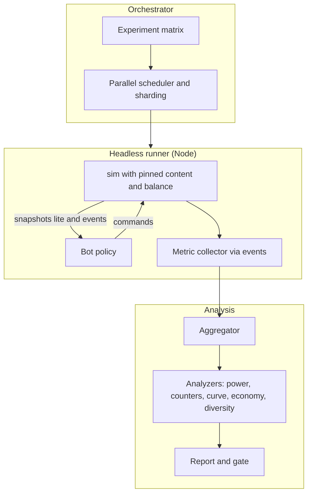

# 12. Balancing Architecture

Balancing is treated as a **data pipeline with automated feedback**, not a manual spreadsheet exercise. The goal is to make the GDD's guarantees (§2.8–2.9: soft counters, power parity, no mandatory build order, fair difficulty curve, ≥ 200 hours of progression) *measurable and enforceable*.

## 12.1 Objectives and Guarantees

| GDD guarantee | Mechanism in this architecture |
|---|---|
| Every tower viable; DPS-per-gold within ±15% of reference | **Power-budget lint** + ablation measurements |
| Every map winnable with ≥ 5 differing loadouts | **Balance bot** matrix with archetype policies |
| No tower in > 40% of winning loadouts (≤ 35% by Beta); every evolution ≥ 3% | Bot + telemetry dashboards with CI gates |
| Every enemy has ≥ 3 counters | **Counter-coverage analysis** (effective-DPS matrix) |
| Max +18% effective HP between consecutive non-boss waves | **Wave-curve analyzer** |
| Meta power capped (Power Ledger) | **Bucket caps** enforced at `BattleSetup` build time and linted in data |
| 200+ hours of content; no excessive grinding | **Economy simulator** + telemetry |
| Fair, reproducible leaderboards | **Immutable, versioned balance bundles** referenced by replays |

## 12.2 Data Architecture

### Separation of Structure and Numbers

| Layer | Owns | Example | Change frequency |
|---|---|---|---|
| **Definitions** (structure) | Shape and behavior: which effects, archetypes, tags | "Arcane Tower uses Projectile archetype with Dual Bolt perk" | Rare; requires review |
| **Balance tables** (numbers) | All tunable numbers, by key | `tower.arcane_tower.damage = 18`, `tier.II.damage_mult = 1.5` | Frequent |
| **Curves** | Named functions baked to tables | `waveScalar`, `xpToNext`, `costCurve` | Occasional |
| **Profiles** | Difficulty/mode parameter sets | Normal/Veteran/Heroic/Mythic, Endless, Survival | Occasional |
| **Ledger & caps** | Global limits | Power buckets, stat clamps | Rare; high scrutiny |
| **Overrides** | Scoped patches for experiments/hotfixes | "Mythic 15 Hexed interval = 25 s" | Rare; versioned |

Definitions reference numbers with **balance keys** (e.g., `$bal:tower.arcane_tower.damage`). The compiler resolves keys into the registry bundle, so a numeric tweak never touches structural files and diffs are reviewable.

### Balance Bundle

| Contents | Notes |
|---|---|
| Entity tables | Towers (cost, stats, tier mults), enemies (HP, speed, armor, resist, bounty), bosses, heroes (stats, growth), relics, spells, statuses |
| Economy constants | Interest, wave bonus, early-call, refunds, Mana/Energy rates |
| Curves (baked) | HP, XP, building costs, bounty decay, hero growth |
| Profiles | Difficulty, Mythic affix schedule, cycle modifiers, assist options |
| Meta tables | Shard rewards, research costs, mastery perks, relic drop tables |
| Caps | Power Ledger buckets, stat clamps |
| Metadata | `balanceVersion` (content hash), human label, parent version, changelog id, compatible `simVersion` range |

**Immutability (ADR-10):** a published bundle is never mutated. New numbers ⇒ new bundle. Replays, weekly seeds and suspend records reference `balanceVersion`; the replay verifier keeps all published bundles.

## 12.3 Balance Pipeline


| Stage | Tool | Output |
|---|---|---|
| Authoring | Spreadsheets or an in-repo **Balance Console** (dev tool in the web app) editing tables with live preview | Table files (CSV/JSON) in `content-core/data/balance` |
| Validation | `balance-cli validate` | Schema errors, out-of-range values, missing keys |
| Lint | `balance-cli lint` | Power budget, monotonic tiers, evolution parity, role weights, ledger totals |
| Compile | `balance-cli build` | Bundle + `balanceVersion` hash |
| Simulation | `bot` | Metrics JSON, Markdown report, charts |
| Gate | `balance-cli gate` | Pass/fail with annotated diffs vs the previous bundle |
| Publish | CI | Immutable artifact on CDN + replay-verifier archive |

## 12.4 Power Budget Model

### Reference Curve

Investment multipliers (cumulative): Tier I 1.0, II 1.8, III 3.2, IV 5.6 × base cost. Damage multipliers: II ×1.5, III ×2.3, IV ×3.6 for specialization baselines.

| Tier | Invested | Power multiplier | Reference DPS per Gold |
|---|---|---|---|
| I | 1.0× | 1.0 | **0.135** (band 0.11–0.16 per GDD) |
| II | 1.8× | 1.5 | 0.135 × 1.5 / 1.8 = **0.1125** |
| III | 3.2× | 2.3 | 0.135 × 2.3 / 3.2 = **0.097** |
| IV | 5.6× | 3.6 | 0.135 × 3.6 / 5.6 = **0.087** |

*Diminishing efficiency per tier is intentional:* pad scarcity (18–36 small pads) makes concentrating value in fewer towers worthwhile despite worse DPS/Gold, which is the core strategic tension.

**Lint rule:** each tower's `EffectiveDPS / InvestedGold` must fall within **±15%** of the reference at each tier for *Damage-role* towers; other roles are checked through the utility model below.

### Effective DPS

```
EffectiveDPS = damage × attackSpeed × hitsPerShot × typeEfficiency × uptime × (1 + critGain)
```

| Factor | Definition |
|---|---|
| `hitsPerShot` | Expected targets hit (pierce/chain/AoE) using a reference **cluster model** (e.g., 1.0 single, 2.2 chain-3, 2.8 small AoE) |
| `typeEfficiency` | Average over the faction resist table for that damage type, weighted by enemy frequency in the Act set |
| `uptime` | Fraction of time the tower has a target given range/coverage on the reference lane |
| `critGain` | Expected crit contribution |

### Utility and Role Weights

| Role | Primary metric | Conversion |
|---|---|---|
| Damage | EffectiveDPS | Direct |
| Control | **Ablation** (below) | Δ clear margin → Gold equivalent |
| Support | Ablation | Δ clear margin of *other* towers |
| Summon | Blocker value + DPS | Hybrid |
| Economy | Net Gold/Mana per Gold invested over N waves | Payback period within a role band (e.g., payback ≤ 12 waves) |

**Ablation measurement:** the bot runs the same loadout/map with and without a given tower (replaced by a neutral reference damage tower of equal cost). The difference in **clear margin** (Integrity remaining, leaks avoided, time-to-clear) is converted into an equivalent Gold value using the average marginal margin per Gold. This replaces fragile theoretical valuations of slows, stuns, buffs and auras.

## 12.5 Difficulty Profiles

| Parameter | Normal | Veteran | Heroic | Mythic L |
|---|---|---|---|---|
| `hpMult` | 1.0 | 1.35 | 1.8 | 2.4 + 0.2(L−1) |
| `countMult` | 1.0 | 1.1 | 1.2 | 1.25 + 0.02L |
| `bountyMult` | 1.0 | 1.0 | 0.95 | 0.90 |
| `shardsMult` | 1.0 | 1.4 | 2.0 | 2.8 + 0.1L |
| `eliteFreq` | base | +10% | +20% | +30% |
| `leakMult` | 1.0 | 1.0 | 1.25 | 1.5 |
| `startGold` | map | map | −10% | −15% |
| `affixes` | 0 | 0 | 0 | Per Mythic schedule |
| `bossAddon` | – | – | – | Enabled at Mythic ≥ 5 |
| Assist | Allowed | Allowed | Disabled | Disabled (leaderboards require no assist) |

Profiles are data; modes (Endless, Survival, Boss Rush) add their own profile overlays (Survival: no bounty; Boss Rush: HP × 0.6 plus rush addon).

## 12.6 Knob Registry and Governance

Every tunable number has a **knob record**:

| Field | Purpose |
|---|---|
| `key` | Balance key |
| `unit` | tiles, ticks, Gold, % etc. |
| `range` | Hard min/max (validation) |
| `safeStep` | Maximum change per patch without extra review (e.g., ±10%) |
| `owner` | Discipline (combat, economy, progression, content) |
| `dependsOn` | Keys whose change should trigger re-validation |
| `risk` | Low/Med/High (high: affects leaderboards or save-visible state) |

**Change process**

1. Propose via PR with a **balance changelog entry** (intent, expected effect, affected content).
2. CI runs validate → lint → bot smoke for affected content.
3. Review checklist: within `safeStep`? Does it alter the Power Ledger? Does it affect weekly challenges or leaderboards (needs `rulesEpoch` consideration)?
4. Publish as a new bundle; update the changelog surfaced in-game as **patch notes**.

### Leaderboard Epochs

- **`rulesEpoch`** increments only when a change would invalidate score comparability (large combat/economy changes). Leaderboards are bucketed by `rulesEpoch`.
- **Weekly Trials** pin `balanceVersion` at publication; clients load that bundle (cached) so all participants play identical rules.
- Minor patches within an epoch must not shift results beyond a tolerance verified by re-running top replays under the new bundle (informational check).

## 12.7 Balance Bot Architecture



### Components

| Component | Responsibility |
|---|---|
| **Experiment matrix** | Declares maps × difficulties × archetypes × loadouts × seeds; supports stratified sampling |
| **Headless runner** | Runs `sim` without rendering at maximum speed; deterministic; isolates each battle in a worker thread or process |
| **Bot policy interface** | `observe(world view) → commands`; separate per archetype; uses the same command API as a human |
| **Placement evaluator** | Scores pads by *path coverage within range*, chokepoint value, synergy adjacency, Large-pad needs |
| **Upgrade planner** | Budgeted investment: focus vs spread rules per archetype |
| **Hero/spell policy** | Hero stance at chokepoints; cast skills on rules (cooldown ready + condition) |
| **Metric collector** | Event-based counters: damage by tower/school, kills, leaks, economy curves, time-to-kill |
| **Analyzers** | Power, counters, wave curve, economy, diversity (below) |
| **Reporter** | JSON + Markdown + charts; diff against previous bundle |
| **Gate evaluator** | Applies thresholds; emits annotated failures |

### Bot Archetypes

| Archetype | Behavior | GDD risk it probes |
|---|---|---|
| **MonoElement** | Builds only one school/damage type | Mono-element dominance; resist walls |
| **HeroCarry** | Invests heavily in hero skills/gear, minimal towers | Hero-carry dominance |
| **EconomyTurtle** | Banks interest, delays building, maximizes Harvesters | Economy snowball and interest cap |
| **TowerSpam** | Many Tier I–II towers, no evolutions | Pad scarcity vs width |
| **Balanced** | Mixed damage/control/support with evolutions | Baseline viability |
| **ControlHeavy** | Slows/stuns/aura-first | Control overpower |
| **RandomValid** | Random legal loadouts and placements | Discover degenerate strategies |
| **HumanReplay** | Re-simulates real player replays under a new bundle | Regression against real behavior |

### Throughput Targets

| Metric | Target |
|---|---|
| Average headless step | ≤ 1 ms/tick (a 30-minute battle ≈ 54,000 ticks ≈ 54 s per core) |
| Full matrix (e.g., 50 maps × 6 archetypes × 4 difficulties × 3 seeds = 3,600 runs) | ≈ 54 CPU-hours, executed via sharded CI workers |
| PR smoke | Only maps/content affected by the diff, 2 archetypes, 1 seed |
| Nightly | Stratified ~10% sample of the full matrix |
| Weekly / release gate | Full matrix |

## 12.8 Metrics and Gates

| Metric | Definition | Gate (Alpha → Beta → 1.0) |
|---|---|---|
| **Winnability** | Archetypes/loadouts that clear a map on Normal | ≥ 5 distinct loadouts per map |
| **Trivialization** | A win with ≥ 95% Integrity and ≥ 40% Gold unspent | Flag if ≥ 2 of 5 archetypes do so |
| **Tower share** | % of *winning* loadouts containing a tower | ≤ 40% → 35% → 33% |
| **Evolution share** | % of winning loadouts using each evolution | ≥ 3% |
| **Power band** | DPS-per-Gold vs reference per tier | within ±15% (Damage role) |
| **Counter coverage** | Towers with effective DPS ≥ 70% of the median against each enemy | ≥ 3 per enemy; ≥ 1 within the Act's unlock set |
| **Hard counters** | Enemy/tower pairs with effective DPS < 25% of median for ≥ 10 towers | None |
| **Wave curve** | `effectiveHP(w+1) / effectiveHP(w)` for non-boss waves, where effective HP weights count × HP by path-time factor | ≤ 1.18 |
| **Boss diversity** | Distinct archetypes that defeat each boss | ≥ 3 |
| **Boss anti-monoculture** | Archetype win rate vs bosses designed to punish it | Strictly lower than Balanced on those bosses |
| **Economy health** | Gold unspent at battle end; interest share of income | Interest ≤ 15% of income for non-turtle bots |
| **Time-to-first-clear** | Median attempts for a "competent player" policy | 1–3 on Normal; 3–8 on Heroic |
| **Determinism** | Re-run same seed ⇒ identical hash | 100% |

**Interpretation note:** the trivialization rule operationalizes the GDD's requirement that no loadout trivializes a map; thresholds are starting values to be tuned with playtest data.

## 12.9 Analyzers

| Analyzer | Method |
|---|---|
| **Power analyzer** | Computes EffectiveDPS/Gold per tower/tier; compares to reference; reports outliers and trends across bundles |
| **Counter analyzer** | Builds the enemy × tower **effective DPS matrix** (including resist, armor, evasion, status immunities); flags hard counters and enemies lacking ≥ 3 answers |
| **Wave analyzer** | Computes effective HP per wave, spike ratios, composition novelty (mechanics per wave), time-on-path |
| **Economy analyzer** | Gold income vs spend curves; turtle viability; interest dominance |
| **Diversity analyzer** | Tower/evolution/hero/relic usage among winners; Gini coefficient of usage |
| **Meta economy simulator** | Models player archetypes (casual, competent, expert) progressing through campaign with the reward formulas; outputs time-to-unlock, currency stockpile, research queue idle time, hours-to-100 |
| **Regression analyzer** | Compares reports between bundles; highlights significant deltas (e.g., > 5% win-rate shift) |

## 12.10 Telemetry Feedback Loop

| Aspect | Design |
|---|---|
| Opt-in only; anonymised | No PII; battle summaries rather than raw events |
| **Battle summary event** | Map, difficulty, loadout ids, outcome, waves, leaks, damage by source, gold curve samples, deaths by wave, time |
| **Progression events** | Unlock times, currency balances at milestones, research queue state |
| **Aggregation** | Offline job; produces dashboards (win rate by map/difficulty, tower share, evolution share, DPS share, wave-of-death histograms, economy curves) |
| **Alerts** | Thresholds from 12.8 on live data (e.g., tower share > 35% for two consecutive weeks) |
| **Closing the loop** | Findings feed new balance PRs; bot suites are updated with newly observed human strategies (HumanReplay) |

### Suggested Decision Rules

| Observation | First response |
|---|---|
| Tower share > threshold with high win-rate lift | Reduce the strongest *role-specific* number (not cost first), re-run bot; if share persists, adjust cost |
| Evolution share < 3% | Check for strictly dominated sibling; buff unique mechanic or cost; avoid raw damage inflation |
| Hard counter detected | Add a soft answer (counter hint, tower synergy, enemy trait change), not a resist change alone |
| Wave-of-death spike | Re-tune that wave's composition or timing; verify telegraphs |
| Currency stockpile > 5× sinks | Add sink/option or reduce faucet; never add a time gate |
| Grind survey > 2.5/5 | Rebalance rewards per hour and star bonuses |

## 12.11 In-Game Explainability

Because stats are modifier stacks with source labels (04 §7.15):

- **Tooltips** show base value plus the breakdown by source (tier, relic, research, hero aura).
- **Codex** shows resist/weakness values tied to the same tables the sim uses (no duplicated numbers).
- **Combat log** (optional) prints the pipeline steps for a selected hit (Examples A–D), which doubles as a balance debugging tool.

## 12.12 Balance Console (Dev Tool)

| Feature | Purpose |
|---|---|
| Table editor with validation | Edit balance keys with range feedback |
| Live sandbox | Spawn an enemy and a tower, apply changes, observe damage numbers and the pipeline trace |
| DPS/Gold charts | Per-tower and per-tier reference band overlay |
| Counter matrix heatmap | Enemy × tower effective DPS |
| Wave curve plotter | Effective HP per wave with spike markers |
| Bundle diff | Compare two bundles with affected content list |
| One-click smoke bot | Run the PR-smoke matrix for edited content |

## 12.13 Testing the Balance System Itself

| Test | Purpose |
|---|---|
| Lint unit tests | Synthetic content with known violations is flagged |
| Bot determinism | Same matrix ⇒ same metrics |
| Gate tests | Gate evaluator passes/fails on crafted reports |
| Curve baking tests | Baked tables match reference high-precision computations within tolerance |
| Bundle immutability | Published hashes cannot be altered; verifier refuses mismatches |
| Replay cross-bundle | Replays only verify against their own bundle |

## 12.14 Risks and Mitigations

| Risk | Mitigation |
|---|---|
| Bot policies don't resemble human play | Multiple archetypes, `RandomValid` fuzz, `HumanReplay` seeds, telemetry-driven updates |
| Over-fitting to the bot | Gates are *necessary*, not sufficient; playtests remain required exits for each milestone |
| Combinatorial explosion (30 towers × 60 evolutions × 15 heroes × 120 relics) | Stratified sampling, pairwise coverage, ablation instead of exhaustive search |
| Balance churn invalidating leaderboards | `rulesEpoch`, pinned weekly bundles, safe-step rules |
| CPU cost of sweeps | Sharding, nightly sampling, avoid rerunning unaffected content via dependency tracking |
| Designer friction | Balance Console, instant previews, clear lint messages |

## 12.15 Milestone Requirements

| Capability | Milestone |
|---|---|
| Balance tables + validation + power-budget lint | **MVP** |
| Headless runner + Balanced and MonoElement bots + wave-curve analyzer | **Alpha** |
| Full archetype set, counter analyzer, diversity analyzer, gates in CI | **Alpha → Beta** |
| Telemetry pipeline and dashboards, Balance Console, meta economy simulator | **Beta** |
| `rulesEpoch`, pinned weekly bundles, bundle archive for replay verification | **Beta → 1.0** |
| HumanReplay regression suite | **1.0** |

---

# Appendix A: Cross-Document Open Decisions

| # | Decision | Needed by | Notes |
|---|---|---|---|
| 1 | SharedArrayBuffer vs transferable-only snapshots | MVP | Requires cross-origin isolation headers; transferable triple-buffer is the baseline |
| 2 | Custom ECS vs a vetted library | MVP | Prototype both with the stress scene; choose by determinism control and perf |
| 3 | Float64 determinism across browsers | MVP | Golden replays on Chromium, Firefox, Safari; fallback to fixed-point for HP/positions if divergence is observed |
| 4 | Expression evaluator design (bytecode vs closures) | Alpha | Must be allocation-free in hot paths |
| 5 | Tauri vs Electron | Beta | Steamworks bridge maturity |
| 6 | Rewind availability in high Mythic levels | Alpha | Design and balance question |
| 7 | Hero pathfinding: grid A* vs flow field | Alpha | Flow field if two heroes plus many summons need navigation |
| 8 | Backend stack for leaderboards and verification | Beta | Serverless + managed DB; verification via the headless sim in Node |
| 9 | Texture compression strategy for mobile | Post | KTX2/Basis vs per-platform formats |
| 10 | Whether Rift generation lives in `meta` or `sim` | Alpha | Currently `meta` (`RiftGenerator`) producing a map spec consumed by `sim` |

# Appendix B: Glossary

| Term | Meaning |
|---|---|
| **Archetype (entity)** | Assembler building an entity from a definition |
| **Archetype (weapon)** | A reusable attack/behavior template for towers/enemies |
| **Archetype (bot)** | A strategic policy used for balance simulation |
| **Behavior** | Registered code hook for mechanics not expressible as effect compositions |
| **Bundle (balance)** | Immutable compiled set of tuning data |
| **Command log** | Ordered player commands with execution ticks; basis of replays |
| **Interceptor** | Ordered handler that can modify or veto a request event |
| **Keyframe** | Binary serialization of the entire world at a tick |
| **Knob** | A single tunable number with metadata |
| **Rules epoch** | Version boundary for leaderboard comparability |
| **Snapshot** | Per-tick render-facing data written by the sim |
